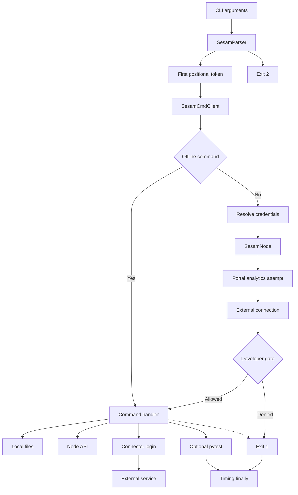

# CLI architecture, command contracts and risk boundaries

## Mental model and ownership

Start with these cooperating components, not the command descriptions in help:

- **`SesamParser`** owns argument errors and their exit code. The **`sesam.py` `__main__` dispatcher** selects one command, performs connection and developer-node checks, calls its handler, optionally runs pytest, and reports elapsed time.
- **`SesamCmdClient`** owns command orchestration, local configuration archives, whitelist state, expected-output comparisons, and scheduler coordination. Its `sesam_node` starts as `None` and is assigned only for online dispatch.
- **`SesamNode`** is the local remote-access boundary: it decodes the supplied JWT payload for a subscription identifier, registers portal analytics, creates `sesamclient.Connection`, and wraps configuration, environment, pipe, publisher and scheduler calls. **`sesamclient` internals are delegated**, not implemented here; the dependency is pinned in `requirements.txt`.
- **`TestSpec`** interprets `expected/*.test.json` and connects a pipe/endpoint/stage to an expected file and comparison policy.
- **Connector modules** provide manifest/template expansion and collapse (`connectorpy`), and authentication helpers (`oauth2login`, `api_key_login`, `tripletexlogin`, with `superofficelogin` reached through OAuth2). The inspected `connector_cli/__init__.py` is empty; `sitecustomize.py` adds connector directories to Python's site path. Historical `connectorpy init/expand/collapse` examples in the connector README are not a separate command dispatcher established by the current `connectorpy.py`.

Sources: [`SesamParser` and `TestSpec`, sesam.py:86–228](../../sesam.py#L86-L228), [`SesamNode`, sesam.py:231–337](../../sesam.py#L231-L337), [`SesamCmdClient.__init__`, sesam.py:828–866](../../sesam.py#L828-L866), [dispatcher, sesam.py:4044–4307](../../sesam.py#L4044-L4307), [imports](../../sesam.py#L27-L34), [requirements](../../requirements.txt#L1-L10), [sitecustomize.py](../../sitecustomize.py#L1-L4), [connector module](../../connector_cli/connectorpy.py), [historical examples](../../connector_cli/README.md#L5-L24).

This page owns the single canonical command/handler/input/output/side-effect table. Use the [quickstart](../quickstart.md) for entrypoint/setup guidance and workflow pages for procedures, rather than duplicating this flag reference.

## Dispatch and the two gates


The dispatcher skips remote bootstrap only for `validate` and `format`, and runs optional pytest after the selected handler; the final block records timing, not cleanup.

Diagram evidence: [bootstrap and developer gate, sesam.py:4100–4166](../../sesam.py#L4100-L4166), [analytics before connection, sesam.py:234–337](../../sesam.py#L234-L337), [handler selection and finalization, sesam.py:4167–4307](../../sesam.py#L4167-L4307). The timing edge applies to failures inside the dispatch `try`, not earlier parsing/connection failures.

### One command, not a pipeline

The parser stores positional tokens in `args.command` using `nargs="*"`. Only `args.command[0]`, lowercased, selects the command; remaining positional tokens are `command_args`. They are **not an ordered multi-command pipeline**. Most handlers ignore them. `format` uses the first remaining token, `run-pytest` uses the first as its test folder, and `add-datatype` iterates over all remaining tokens as datatype names. Those arguments are not lowercased with the command. [Parser positional definition](../../sesam.py#L3756-L3761), [selection](../../sesam.py#L4044-L4051), [argument consumers](../../sesam.py#L4260-L4281), [`add_datatype`](../../sesam.py#L2751-L2790).

```bash
python sesam.py format expected
python sesam.py format pipes/example.conf.json
python sesam.py add-datatype company contact --share
python sesam.py run-pytest tests -pytest-args="-vv -x"
python sesam.py -run-pytest tests test
```

These illustrate syntax, not commands executed during this research. `upload run verify` would select **only `upload`**, not run three commands. For built-in sequencing use `test`; for separate commands use separate shell invocations. The implemented spelling is **`connector-init`**, not the help text's `connector_init`; **`add-datatype` is implemented but omitted from that help command list**. [Help](../../sesam.py#L3350-L3371), [allowlist](../../sesam.py#L4060-L4083), [branches](../../sesam.py#L4214-L4225).

### Offline means exactly `validate` and `format`

`offline = command in ["validate", "format"]`. These skip credential resolution, `SesamNode` construction and the developer check. `validate` nevertheless expands the connector first, **deleting/recreating its expanded directory and writing generated files**, then checks connector templates and `.expanded`. It requires a manifest and is **not a general regular-configuration validator**. `format` also rewrites files. Optional `-run-pytest` still runs after either handler; the offline classification is not a sandbox for arbitrary Python tests. [Dispatch](../../sesam.py#L4100-L4103), [validate branch](../../sesam.py#L4173-L4177), [expansion](../../connector_cli/connectorpy.py#L121-L167), [validation](../../sesam.py#L1218-L1409), [pytest hook](../../sesam.py#L4278-L4281).

Every other recognized command—including **`expand`, `dump`, `convert`, `init`, `connector-init`, `add-datatype` and `run-pytest`**—resolves credentials and constructs `SesamNode` before the handler, even if its own work is local. Construction attempts portal analytics **before** creating the external connection; analytics is skipped without a subscription identifier, throttled to at most one attempt per 60 seconds per node object, and `RequestException` is debug-logged rather than propagated. The POST has no explicit timeout in this local code. [Credential delegation](../../sesam.py#L1103-L1115), [online bootstrap](../../sesam.py#L4100-L4155), [`SesamNode.__init__` and `register_user_interaction`](../../sesam.py#L234-L337).

### Developer-node gate

After remote bootstrap, dispatch requires truthy `get_api_info()["status"]["developer_mode"]`, except that **`upload` and `download` alone can bypass this check with `-force`**. `-force` does not unlock `status`, `stop`, local preparation, pytest, reset or wipe on a non-developer subscription. Offline commands bypass the check. This is a dispatcher guard, not a transaction, permission model or proof that an operation is harmless. Upload additionally forwards `force` to the dependency's configuration upload. [Gate and denial](../../sesam.py#L4157-L4166), [denial message](../../sesam.py#L4282-L4292), [upload forwarding](../../sesam.py#L1515-L1522).

## Canonical command contract table

**All rows have online bootstrap and the developer gate unless marked offline.** Inputs below are handler inputs, in addition to common connection/logging options. Local paths normally refer to the launch directory; connector-specific directory changes are noted below. `SesamCmdClient` is abbreviated **Client** and `connectorpy` as **Connector**.

| Group | Command | Handler and inputs | Output | Side effects / risk |
|---|---|---|---|---|
| Synchronization | `upload` | [`Client.upload`](../../sesam.py#L1411-L1592); `pipes/`, `systems/`, optional `node-metadata.conf.json`, required `<profile>-env.json`, optional parent `.additional_parameters.json`, `testdata/`; `-profile`, `-whitelist-file`, `-dump`, `-force`, `-upload-delete-sink-datasets`, upload worker/rate and metadata options | Uploaded configuration/environment, optional archive, upload report | Writes environment **before** config; waits for deployment then posts test data. Optional all-sink-dataset deletion. Connector dispatch expands, validates, uploads from expanded directory and authenticates unless `-skip-auth`. |
| Synchronization | `download` | [`Client.download`](../../sesam.py#L1704-L1793); node config/environment; `-profile`, `-dump`, `-whitelist-file`, connector directory/placeholder inputs | Local config and profile, optional ZIP; connector templates/manifest after collapse | Deletes selected existing local pipe/system files, then extracts the **whole** remote archive; whitelist does not filter extraction. Connector collapse rewrites authored files. |
| Synchronization | `status` | [`Client.status`](../../sesam.py#L1795-L1878); local archive/profile versus remote config/environment; `-diff`, `-dump`, `-whitelist-file` | Sync/difference logs, optional remote ZIP | Creates/removes a temporary local archive; differences are reported, not an exit failure. Uses Python `unified_diff`, not an external diff executable. |
| Connector development | `connector-init` | [`Client.connector_init`](../../sesam.py#L2543-L2641); `-d`, `--auth` (`oauth2` default, `api_key`, `jwt`); directory name ending `-connector` and source `LICENSE` | Manifest, system template, README, copied license | Writes scaffold only when manifest is absent; existing manifest skips initialization. Still online-gated. |
| Connector development | `add-datatype` | [`Client.add_datatype`](../../sesam.py#L2751-L2790), [`get_datatype_template`](../../sesam.py#L2643-L2749); one or more positional names, `-d`, `--share` | Datatype templates, manifest entries, system operations | Overwrites corresponding template/manifest entries and updates system operations. `--share` adds share pipe/REST operations. `--datatype` does not select these positional names. |
| Connector development | `expand` | [`Connector.expand_connector`](../../connector_cli/connectorpy.py#L50-L167); launch-directory manifest/templates; `--system-placeholder`, `-e`, `-profile` | Expanded pipes/systems, node metadata, profile | Removes/recreates expanded directory. Reused-template pipes get a warning comment; webhook event permissions may be overwritten with anonymous write access. No upload or validation, but **not offline**. |
| Connector development | `validate` **offline** | [`Connector.expand_connector`](../../connector_cli/connectorpy.py#L121-L167) then [`Client.validate`](../../sesam.py#L1256-L1409); manifest/templates and hard-coded `.expanded` | Validation logs or exit failure | Regenerates local expansion before checking template `sink.dataset`, JSON, warning descriptions and collect/share conventions. Success itself is logged at WARNING level. |
| Connector development | `authenticate` | [`Client.authenticate`](../../sesam.py#L1131-L1216); `-d`, manifest auth/variant, `.authconfig` or applicable auth arguments | Auth helper logs; node secrets and, for OAuth2/Tripletex, environment updates | May start a localhost OAuth2 callback server and contact third parties. API-key branch invokes its helper **only when `.authconfig` exists**; unrecognized auth falls through without work. |
| Connector development | `update-schemas` | [`Connector.update_schemas`](../../connector_cli/connectorpy.py#L302-L542); `-d`, manifest datatypes, live collect pipes | `schemas/*.json`, `*.merged.json`, `schema.csv` | Attempts inference metadata update, waits for deployment, runs collect pumps, reads inferred entity types and writes local schemas. Dispatch does not forward custom `--system-placeholder`; helper uses `xxxxxx`. |
| Execution | `run` | [`Client.run`](../../sesam.py#L3094-L3101) → `stop` → `run_internal_scheduler`; scheduler controls | Completion/logs, optional `additional_info` | Stops prior internal scheduler, then starts node-side execution. Dataset deletion/reset parameters are described below; not read-only. |
| Execution | `stop` | [`Client.stop`](../../sesam.py#L2895-L2905) → [`SesamNode.stop_internal_scheduler`](../../sesam.py#L610-L618) | Stop confirmation or exception | POSTs stop request for the node's internal scheduler; does not select a separate scheduler implementation. |
| Expected-output testing | `update` | [`Client.update`](../../sesam.py#L2792-L2893); output/endpoint pipes, `expected/*.test.json`, `-whitelist-file`, `-unicode-encoding`, `-disable-json-html-escape`, `-no-large-int-bugs` | Updated expected files and missing default specs | Writes new baselines; spec loading can remove obsolete non-ignored specs and ignored output files. Publisher reads may enable disabled pumps. Does not run pipes first. |
| Expected-output testing | `verify` | [`Client.verify`](../../sesam.py#L2069-L2368); live output/endpoint pipes and expected specs/files, whitelist/comparison policy | Comparison report; exception for mismatches/missing coverage | Does not upload or run first. JSON/Excel compare normalized entities; XML is normalized with fallback; other endpoints compare bytes. Publisher reads can enable pumps. No specs is warning-and-return. |
| Expected-output testing | `test` | [`Client.test`](../../sesam.py#L2907-L2923); upload inputs, `-runs` (default `1`), scheduler inputs, expected specs | Upload/run/verify report | Calls `upload`, waits, performs `run` `runs` times, then **one** `verify`. It calls the upload method directly, not the dispatcher's connector expansion/authentication wrapper. |
| Expected-output testing | `run-pytest` | [`Client.run_pytest_tests`](../../sesam.py#L2925-L2954); first positional folder, `-pytest-args` (default `-rP -v`) | pytest output or raised failure | Executes arbitrary test code via `pytest.main`; does not upload/run. Missing folder is exit 1; no direct `test_*.py` files is warning-and-return. Still online-gated. |
| Local preparation | `init` | [`Client.init`](../../sesam.py#L2396-L2541); local pipes; `-add-test-entities`, `-force-add` | Rewritten pipe configurations | Adds conditional `prod`/embedded `test` alternatives selected by `$ENV(node-env)`; excludes dataset/merge/union/diff/embedded sources. Optional live sample of at most 10 entities. No whitelist restriction. |
| Local preparation | `convert` | [`Client.convert`](../../sesam.py#L3175-L3231); local pipe files, `-profile`, optional `-dump` backup | Modified pipes and `testdata/<pipe _id>.json` | Converts **conditional embedded alternative for selected profile** to `http_endpoint` and extracts entities; not every embedded source. Overwrites local files without whitelist filtering. |
| Local preparation | `dump` | [`Client.dump`](../../sesam.py#L1697-L1702) → [`get_zip_config`](../../sesam.py#L981-L1005); local config, whitelist | `sesam-config.zip` | Replaces any archive of that name. Handler archives local config, but dispatch still connects/checks developer mode first. |
| Local preparation | `format` **offline** | [`Client.format`](../../sesam.py#L3233-L3311); first positional `all` (default), `pipes`, `systems`, `testdata`, `expected`, or a `.json` path; encoding/HTML-escape options for expected data | Rewritten JSON files | Group globs are nonrecursive; grouped expected formatting skips `.test.json`. Explicit file path can format a spec too. Unknown non-JSON option logs and returns, not failure. No whitelist restriction. |
| Destructive administration | `wipe` | [`Client.wipe`](../../sesam.py#L3103-L3147); optional local node metadata | Cleared remote config/environment, disappearance confirmation | Stops scheduler; uploads metadata disabling scheduling/signalling/C++ extensions, then `[]`, both with API `force=True`; clears environment and waits for user pipes to disappear. Help's user-dataset deletion promise relies on delegated backend semantics. No whitelist boundary. |
| Destructive administration | `reset` | [`Client.reset`](../../sesam.py#L3149-L3160) → [`SesamNode.reset`](../../sesam.py#L406-L433); `-restart-timeout` (default 900 seconds) | Reset/restart confirmation | Best-effort stop, delegated `reset_node()` (help describes entire database deletion), checks OK response and changed `node_start_time`. `-force` cannot bypass developer gate. |
| Destructive administration | `restart` | [`Client.restart`](../../sesam.py#L3162-L3173) → [`SesamNode.restart`](../../sesam.py#L377-L404); `-restart-timeout` | Restart confirmation | Best-effort stop, delegated `restart_node()`, checks OK response and changed `node_start_time`; not a wipe. |

All command-to-handler mappings: [sesam.py:4167–4276](../../sesam.py#L4167-L4276). `status`'s diff implementation: [`get_diff_string`, sesam.py:2013–2017](../../sesam.py#L2013-L2017). Publisher pump enablement: [`get_published_data`, sesam.py:656–670](../../sesam.py#L656-L670).

## Inputs, scope and ordering that change the risk

### Shared inputs and help discrepancies

- `-node`, `-jwt`, and `-sync-config-file` (default `.syncconfig`) are passed to **`sesamclient.utils.get_node_and_jwt_token`**. Environment/file precedence and URL normalization inside that function remain delegated. See [configuration and credentials](../concepts/configuration-and-credentials.md). [Local call](../../sesam.py#L1103-L1115), [parser](../../sesam.py#L3412-L3419).
- `-profile` defaults to `test`: upload requires `<profile>-env.json`, download overwrites it, expansion copies or creates it, and conversion selects that named alternative. It is not a global selector for all node operations. [Upload](../../sesam.py#L1411-L1422), [download](../../sesam.py#L1714-L1721), [expand](../../connector_cli/connectorpy.py#L133-L144), [convert](../../sesam.py#L3180-L3198).
- `-d` defaults to `.`, `-e` to `.expanded`, and `--system-placeholder` to `xxxxxx`. Their use is branch-specific: connector `upload` changes into `-d` before expansion; direct `expand` and `validate` dispatch **do not**. `validate` tests `self.args.command == "validate"` even though the parser supplies a list, and walks literal `.expanded` rather than `-e`. Run direct expansion/validation from the connector root with the default expanded directory; do not infer working-directory support from accepted flags. [Options](../../sesam.py#L3801-L3825), [branches](../../sesam.py#L4169-L4198), [`validate`](../../sesam.py#L1256-L1265).
- **Parsed does not mean effective:** `-single` and `-sesamconfig-file` have **no inspected consumer** in the CLI/modules. Do not rely on them for single-pipe scope or a formatting-style override. The usage document's optional `.sesamconfig.json` customization is not established by current handler code, which calls `format_json` with its default style. `--datatype` is parsed but `add-datatype` consumes positional names instead. [Parser declarations](../../sesam.py#L3514-L3520), [sesamconfig declaration](../../sesam.py#L3722-L3729), [datatype declaration](../../sesam.py#L3935-L3937), [handler](../../sesam.py#L2751-L2790), [formatter calls](../../sesam.py#L3233-L3255), [`format_json` default](../../jsonformat.py#L9-L60), [documented intent](../../readme.usage.md#L52-L81).

### Synchronization is staged, not rolled back

Local archives contain `.conf.json` under `pipes/` and `systems/`, plus optional node metadata—not expected output or test data. Regular configuration can substitute `.jinja_vars` during archiving and reverse-substitute after download. Connector upload adds a wrapper: change directory → expand → validate → change into expanded directory → upload → return → authenticate unless `-skip-auth`. `test` does **not** take this wrapper path. [Archive and substitution](../../sesam.py#L938-L1005), [online variable loading](../../sesam.py#L4117-L4134), [connector upload](../../sesam.py#L4178-L4193), [`test`](../../sesam.py#L2907-L2917).

Upload can delete all sink datasets, replaces environment, builds/modifies its configuration ZIP, uploads config, waits for user pipes to deploy, and only then uploads test data. Node-metadata rewriting defaults to disabled user scheduling and disabled eager microservices; `-enable-user-pipes`, `-enable-eager-ms`, and `-disable-cpp-extensions` change the **uploaded archive entry**, not a later `run` operation. `replace_file_in_zipfile` only replaces an existing entry, so omitted/whitelist-excluded node metadata is not synthesized into the archive. Failure at a later stage does not undo earlier writes. [Upload ordering](../../sesam.py#L1424-L1528), [archive replacement](../../sesam.py#L1017-L1032), [run warnings](../../sesam.py#L4228-L4249). See [configuration sync](../workflows/configuration-sync.md).

Testdata filenames map to pipe IDs by removing the extension. Default concurrency is 8 workers; `-single-thread-upload` selects the sequential path and ignores custom `--upload-workers`. `--upload-rate` defaults to `0` (unlimited) and spaces request attempts using a client-wide lock, including retries. The code allows up to four attempts, with exponential delay plus jitter for retryable request failures (429 and server errors); ordinary other 4xx errors are not retried. Parallel failures are collected into `TestDataUploadException`; sequential failure propagates immediately. A previous successful configuration/environment write is not rolled back. The log saying “Waiting 5 seconds” after parallel upload has no corresponding sleep there. [Defaults](../../sesam.py#L831-L848), [paths/reporting](../../sesam.py#L1528-L1592), [jobs, rate and retries](../../sesam.py#L1594-L1675), [argument checks/warning](../../sesam.py#L3987-L3990), [ignored worker warning](../../sesam.py#L4053-L4058).

### Whitelist is per handler, not a global safety boundary

`-whitelist-file` is loaded once into filename and derived pipe/system lists. Pipe/system identifiers are derived from lines beginning `pipes/` or `systems/`. The contracts differ:

- **Upload/dump/status local ZIP:** filter pipe/system files by normalized path. Node metadata has its own inclusion condition. Environment replacement and all-sink-dataset deletion are not limited by this list.
- **Testdata/update/verify:** pipe filtering applies only when the derived pipe list is truthy. A whitelist with no pipe entries does **not** mean “select no pipes” here.
- **Download:** restricts deletion of old local pipe/system files, but `extractall()` still writes the whole archive. It does not make download a partial safe replacement.
- **Run/stop/authenticate/expand/validate/init/convert/format/update-schemas/wipe/reset/restart:** no handler-wide whitelist filter is implemented. The derived system list has no inspected consumer, and login helpers can update multiple systems.

Sources: [whitelist loader](../../sesam.py#L850-L866), [archive filtering](../../sesam.py#L938-L1005), [testdata filtering](../../sesam.py#L1594-L1603), [test specs](../../sesam.py#L1912-L2009), [verify](../../sesam.py#L2092-L2099), [update](../../sesam.py#L2805-L2812), [download deletion and extraction](../../sesam.py#L1740-L1768), [remaining handlers](../../sesam.py#L2895-L3311), [OAuth2 system iteration](../../connector_cli/oauth2login.py#L121-L128).

## Execution and expected-output lifecycle

`run` always stops the old internal scheduler before starting a new one. The remote routes constructed here are `POST /pipes/run-all-pipes`, `POST /pipes/stop-run-all-pipes`, `GET /pipes/get-run-all-pipes-log`, and `GET /pipes/get-pipe-runner-status`, relative to the node API URL. The local client coordinates requests; actual scheduling/stabilization is a backend responsibility. [Node wrappers](../../sesam.py#L561-L643), [`run`](../../sesam.py#L3094-L3101).

Effective scheduler inputs are `-scheduler-zero-runs` (2), `-scheduler-max-runs` (100), `-scheduler-max-run-time` (900 seconds), `-scheduler-mode` (`active`/`poll`, omitted by default), `-scheduler-request-mode` (`sync` default/`async`), `-scheduler-check-input-pipes`, `-scheduler-dont-reset-pipes-or-delete-sink-datasets`, `-output-run-statistics`, and `-print-scheduler-log`. The client requests input-dataset deletion unless local `testdata/` exists, and requests pipe reset/sink-dataset deletion unless the “dont reset” flag is set. These are remote API parameters, not locally proven deletion guarantees. [Parsed defaults](../../sesam.py#L3620-L3678), [parameter construction](../../sesam.py#L2956-L2998), [request serialization](../../sesam.py#L575-L608).

In sync mode a worker thread interprets the run response; in async mode it requires a token and polls status every **10 seconds**, registering user interactions along the way. The foreground completion/log loop sleeps **1 second**. Failed and `not-running` results become operational errors. **`-scheduler-poll-frequency` is parsed but not used** for either loop. Deprecated `-use-internal-scheduler`, `-custom-scheduler`, `-scheduler-image-tag`, `-scheduler-id`, and `-dont-remove-scheduler` do not select a different scheduler or restore automatic cleanup. `-scheduler-node` likewise does not redirect the inspected scheduler path. [Runner and loops](../../sesam.py#L2977-L3092), [deprecated parser entries](../../sesam.py#L3429-L3485), [scheduler node](../../sesam.py#L3499-L3505), [scheduler ID](../../sesam.py#L3612-L3618), [poll declaration](../../sesam.py#L3712-L3720).

**There is no automatic scheduler cleanup on dispatcher exit:** its `finally` only logs total time. Explicit stop occurs before `run` and `wipe`; reset/restart attempt stop with `throw_error=False`. An interrupted/disconnected client can require a separate `stop` command, itself subject to online/developer gating. [Stop policy](../../sesam.py#L2895-L2905), [administration](../../sesam.py#L3103-L3173), [finally](../../sesam.py#L4305-L4307). See [run and verify](../workflows/run-and-verify.md) and [troubleshooting](../operations/troubleshooting-and-releases.md).

`TestSpec` defaults to endpoint `json`, pipe inferred from the spec basename, expected file with the same basename and `.json`, `ignore_deletes=True`, and sorting by `_id` with serialized-entity tie-breaking. Specs can override pipe/file/stage/parameters, ignored tests and blacklist paths. Current JSON entities are filtered recursively to remove most underscore fields (retaining `_id` and true `_deleted`), blacklist matches and unexpected deletes; integral float/decimal values are normalized. Legacy large-integer rounding is reproduced unless `-no-large-int-bugs` is used. XML comparison normalizes serialization with byte-level fallback; other publisher endpoints compare bytes. [Spec policy](../../sesam.py#L93-L228), [filtering](../../sesam.py#L1880-L1905), [numeric compatibility](../../sesam.py#L2048-L2067), [comparisons](../../sesam.py#L2113-L2347).

`update` accepts current output as the baseline, not as verified truth; it can create missing specs/files and remove obsolete or ignored artifacts. `verify` raises for mismatches and missing coverage when specs exist, but no specs is only a warning. Neither command ensures the latest pipes have run. `-run-pytest <folder>` is a **post-command hook**: after the main handler returns, except for standalone `run-pytest`, it invokes Python tests. After `test`, pytest therefore follows upload → repeated runs → one verify; other commands emit a warning that recent upload/run may be needed. Argument strings are split with `.split()`, not shell-aware quoting. [Spec lifecycle](../../sesam.py#L1907-L2011), [update](../../sesam.py#L2792-L2893), [verify](../../sesam.py#L2083-L2088), [pytest runner](../../sesam.py#L2925-L2954), [hook ordering](../../sesam.py#L4278-L4281).

## Errors, logs and external boundaries

### Exit status is not log severity

- **Parser errors: exit 2.** `SesamParser.error` writes an error, prints help and exits 2; this includes invalid typed inputs and explicit checks that upload workers are at least 1 and rate is nonnegative. Help/version exits are separate; `-version` prints and exits 0 before command validation.
- **Operational errors: exit 1.** Missing/unknown command, credential resolution or connection failure, developer-gate denial and command exceptions take this path. `UploadException` prints a validation report; `TestDataUploadException` prints failed files. The dispatcher catches `BaseException`, including handler `SystemExit`/interrupts, and normalizes dispatch failure to 1. Generic underlying traceback is logged only at `-vv`/`-vvv` in that catch.
- **Logging alone is not failure.** `status` can say “NOT in sync” and return normally; a missing profile there is logged without raising. Missing connector expansion for `status` is also log-only. `verify` with no specs, pytest with no direct matching files, an invalid non-JSON format selector, skipped connector initialization, and failed best-effort stop before reset/restart can all return/proceed. `validate`'s success uses WARNING. Conversely validation failures call exit 1. Do not use ERROR/WARNING text as the sole CI pass/fail signal—and do not interpret successful return as proof that tests actually ran.

Sources: [parser error](../../sesam.py#L86-L90), [parse/version/numeric checks](../../sesam.py#L3975-L3990), [unknown command and bootstrap failures](../../sesam.py#L4084-L4155), [exception handling](../../sesam.py#L4293-L4307), [status logs](../../sesam.py#L1848-L1878), [connector status](../../sesam.py#L4199-L4213), [no-specs return](../../sesam.py#L2083-L2088), [no-pytest-files return](../../sesam.py#L2925-L2932), [format return](../../sesam.py#L3272-L3278), [validation result](../../sesam.py#L1400-L1409).

### Network, credentials and subprocess boundaries

- **Node API/dependency:** credential resolution, `sesamclient.Connection`, configuration/environment/database operations, pipe/pump objects and their underlying behavior are delegated. Direct session requests in `SesamNode` establish route/method usage, not backend transactions or authorization guarantees. A publisher read can enable a disabled pump.
- **Portal analytics:** the constructor sends the node JWT as a bearer token to `https://portal.sesam.io/api/analytics` when it has a subscription ID, even if the subsequent node connection fails. This happens before the developer gate.
- **Credential exposure:** routine constructor debug logging masks the JWT, but connection-failure logging includes the **full URL and JWT**. `-vvv` enables HTTP debugging. Regular `.jinja_vars` values are logged when loaded. Treat captured CLI/HTTP output and command arguments as sensitive; this page intentionally supplies no real credentials. `-skip-tls-verification` disables certificate verification for the external node connection and suppresses insecure-request warnings; it does not establish a universal TLS policy for independently issued login/analytics requests.
- **Connector login:** OAuth2 logs an authorization URL, starts Flask on port 5010, exchanges the callback code with the external token endpoint, and writes secrets to **all returned systems** before updating environment. With `--use-client-secret`, the logged authorization URL includes the secret parameter. Its shutdown helper invokes `lsof -i tcp:5010` through a shell and kills returned PIDs. API-key/JWT login can contact a manifest login URL and writes secrets to all systems; Tripletex writes the selected placeholder system's secrets/environment and constructs a token URL rather than directly calling that token endpoint here. SuperOffice-ticket OAuth2 adds external key/ticket/API calls. Several helpers catch errors and report failure through logs/callback responses instead of raising to dispatch; this is not reliable transactional success reporting.

Sources: [node and analytics](../../sesam.py#L234-L337), [publisher](../../sesam.py#L656-L670), [connection error exposure](../../sesam.py#L4136-L4155), [HTTP debugging](../../sesam.py#L4027-L4036), [variable logging](../../sesam.py#L4117-L4134), [auth dispatch](../../sesam.py#L1144-L1216), [OAuth2 callback writes/errors](../../connector_cli/oauth2login.py#L65-L165), [OAuth2 URL/server](../../connector_cli/oauth2login.py#L168-L237), [shutdown subprocess](../../connector_cli/oauth2login.py#L23-L39), [API-key helper](../../connector_cli/api_key_login.py#L7-L49), [Tripletex helper](../../connector_cli/tripletexlogin.py#L10-L82), [SuperOffice ticket helper](../../connector_cli/superofficelogin.py#L77-L157). For auth procedures and scheme-specific limitations, use [connector authentication](../integrations/connector-authentication.md).

Unanswered runtime/API semantics belong to **lake**, full configuration/DTL reference questions to **docs**, and management/analytics behavior to **portal**. These are **not-yet-linked handoffs**, not inspected sibling repositories or invented cross-wiki URLs.

## Safe changes and focused validation

Changing a command requires reconciling parser/help, the recognized-command list, dispatch branch, offline classification and developer override policy—not merely adding a `SesamCmdClient` method. Changes to directory handling must follow the actual `chdir` branches and the hard-coded validation path. Scheduler changes must preserve the explicit stop/start order and failure reporting rather than assuming `finally` will clean up. [Dispatch](../../sesam.py#L4044-L4307), [`run`](../../sesam.py#L3094-L3101).

The closest inspected checks are **credentialed integration scenarios**, not a proof of every contract:

- [`tests/fair_weather_test/run_test.sh`](../../tests/fair_weather_test/run_test.sh#L31-L49) resets, runs whitelisted `test` with the pytest hook, updates, checks status and downloads with `-dump`, then resets again. Its `-sesamconfig-file` argument does not establish a working consumer. [`test_pipe_id.py`](../../tests/fair_weather_test/tests/test_pipe_id.py#L6-L18) checks underscore-free filenames and pipe IDs; it does not verify the developer gate or error codes.
- [`tests/embedded_conversion_test/run_test.sh`](../../tests/embedded_conversion_test/run_test.sh#L31-L58) copies fixtures, wipes, converts, runs `test`, resets and compares the resulting tree. The before/after fixture shows the selected conditional test source becoming `http_endpoint` while `prod` stays unchanged ([before](../../tests/embedded_conversion_test/before/pipes/input-pipe-1.conf.json#L4-L29), [after](../../tests/embedded_conversion_test/expected_after/pipes/input-pipe-1.conf.json#L4-L15)).
- [`test.sh`](../../test.sh#L15-L30) performs executable help smoke checking and runs the scenario directories against a credentialed node. Do **not** run these reset/wipe scenarios on an arbitrary subscription. No CLI, login server or remote test was executed for this documentation.

**Proposed regression checks, not existing verified coverage:** mock credential resolution/`SesamNode` to test the exact offline set and pre-handler ordering; exercise non-developer mode with/without `-force`; test extra positional tokens, `connector-init` spelling and post-command pytest; assert parser exit 2 versus operational exit 1; test log-only branches, whitelist truthiness/full download extraction, custom `-d`/`-e` behavior, and interruption without scheduler cleanup. See [change validation](../testing/change-validation.md), [connector development](../workflows/connector-development.md), and [local configuration preparation](../workflows/local-configuration-preparation.md).
