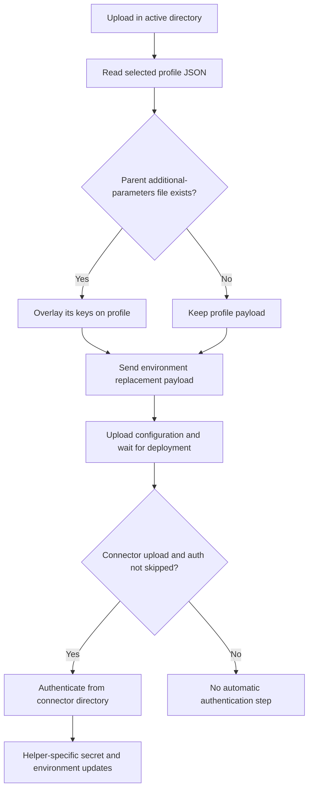

# Working configuration, profiles and credential resolution

There is **no single configuration or precedence chain**. Node access is resolved by an external dependency; connector credentials are selected by the CLI; upload constructs an environment-variable payload; authentication helpers can subsequently merge that environment again. Directory changes determine which files participate.

Start with the [quickstart](../quickstart.md) and [CLI contract](../architecture/cli-contract.md). For execution details, see [configuration synchronization](../workflows/configuration-sync.md), [connector development](../workflows/connector-development.md), and [connector authentication](../integrations/connector-authentication.md).

## File and input map

| Input | Responsibility and effective lookup |
| --- | --- |
| `.syncconfig`, `-sync-config-file` | Node URL and JWT configuration input. The argument defaults to `.syncconfig`; the CLI passes the filename, `-node`, and `-jwt` to `sesamclient.utils.get_node_and_jwt_token`. Its internal lookup and precedence are delegated, not established by the local parser described below. |
| `-node`, `-jwt`, OS `NODE` / `JWT` | Explicit node-access arguments plus environment sources documented by the README. The local wrapper does not implement their ordering. |
| `.authconfig` | Connector credentials: OAuth2 `client_id`, `client_secret`, optional `account_id`; Tripletex `consumer_token`, `employee_token`; API-key `api_key`. `authenticate()` first changes to `connector_dir` and checks for a **current-directory** `.authconfig` before reading it. |
| Credential arguments | `--client_id`, `--client_secret`, `--account_id`, `--consumer_token`, `--employee_token`, `--api_key`, and `--base_url` participate according to the selected authentication branch, not a common fallback policy. |
| `<profile>-env.json`, `-profile` | JSON environment-variable payload. Profile defaults to `test`, selecting `test-env.json`. Upload reads it in its active directory; download writes it there; status compares it with the node environment. Connector expansion propagates a connector-root profile into the generated directory. |
| `.additional_parameters.json` | Upload reads **exactly `../.additional_parameters.json` relative to its active directory**. Its keys override or extend the profile payload. This is not the generic upward search. |
| `.jinja_vars` | Regular, non-connector configuration substitutions. Checked only in the launch working directory during non-offline setup, then parsed directly. No parent search. |
| `.sesamconfig.json`, `-sesamconfig-file` | Documented formatting customization intent. The option is parsed but **not wired into formatting** in the inspected implementation; do not rely on this file changing CLI output. |
| `manifest.json` | Detects connector context and chooses authentication through `auth` / `auth_variant`; supplies OAuth URLs/scopes and service-access/webhook requirements. |
| OS `RSA_PRIVATE_KEY` | Explicit local environmental input for the SuperOffice-ticket variant. It is separate from both profile environment variables and node/JWT resolution. |

Sources: [`SesamCmdClient.get_node_and_jwt_token`](../../sesam.py#L1103-L1115), [parser defaults and options](../../sesam.py#L3404-L3419), [`-profile`](../../sesam.py#L3603-L3610), [connector arguments](../../sesam.py#L3801-L3916), [`authenticate`](../../sesam.py#L1144-L1216), [README configuration inputs](../../readme.usage.md#L3-L103), and [`get_so_ticket`](../../connector_cli/superofficelogin.py#L77-L93).

### Node/JWT resolution is an integration boundary

The wrapper calls:

```python
sesamclient.utils.get_node_and_jwt_token(
    node_url=args.node, jwt_token=args.jwt, config_filename=args.sync_config_file
)
```

It stores the returned pair on `SesamCmdClient` and later constructs `SesamNode`. `requirements.txt` pins `sesamclient==1.2.6`, but that dependency's implementation is not in this repository. The README lists environment, arguments, and file inputs and describes upward `.syncconfig` lookup. **That documentation does not prove a particular environment/token ordering in the dependency**, nor does the locally defined `read_config_file()` prove that the dependency uses it. See the [CLI contract boundary](../architecture/cli-contract.md).

Only `validate` and `format` are marked offline by dispatch. Other commands enter node/JWT resolution and node construction, including names such as `dump`, `init`, and `expand` that might otherwise sound local. Sources: [delegating wrapper](../../sesam.py#L1103-L1115), [dependency pin](../../requirements.txt#L1-L2), [README lookup guidance](../../readme.usage.md#L5-L19), [setup/dispatch](../../sesam.py#L4100-L4139).

## Local JSON/INI parsing and directory search

`SesamCmdClient.parse_config_file(filename)` is a format parser, not a credential resolver:

1. Open the named file and try `json.load()`; catch `ValueError`.
2. If the result is **falsy**, reopen it as INI. This includes successfully decoded falsy JSON, not just invalid JSON. An empty JSON object is therefore not guaranteed to be accepted as an empty mapping: its text is handed to the INI parser.
3. Use `ConfigParser(strict=False)` and prepend a synthetic `[sesam]` section, allowing sectionless `key=value` input.
4. Flatten all sections into one dictionary with lowercase keys and string values. Colliding keys from later section iteration overwrite earlier entries. JSON keys/types are returned as decoded instead; there is no mapping/schema check here.

INI quoting is not shell quoting. Quotes remain part of the parsed value. The separate `set_authconfig_credentials()` strips **one enclosing pair of double quotes** before assigning a credential to `args`; it does not strip single quotes. This stripping is not a property of every configuration consumer. Non-string JSON credentials can fail at `startswith()`.

Tiny synthetic example:

```ini
CLIENT_ID="demo-client"
```

The INI parser returns a lowercase `client_id` whose value still contains double quotes; the authentication assignment removes that pair. A JSON object such as `{"CLIENT_ID":"demo-client"}` keeps its uppercase key and will not satisfy a lowercase `client_id` lookup.

[`parse_config_file` and `set_authconfig_credentials`](../../sesam.py#L868-L887), [credential assignment](../../sesam.py#L1131-L1142).

`read_config_file(filename, is_required=False)` adds lookup:

- A file in the current directory wins the location decision. If it parses to a falsy result, this branch does **not** retry parents.
- Only when no local file exists does it walk ancestors toward the filesystem root, accepting the first truthy parsed result. This helper has no repository-root boundary.
- No usable result returns the empty/falsy result for an optional lookup; a required lookup raises. Read/parse errors are logged and re-raised rather than treated as another candidate.

**Eligibility at the caller still matters.** `authenticate()` checks `os.path.exists(".authconfig")` in the connector directory before calling this helper, so an absent local `.authconfig` does not activate parent credentials through the normal authentication branches. `.jinja_vars` instead has an `os.path.isfile()` check and calls the parser directly. Neither call site supplies a general “inherit all configuration from parents” policy. These rules are derived from source; no parent credential files were read during research. Sources: [`read_config_file`](../../sesam.py#L889-L931), [authentication guards](../../sesam.py#L1161-L1213), [local substitution check](../../sesam.py#L4117-L4134).

## Profiles, active directories, and environment updates

### Filename selection is not `node-env` selection

`-profile demo` selects `demo-env.json`; it does not automatically set `"node-env": "demo"`. Upload sends the file's contents, not a value inferred from its name. Conditional sources authored by `add_conditional_source()` select between `prod` and `test` using `$ENV(node-env)`.

For example, a synthetic `demo-env.json` can contain:

```json
{"node-env":"test","mode":"demo"}
```

Connector expansion copies an existing connector-root `<profile>-env.json` into the generated directory. If absent, it creates one with **`"node-env": "test"` regardless of the selected profile name**, plus empty values for manifest `additional_parameters`. Selecting a filename such as `prod-env.json` alone is consequently not evidence of production source selection. Expansion also recreates the generated directory; keep authored profile changes in the connector root, not only in `.expanded`.

Sources: [`-profile` default](../../sesam.py#L3603-L3610), [`upload` payload read](../../sesam.py#L1411-L1422), [`add_conditional_source`](../../sesam.py#L2438-L2449), [`expand_connector`](../../connector_cli/connectorpy.py#L121-L144). See [local configuration preparation](../workflows/local-configuration-preparation.md).

### Upload's locally implemented merge

For regular configuration, upload uses the launch working directory. For connector **`upload` dispatch**, the CLI changes to `-d` (default `.`), expands to `-e` (default `.expanded`), validates, then changes into the expanded directory before invoking `upload()`. Thus the usual connector layout reads `.expanded/test-env.json` and `../.additional_parameters.json` from the connector root.


*The upload merge precedes configuration upload; optional connector authentication has a separate contract.*

The required profile is loaded first. Missing/malformed profiles fail. Optional parent additional parameters are loaded next; malformed JSON fails, while absence means `{}`. Their keys overwrite matching profile keys, with warnings naming the keys/files rather than values. The resulting object is sent to `put_env()` **without fetching/merging the old remote environment**. `SesamNode.put_env()` delegates to `api_connection.put_env_vars()`; remote API guarantees beyond that boundary are not locally implemented.

Environment submission occurs before configuration ZIP creation/upload. A later configuration failure does not have a local rollback of this earlier environment update. Connector `upload` subsequently authenticates unless `-skip-auth` is set. Do not generalize this dispatcher sequence to `test`: `SesamCmdClient.test()` calls `upload()` directly, then run/verify, rather than entering the connector-upload expansion/authentication branch.

Sources: [`upload`](../../sesam.py#L1411-L1524), [`put_env`](../../sesam.py#L439-L445), [connector upload dispatch](../../sesam.py#L4178-L4193), [`test`](../../sesam.py#L2907-L2923).

Download saves the node environment into the selected local profile, then extracts/formats configuration; connector download operates inside the expanded directory. Status reads the selected local profile and compares it directly to the remote environment—**it does not apply the additional-parameter overlay used by upload**. A successful upload can therefore still leave a profile/environment difference visible in status. Sources: [`download`](../../sesam.py#L1704-L1721), [`status`](../../sesam.py#L1795-L1849).

### Authentication is a separate set of contracts

`authenticate()` sets `service_url` and `service_jwt` from the resolved node pair, even though similarly named arguments are parsed. It chooses the helper from the manifest, with Tripletex `auth_variant` checked before OAuth2/API-key `auth`.

| Branch | Local credential selection | Subsequent environment behavior |
| --- | --- | --- |
| OAuth2 | A local `.authconfig` overwrites matching `args` fields for `client_id`, `client_secret`, then optional `account_id`. Without it, arguments remain the inputs. Missing required credentials terminate. URLs/scopes come from the manifest; an explicit non-default `--base_url` wins, otherwise base URL is derived from the token URL. | Callback starts with remote environment, optionally sets `service_url`, overlays the connector-root profile, then forces `token_url`, `base_url`, and `account_id`. It writes OAuth secrets to every system returned by `get_systems()`. |
| Tripletex | Local `.authconfig` supplies consumer/employee tokens over arguments; missing required tokens terminate. | Starts with remote environment, optionally sets `service_url`, overlays the connector-root profile, then forces `base_url` and its derived session `token_url`. Secrets go to the selected system. |
| API key / JWT variant | The dispatcher invokes this helper **only when a local `.authconfig` exists**, loading `api_key`. An API-key argument alone does not trigger the helper. The helper also requires truthy `base_url`, system placeholder, and key. | Writes API-key secrets, optionally exchanging the key for JWT access/refresh tokens, to every returned system. It makes **no environment read/write**, despite its success message mentioning environment variables. |

A missing `.authconfig` key causes a warning; it does not reset that argument. Assignment loops stop at the first missing key, so an earlier field may already have been overwritten while later fields keep their prior values. Other parsing/type failures are not caught by this `KeyError` handler.

Authentication helpers do not reread `.additional_parameters.json`. In particular, their later profile overlay can overwrite a duplicate key that additional parameters won during upload. **Profiles/additional parameters are environment-variable inputs, not a general secret-store import**; secret payloads are constructed by the selected helper. See [connector authentication](../integrations/connector-authentication.md) for callback lifecycle, SuperOffice ticket handling, and service-specific side effects.

Sources: [`set_authconfig_credentials` / `authenticate`](../../sesam.py#L1131-L1216), [OAuth secret/environment updates](../../connector_cli/oauth2login.py#L65-L150), [Tripletex updates](../../connector_cli/tripletexlogin.py#L10-L67), [API-key helper](../../connector_cli/api_key_login.py#L7-L49).

## `.jinja_vars`: regex rewriting, not connector Jinja rendering

For regular configuration, `zip_dir()` recursively packages `.conf.json` files under `pipes` and `systems`, applying `replace_jinja_variables()` to their text. Connector packaging writes those files unchanged. Root `node-metadata.conf.json` is packaged separately and does not pass through this substitution.

With synthetic `.jinja_vars` content:

```ini
label=demo-marker-unique
```

text `"{{@ label @}}"` becomes `"demo-marker-unique"` in the archive. Download performs the reverse substitution after extraction/formatting, on immediate `.json` children of `pipes` and `systems`, provided both directories exist. It does not recursively reverse every file that upload visited.

Both directions use **`re.sub()` over raw text**, not JSON-aware or literal matching:

- Forward matching embeds the variable name in a regex with the exact spaced delimiter form `{{@ name @}}`; names are not escaped, and values are replacement strings with regex replacement semantics.
- Reverse matching treats each value as a regex and replaces all matches with the placeholder. Regex metacharacters, backslashes, shared values, substrings, and sequential substitutions can match unrelated text, collide, or cause errors. A near-unique value reduces accidental collisions but does not neutralize regex syntax.
- There is no JSON escaping or datatype validation in these helpers. A substituted quote or newline can invalidate configuration text. The reverse operation is not a guaranteed lossless round trip.

Loaded `.jinja_vars` are logged **with their entire values at INFO level**. Do not put secrets there assuming templating hides them; archives can also contain their expanded values. Connector templates instead use the real Jinja2 environment with custom delimiters in `expand_connector_config()`—similar notation does not imply identical semantics.

Sources: [`zip_dir` and replacement helpers](../../sesam.py#L938-L979), [metadata packaging](../../sesam.py#L988-L995), [download reversal](../../sesam.py#L1765-L1779), [value logging](../../sesam.py#L4117-L4134), [connector Jinja environment](../../connector_cli/connectorpy.py#L50-L84). The [README](../../readme.usage.md#L83-L103) documents the near-unique-value recommendation.

## Formatting: documented customization versus actual behavior

The README describes `.sesamconfig.json` with a `formatstyle` object and an alternate filename/location. The authored fixture [`tests/fair_weather_test/.mysesamconfig.json`](../../tests/fair_weather_test/.mysesamconfig.json#L1-L14) expresses that intent, including `elements_of_array_as_value_on_separate_lines: true`.

Actual CLI formatting calls `jsonformat.format_json()` without a style argument. `-sesamconfig-file` has a destination/help text but no explicit parser default (so the absent argument is `None`), no loading path, and no consumption by those call sites. The help's claimed default filename is not implemented lookup.

`FormatStyle()` actually defaults to two-space indentation, no tabs, spaces after colons/commas, no newline before object values/array objects, nested-array closing on a new line, collapsed indentation for objects in arrays, **`elements_of_array_as_value_on_separate_lines=False`**, and convention-based key sorting. Library callers can explicitly pass a constructed style, but CLI configuration files currently do not reach that extension point. Download ZIPs/profiles, status normalization, and ordinary offline `format` use these defaults. `format expected` instead uses `json.dumps()` with two-space indentation/alphabetic sorting plus the encoding/HTML-escape flags.

Sources: [documented intent](../../readme.usage.md#L52-L80), [parsed option](../../sesam.py#L3722-L3729), [`FormatStyle` / `format_json`](../../jsonformat.py#L9-L60), [ZIP formatting](../../sesam.py#L1117-L1129), [download/status calls](../../sesam.py#L1714-L1718), [status calls](../../sesam.py#L1831-L1836), [`format`](../../sesam.py#L3233-L3255).

## Security and operational consequences

- **Arguments are not a secret channel.** `-jwt` and connector-secret options place sensitive material in process arguments and can expose it through shell history, process inspection, or CI command logging. Prefer restricted credential provisioning, but remember that file use does not eliminate the logging risks below.
- **Connection-failure logging defeats normal masking.** `SesamNode.__init__()` logs a partial JWT at DEBUG (first/last ten characters), but the main constructor-failure handler prints the **full resolved token and URL at ERROR**, irrespective of verbosity. Even a token read from a file/environment can leak on this path. Do not paste raw failure output into tickets.
- **HTTP debug is sensitive.** When `-vvv` is the selected verbosity branch, it enables `HTTPConnection.debuglevel = 1`, root DEBUG logging, and urllib3-related logging. Treat captured HTTP output as potentially containing authorization headers, secret-bearing request bodies, and URLs. OAuth also logs its browser authorization URL; `--use-client-secret` adds the secret to that URL's query parameters.
- **TLS bypass is explicit and bounded.** `-skip-tls-verification` passes `verify_ssl=False` to the node's `sesamclient.Connection` and suppresses urllib3 `InsecureRequestWarning`. This removes server-certificate verification for that delegated connection, increasing interception risk. It is **not a blanket bypass for all requests**: the Portal analytics `post()` and direct OAuth/API-key `requests` calls do not receive this option or a local `verify=False` setting. Warning suppression does not itself disable verification on those calls, and the flag does not rewrite remote system configurations.
- **Directory/layout and artifacts are security boundaries to review.** Generic parent search can escape the repository; the README even suggests shared parent `.syncconfig` files. Verify the chosen node through controlled inputs rather than assuming repository-local isolation. Upload's parent additional-parameter path can also select a file outside a regular configuration directory. Downloaded profiles persist remote environment values, and retained ZIPs can contain expanded substitutions. Restrict file/log/artifact access, keep credentials out of version control, and redact outputs before sharing.

Sources: [credential argument parsing](../../sesam.py#L3506-L3512), [connector-secret options](../../sesam.py#L3827-L3889), [masked log and TLS forwarding](../../sesam.py#L234-L272), [full-token failure message](../../sesam.py#L4136-L4155), [verbosity setup](../../sesam.py#L4023-L4038), [OAuth URL construction/logging](../../connector_cli/oauth2login.py#L197-L221), [analytics request](../../sesam.py#L312-L337), [direct OAuth requests](../../connector_cli/oauth2login.py#L73-L103), [API-key request](../../connector_cli/api_key_login.py#L19-L28), [generic lookup](../../sesam.py#L889-L931). For incident handling and directory mistakes, see [troubleshooting](../operations/troubleshooting-and-releases.md).

## Evidence limits and focused checks

The authored fair-weather shell scenario supplies node/JWT via argument variables, uses TLS bypass, and invokes download with `-sesamconfig-file .mysesamconfig.json`. Its final assertion checks that `sesam-config.zip` exists, **not that custom formatting was applied**. The accompanying Python test checks pipe filenames/IDs, not credential precedence. The small `test-env.json` fixture explicitly sets `node-env` to `test`. These are useful intent/exercised-path evidence, not proof of the missing formatting wiring or the dependency's resolution order.

Sources: [shell scenario](../../tests/fair_weather_test/run_test.sh#L29-L49), [formatting fixture](../../tests/fair_weather_test/.mysesamconfig.json#L1-L14), [pipe-ID test](../../tests/fair_weather_test/tests/test_pipe_id.py#L6-L18), [profile fixture](../../tests/fair_weather_test/test-env.json#L1-L3).

For safe changes, proposed isolated regression tests should cover falsy JSON/INI fallback, key casing/quotes, local versus ancestor eligibility, partial credential assignment, profile/additional-parameter collisions, helper-specific merges, literal-looking regex hazards, and formatting style propagation. Use temporary synthetic files and mocked dependency/node calls. Do not run the credentialed shell scenarios or login helpers merely to discover precedence.
