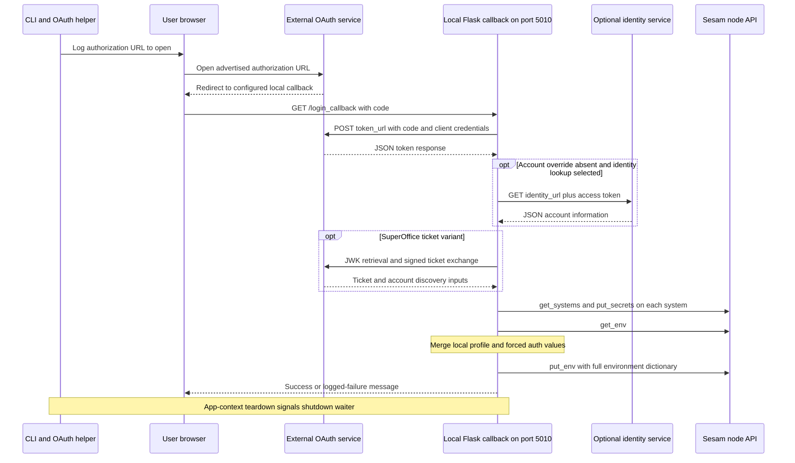

# Connector authentication and external-service side effects

## Mental model and safety boundary

Connector authentication is a **remote mutation step**, not just a local credential check. `SesamCmdClient.authenticate` reads the connector manifest and delegates to login helpers. OAuth2 and API-key helpers send secrets to **every system returned by `get_systems()`**; Tripletex targets only `get_system(system_id)`. OAuth2 and Tripletex also read and replace the node environment. The external `sesamclient` owns the underlying API implementation: this repository establishes the calls and supplied dictionaries, not backend transactionality or secret-merge guarantees. Sources: [`authenticate`](../../sesam.py#L1144-L1216), [`login_callback`](../../connector_cli/oauth2login.py#L121-L150), [`login_via_api_key`](../../connector_cli/api_key_login.py#L7-L34), [`login_via_tripletex`](../../connector_cli/tripletexlogin.py#L39-L67), and [`SesamNode` environment wrappers](../../sesam.py#L439-L452).

**Documentation intent versus implementation:** the [connector README](../../connector_cli/README.md#L30-L81) describes installing OAuth secrets and `token_url`, with system templates referencing `$SECRET(...)`. The [usage guide](../../readme.usage.md#L21-L50) describes `.authconfig`, argument alternatives and profile additions. Those descriptions are not proof of narrower write scope, working standalone script invocation, or verified third-party integration. In particular, the API-key helper reports environment success without writing any environment variables.

This page is based on static source inspection. No credentials or private-key material were read, no helpers or callbacks were started, and no external requests or integration tests were executed. See [configuration and credentials](../concepts/configuration-and-credentials.md) for local configuration handling, [connector development](../workflows/connector-development.md) for expansion/collapse, and [CLI contract](../architecture/cli-contract.md) for the wider command boundary.

## Entrypoints and exact dispatch order

The main CLI resolves node credentials through `sesamclient.utils.get_node_and_jwt_token`, stores the returned URL/JWT on `SesamCmdClient`, and constructs `SesamNode` before authentication. `authenticate` then changes the process working directory to `args.connector_dir` and **overwrites `args.service_url` and `args.service_jwt` with those resolved node credentials**. Supplying separate `--service_url` or `--service_jwt` values does not preserve them through this entrypoint. Sources: [`get_node_and_jwt_token`](../../sesam.py#L1103-L1115), [main initialization](../../sesam.py#L4100-L4139), [`authenticate`](../../sesam.py#L1144-L1159).

Connector mode is detected from a `manifest.json` under `connector_dir`. Explicit `authenticate` dispatches directly. Connector `upload` changes into the connector directory, expands and validates, changes into the expanded directory and uploads, then navigates upward and calls `authenticate` unless `-skip-auth` is set. **`-skip-auth` skips only that post-upload login**: it does not suppress an explicit `authenticate`, nor the upload's own environment/configuration writes. Explicit authentication is subject to the developer-mode gate; `-force` is permitted for `upload`/`download`, not standalone `authenticate`. Sources: [connector detection](../../sesam.py#L3975-L3979), [command gate and upload sequence](../../sesam.py#L4157-L4193), [upload environment replacement](../../sesam.py#L1411-L1462).

The dispatcher is an ordered set of manifest conditions, not a registry or a switch on `--auth`:

| Priority | Manifest condition | Behavior |
| --- | --- | --- |
| 1 | `auth_variant.lower() == "tripletex"` | Read consumer/employee tokens from local `.authconfig` if it exists, otherwise use arguments; missing `None` values exit. Call Tripletex even if another `auth` value is present. |
| 2 | `auth.lower() == "oauth2"` | Take login/token URLs, scopes and optional scopes from `oauth2`; resolve client credentials/account override; dispatch OAuth, with `require_so_ticket=True` for `superoffice-ticket`. |
| 3 | `auth.lower() == "api_key"` | **Only if local `.authconfig` exists**, resolve `api_key` and call the helper. Without that file this branch silently does nothing, even with `--api_key`. |
| Otherwise | No matching branch | No authentication helper runs. `auth: "jwt"` is not a separate branch; JWT is an API-key helper variant. |

Source: [`SesamCmdClient.authenticate`](../../sesam.py#L1161-L1216); [`--auth` parser declaration](../../sesam.py#L3927-L3933); [`JWT variant`](../../connector_cli/api_key_login.py#L19-L27). Dispatcher comparisons lowercase the values, but the helper's JWT comparison is exactly `auth_variant == "jwt"`.

### Directory and credential precedence

- A missing manifest logs an error and exits. `authenticate` does not restore the working directory. Each helper also calls `expand_connector_config(system_id)` to obtain the manifest; that function reads `manifest.json` **and renders system/datatype/shim templates**. Authentication therefore depends on valid expansion inputs, not merely on the credential fields in a manifest. Sources: [`authenticate`](../../sesam.py#L1144-L1159), [helper call sites](../../connector_cli/oauth2login.py#L173-L187), [API-key setup](../../connector_cli/api_key_login.py#L7-L13), [Tripletex setup](../../connector_cli/tripletexlogin.py#L10-L16), [`expand_connector_config`](../../connector_cli/connectorpy.py#L50-L118).
- When local `.authconfig` exists, its requested fields overwrite argument values; surrounding double quotes are removed. `set_authconfig_credentials` catches `KeyError` and warns, retaining prior values for missing fields. A grouped lookup stops at the first missing key, so later fields in that call are not processed. OAuth's `account_id` lookup is a separate call. The shared reader supports JSON or INI-like content and parent search, but the authentication branches first require local `.authconfig` existence; a parent-only file does not activate that lookup. Sources: [`set_authconfig_credentials`](../../sesam.py#L1131-L1142), [branch call sites](../../sesam.py#L1161-L1213), [configuration parser/reader](../../sesam.py#L868-L931).
- OAuth uses an explicitly non-default `--base_url`; otherwise it derives the scheme and authority from `token_url`. Tripletex uses `args.base_url`, whose parser default is `https://api.tripletex.io`. Sources: [OAuth base URL selection](../../sesam.py#L1179-L1190), [Tripletex call](../../sesam.py#L1176-L1177), [base URL option](../../sesam.py#L3892-L3898).
- `authenticate` mixes `self.args` with module-global `args` and `parser`, which are initialized under `if __name__ == "__main__"`. Direct library calls or isolated tests cannot assume that passing an argument object alone supplies all dependencies. Sources: [`authenticate`](../../sesam.py#L1144-L1213), [main guard](../../sesam.py#L3345-L3347), [argument initialization](../../sesam.py#L3975-L3977).

## OAuth2: browser callback and remote writes

`login_via_oauth` sets module-global node/variant state and starts two threads: the Flask server and a shutdown waiter. `start_server` loads the arguments/manifest and starts Flask on port **5010** only if system ID, client ID, client secret, service URL, login URL, token URL and scopes are truthy. It logs the full authorization URL for the user to open. That URL contains `client_id`, joined `scope`, `redirect_uri=http://localhost:5010/login_callback`, `response_type=code`, optional `optional_scopes`, and—when `--use-client-secret` is enabled—**`client_secret` in the query string**. It chooses `?` or `&` according to the existing URL. Sources: [`start_server`](../../connector_cli/oauth2login.py#L168-L222), [`login_via_oauth`](../../connector_cli/oauth2login.py#L225-L237).

*OAuth callback sequence: the advertised authorization URL leads to local Flask on port 5010, external token and optional identity/ticket calls, writes to all retrieved systems, and full environment replacement. This depicts the normal source path, not verified provider behavior or guaranteed completion after failure.* Sources: [`start_server`](../../connector_cli/oauth2login.py#L197-L222), [`login_callback`](../../connector_cli/oauth2login.py#L65-L165), [SuperOffice calls](../../connector_cli/superofficelogin.py#L57-L157).

### What the callback actually validates

`login_callback` reads `request.args.get("code")` and posts it with client credentials, `grant_type="authorization_code"` and the fixed redirect URI. It immediately parses JSON and indexes `access_token` and, unless `--ignore-refresh-token`, `refresh_token`. It does **not** explicitly reject a missing code, check a returned OAuth error, call `raise_for_status`, generate/check `state`, or implement PKCE/nonce checking. Do not infer those OAuth guarantees from the helper's name. The `/` route redirects to the global `login_url`; the encoded parameters are appended for logging, not assigned back to that variable, so the root route is not equivalent to the advertised complete URL. Sources: [callback input/token handling](../../connector_cli/oauth2login.py#L42-L103), [URL construction](../../connector_cli/oauth2login.py#L197-L222).

Account resolution is ordered: a truthy `account_id` override wins; otherwise a list-valued `tenant_id_expression` selects a field using element `[1]` from the decoded `id_token` payload, a matching token-response field wins next, and finally `identity_url` is concatenated directly with the access token for a GET. The generic JWT path splits and Base64-decodes the payload without signature verification or padding repair; this is account extraction, not JWT authentication. Sources: [`get_account_id_from_jwt`](../../connector_cli/oauth2login.py#L47-L62), [account selection](../../connector_cli/oauth2login.py#L70-L103).

## Secret scope and environment precedence

| Helper | Remote secret target and content | Environment order, later values win |
| --- | --- | --- |
| OAuth2, including SuperOffice | Every system from `api_connection.get_systems()`: `oauth_access_token`, `oauth_client_id`, `oauth_client_secret`, normally `oauth_refresh_token`, optional service/webhook secrets, and optional `so_ticket`. No system-ID filter. | Existing remote env → optional `service_url` → local `<profile>-env.json` → forced `token_url`, `base_url`, `account_id` → `put_env(env)`. |
| API-key/JWT | Every retrieved system: `api_key`; JWT variant also adds `jwt_access_token` and `jwt_refresh_token`. | **None.** No profile read, `get_env` or `put_env`. `base_url` is a truthiness gate, not an environment write. |
| Tripletex | Selected `get_system(system_id)` only: `consumer_token`, `employee_token`, optional service/webhook secrets. | Existing remote env → optional `service_url` → local `<profile>-env.json` → forced `base_url`, `token_url` → `put_env(dict(env.items()))`. No account-ID assignment. |

Sources: [OAuth secrets and environment](../../connector_cli/oauth2login.py#L73-L150), [API-key helper](../../connector_cli/api_key_login.py#L7-L49), [Tripletex helper](../../connector_cli/tripletexlogin.py#L18-L67).

For OAuth2 and Tripletex, `requires_service_api_access` propagates the resolved node JWT as a system secret named `service_jwt`, and the resolved node URL as environment `service_url`. The local profile is applied **after** that URL assignment and can override it, while the JWT secret remains the resolved node credential. `use_webhook_secret` stores the first 12 hexadecimal characters of SHA-256 over `service_url + "/" + system_id`, encoded with `utf-8-sig`. This is deterministic derivation, not a randomly generated credential. In OAuth, `system_id` affects this derivation but does not narrow the all-systems write. The API-key helper implements neither flag. Sources: [OAuth propagation and merge](../../connector_cli/oauth2login.py#L105-L141), [Tripletex propagation and merge](../../connector_cli/tripletexlogin.py#L29-L58), [complete API-key helper](../../connector_cli/api_key_login.py#L7-L49).

Environment writes pass a full dictionary through `SesamNode.put_env` to `api_connection.put_env_vars`; this is the repository's replacement-style interface, not a series of per-key patches. Unrelated remote values survive only insofar as `get_env` supplied them before the merge. Profiles are read from the connector working directory with `utf-8-sig`. The helpers do not directly load `.additional_parameters.json`: connector upload has already applied that file to the uploaded profile before the post-upload authentication read/merge. A later local-profile merge can therefore override values just uploaded from additional parameters. Sources: [environment wrappers](../../sesam.py#L439-L445), [upload precedence/replacement](../../sesam.py#L1439-L1462), [OAuth merge](../../connector_cli/oauth2login.py#L129-L147), [Tripletex merge](../../connector_cli/tripletexlogin.py#L46-L64). See [configuration sync](../workflows/configuration-sync.md).

The webhook flag also affects expansion: generated `http_endpoint` source pipes whose IDs end in `event` get anonymous `write_data` permissions, overwriting existing permissions. That is a separate configuration side effect; the authentication helpers shown here derive/store a secret, not implement incoming webhook validation. Source: [`expand_connector`](../../connector_cli/connectorpy.py#L145-L160).

### Partial failures are not rolled back

OAuth2 and Tripletex separately catch/log secret construction, secret writes, environment reads/merges and environment writes. Later stages still run after earlier failures. An OAuth token error can therefore be followed by writes of an empty or partially built secret dictionary; a failed environment read can be followed by `put_env({})`, and a profile error can leave a partially assembled environment to be written. A failure midway through an all-systems loop leaves earlier `put_secrets` calls completed and skips later systems in that loop. There is no local rollback. Sources: [OAuth staged error handling](../../connector_cli/oauth2login.py#L70-L165), [Tripletex staged error handling](../../connector_cli/tripletexlogin.py#L18-L78), [API-key loop/error handling](../../connector_cli/api_key_login.py#L15-L45).

The helpers log outcomes rather than return a structured status consumed by the dispatcher. Caught failures therefore do not automatically become a failing main-CLI exit. Some setup failures remain uncaught: API-key `get_systems`/expansion happen before its `try`, and the SuperOffice call sits outside OAuth's secret-construction `try`. Sources: [API-key boundaries](../../connector_cli/api_key_login.py#L7-L49), [OAuth ticket call](../../connector_cli/oauth2login.py#L110-L128), [dispatcher](../../sesam.py#L1176-L1213), [main exception handler](../../sesam.py#L4293-L4304).

## API-key/JWT and Tripletex specifics

**API-key/JWT:** after the dispatcher's local `.authconfig` gate, the helper requires truthy `base_url`, system ID and API key. With exactly `auth_variant: "jwt"`, it reads `jwt.login_url` and `jwt.jwt_header_key`, POSTs the API key under that header, parses JSON fields `AccessToken` and `RefreshToken`, and distributes those tokens with `api_key`. There is no explicit status check or timeout in this call. Its “All secrets and environment variables…” message is misleading: no environment mutation occurs in this helper. Sources: [dispatch gate](../../sesam.py#L1210-L1213), [`login_via_api_key`](../../connector_cli/api_key_login.py#L7-L49).

**Tripletex:** the helper requires truthy system ID, consumer token, employee token and base URL. It constructs `base_url + "/v2/token/session/:create"`, stores that as environment `token_url`, and stores the two input tokens as secrets on the selected system. **It does not execute a direct session-token request**: there is no `requests` call in this helper. The CLI exposes integer `--days` with default `10`, but this helper never reads it or constructs an expiry. Missing truthy inputs only produce the helper's missing-arguments log. Sources: [`login_via_tripletex`](../../connector_cli/tripletexlogin.py#L1-L82), [`--days`](../../sesam.py#L3900-L3907).

## SuperOffice ticket continuation

`superoffice-ticket` is an OAuth continuation, not an independent dispatcher. After normal token/secret acquisition, OAuth calls `get_so_ticket(data, secrets)`, expects a three-value return, then stores **only** `so_ticket["so_ticket"]` in the system-secret dictionary. Source: [variant dispatch](../../sesam.py#L1205-L1208), [callback continuation](../../connector_cli/oauth2login.py#L114-L117).

The helper's intended call chain is concrete:

1. Derive the customer context by splitting the access token; obtain `id_token`, read **`RSA_PRIVATE_KEY` from the process environment**, and read `oauth2.jwks_uri` from local `manifest.json`. The OAuth client secret becomes the application token.
2. GET JWKs, use the **first** key through `jwk_from_dict`, decode the ID token with `JWT().decode`, and extract `http://schemes.superoffice.net/identity/system_token`. No local `kid` selection or explicit issuer/audience policy is supplied; verification details are delegated to the installed JWT library.
3. Convert the XML RSA key to PEM with `get_rsa_as_pem_content`, append UTC time formatted `%Y%m%d%H%M` to the system-user token, sign it using `crypto.load_privatekey` and `crypto.sign(..., 'sha256')`, and Base64-encode the signature. The helper builds `signed_so_token` in its local ticket dictionary.
4. Infer the SuperOffice environment from the JWK URI and POST `SignedSystemToken`, `ApplicationToken`, `ContextIdentifier` and `ReturnTokenType: "JWT"` to `https://{environment}.superoffice.com/Login/api/PartnerSystemUser/Authenticate`.
5. On `IsSuccessful`, retrieve JWKs again, decode the returned token, extract ticket and context claims, and timestamp the ticket. GET `https://{environment}.superoffice.com/api/state/{customer}` to derive a base URL from `v1` or `Api`, then GET `{base_url}/v1/User/currentPrincipal` using `SOTicket` and `SO-AppToken` headers. A non-200 principal response is logged but does not prevent returning the tuple.

Sources: [RSA conversion](../../connector_cli/superofficelogin.py#L15-L36), [base URL discovery](../../connector_cli/superofficelogin.py#L39-L54), [JWK/ID-token handling](../../connector_cli/superofficelogin.py#L57-L74), [`get_so_ticket`](../../connector_cli/superofficelogin.py#L77-L157). These are source-level intended requests, **not verified SuperOffice behavior**. The returned timestamp and signed token are not persisted by the OAuth caller.

### Call/return and dependency risks

- If no system token is found, `get_so_ticket` returns just an empty dictionary, while the caller unpacks three values. An unsuccessful exchange returns `(None, None, None)`, after which the caller indexes `so_ticket["so_ticket"]`. Both shapes can raise outside OAuth's catch blocks, before `g.shutdown_server` is set. The comment claiming that the missing ticket is handled by the callback is not an implemented recovery path. Sources: [early return](../../connector_cli/superofficelogin.py#L93-L96), [failed exchange/return](../../connector_cli/superofficelogin.py#L149-L157), [callback unpack/index](../../connector_cli/oauth2login.py#L114-L117).
- Missing or malformed `RSA_PRIVATE_KEY`, unexpected token delimiters, missing JWK/claim fields, failed JSON parsing, and signing errors are not caught inside `get_so_ticket`. Requests, key selection and URL parsing assume the expected provider shapes. Sources: [`get_so_ticket`](../../connector_cli/superofficelogin.py#L84-L146), [XML parsing](../../connector_cli/superofficelogin.py#L25-L36).
- The helper imports `JWT`/`jwk_from_dict` from `jwt` and uses `OpenSSL.crypto.sign`. Requirements declare **both `PyJWT==2.10.1` and `jwt~=1.3.1`**, as well as `pyOpenSSL==25.1.0`, `cryptography==45.0.6` and `pycryptodome==3.23.0`. JWT namespace/API resolution and signing API availability are compatibility review points, not an established working combination here. `sesam.py` imports OAuth, which imports SuperOffice, so failures at this dependency-import boundary can affect other CLI commands too. Sources: [helper imports](../../connector_cli/superofficelogin.py#L1-L12), [signing calls](../../connector_cli/superofficelogin.py#L100-L107), [requirements](../../requirements.txt#L7-L14), [CLI imports](../../sesam.py#L27-L34), [OAuth imports](../../connector_cli/oauth2login.py#L11-L15).

## Callback lifecycle, platform assumptions and transport

Normal callback completion assigns `g.shutdown_server = True`; Flask app-context teardown then sets the module-global event. The shutdown thread waits on that event, runs **`lsof -i tcp:5010`** through a shell, finds the `PID` column and sends **`SIGKILL` to every returned PID**. It does not check ownership or retain the Flask server PID, and the command has no `LISTEN`-only filter: processes with other matching TCP connections can also be selected. Because Flask runs in a thread of the login process, killing its listening PID can terminate the whole CLI, bypassing normal exception/finally cleanup. This is forced process termination, not graceful Flask shutdown. Sources: [`wait_on_server_shutdown` and teardown](../../connector_cli/oauth2login.py#L17-L39), [completion flag](../../connector_cli/oauth2login.py#L145-L165).

Operational consequences:

- This assumes an available `lsof`, its expected text output, suitable kill permissions and Unix-style process signaling. Empty output or a missing `PID` header raises during parsing; killing unrelated port-5010 processes is possible. A Windows CI matrix elsewhere is not proof this callback shutdown works on Windows.
- A falsey required input, including empty scopes, causes `start_server` to return without starting Flask or signaling the event. A server-start exception or no browser callback can likewise leave the shutdown waiter blocked. Both threads are joined without a timeout. An exception before the completion flag—especially the SuperOffice continuation—can leave the server/waiter running indefinitely.
- Node, manifest, credentials, URLs and the event are module-global. The event is not reset for a second login, so concurrent or repeated use is not isolated.

Sources: [global state and shutdown](../../connector_cli/oauth2login.py#L17-L39), [callback exception boundary](../../connector_cli/oauth2login.py#L110-L151), [server gate and thread joins](../../connector_cli/oauth2login.py#L168-L237), [CI platform matrix](../../.github/workflows/test.yml#L13-L22). See [troubleshooting and releases](../operations/troubleshooting-and-releases.md).

`-skip-tls-verification` is passed to `SesamNode`'s `sesamclient.Connection`; disabling urllib3 warnings there does not disable certificate verification globally. OAuth token/identity requests, API-key/JWT requests and SuperOffice requests are separate `requests` calls, with no forwarded bypass and no explicit timeout. They retain Requests' own TLS behavior, may block without a helper-level deadline, and have uneven response checks: OAuth/API-key parse directly, SuperOffice checks `IsSuccessful` for exchange and status `200` for state/principal calls. Sources: [main TLS propagation](../../sesam.py#L4136-L4139), [`SesamNode.__init__`](../../sesam.py#L257-L272), [OAuth requests](../../connector_cli/oauth2login.py#L73-L103), [JWT request](../../connector_cli/api_key_login.py#L19-L27), [SuperOffice requests](../../connector_cli/superofficelogin.py#L39-L63), [exchange/principal checks](../../connector_cli/superofficelogin.py#L122-L154).

Treat logs and browser history as credential-bearing surfaces: the optional client-secret authorization URL is logged in full; identity lookup embeds the access token in a URL; main connection failure logging also includes the supplied JWT without masking at that error site. Do not paste these outputs into tickets or wiki examples. Sources: [authorization logging](../../connector_cli/oauth2login.py#L206-L220), [identity URL](../../connector_cli/oauth2login.py#L100-L103), [connection failure log](../../sesam.py#L4147-L4150).

## Validation coverage and safe change checks

The inspected test scenarios exercise remote-node configuration/runtime behavior and embedded-source conversion, not connector OAuth/API-key/Tripletex/SuperOffice login. The nested Python test checks pipe IDs. CI runs `test.sh` across Linux, macOS and Windows with a shared credentialed node and serialized jobs; that is not callback or provider compatibility coverage. Sources: [test orchestration](../../test.sh#L15-L32), [fair-weather commands](../../tests/fair_weather_test/run_test.sh#L29-L49), [conversion commands](../../tests/embedded_conversion_test/run_test.sh#L29-L58), [pipe-ID test](../../tests/fair_weather_test/tests/test_pipe_id.py#L6-L18), [CI configuration](../../.github/workflows/test.yml#L13-L48).

**Proposed focused regression checks, not existing verified tests:**

- Mock `SesamNode`/`api_connection` and use synthetic manifests to check dispatch precedence, `.authconfig` presence/partial overrides, the global `args`/`parser` dependency, and connector-directory transitions.
- Assert OAuth/API-key all-systems scope versus Tripletex selected-system scope; verify service credential propagation, exact webhook derivation and profile overwrite order. Inject a failure on the second system and on environment reads to capture partial-write behavior.
- Use Flask's test client with mocked HTTP responses and shutdown machinery to check absent code/state behavior, account extraction, refresh-token omission, and API-key's lack of environment calls. Never start the real listener or execute `lsof`/`os.kill` in such tests.
- Mock JWK retrieval, signing, ticket exchange and discovery to cover SuperOffice's empty-dictionary and `None` return cases. Separately validate dependency imports/signing API compatibility in an isolated, network-disabled environment without real keys.
- Test the lifecycle with controlled thread/event doubles for falsey input, server exceptions and repeated login, rather than invoking `login_via_oauth` unmodified.

For the broader gates and remote-test precautions, see [change validation](../testing/change-validation.md). Adding a new scheme requires changes to the manifest dispatcher and an explicit decision about write scope, environment precedence, credential propagation and failure signaling; templates and provider-specific response expectations must be tested together, not treated as a generic OAuth promise.
