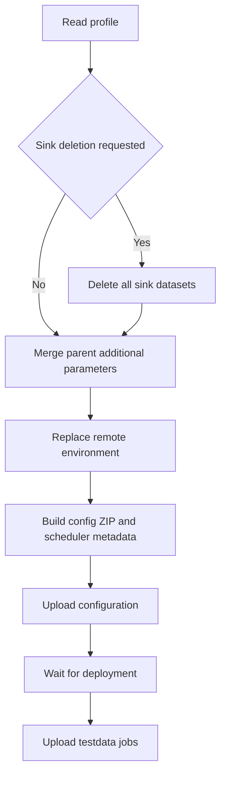
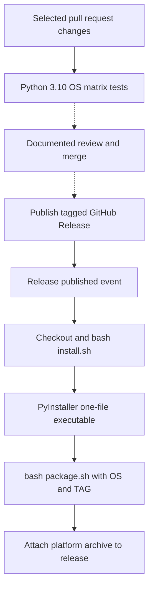

# Operational recovery, destructive administration and releases

This is a **source-based operational guide**, not a recovery script or an installation-success report. Research did not run the CLI, install dependencies, build/package/publish assets, start login servers or execute administration. Use the [CLI contract](../architecture/cli-contract.md#canonical-command-contract-table) for accepted commands and options, [configuration and credentials](../concepts/configuration-and-credentials.md) for input selection, and [quickstart](../quickstart.md) for initial orientation.

## Safety boundary before investigating

Before authorizing any remote write, independently confirm the intended node, credential source, developer-subscription designation, working directory and selected profile. Secure a reviewed recovery copy of local configuration, templates, expected output and relevant remote state; establish who owns the subscription and whether another job is using it. Do not infer safety from a whitelist or a successful exit alone. Whitelist scope is handler-specific, not a global administrative sandbox: see [whitelist boundaries](../architecture/cli-contract.md#whitelist-is-per-handler-not-a-global-safety-boundary).

The dispatcher allows offline execution only for `validate` and `format`. Other commands resolve node/JWT, construct `SesamNode`, then check the API's `developer_mode`. Only `upload` and `download` may override the non-developer gate with `force`; this does **not** authorize `stop`, `wipe`, `reset` or `restart` on an arbitrary subscription. Construction can register a Portal analytics interaction before that gate, so even apparently observational CLI entrypoints are not completely side-effect-free. Sources: [`sesam.py` bootstrap and gate](../../sesam.py#L4100-L4166), [gate denial](../../sesam.py#L4282-L4292), [`SesamNode` construction/analytics](../../sesam.py#L234-L337).

Prefer initial inspection without invoking the CLI:

- Inspect the current directory, repository layout, manifest, profile filename, parent configuration locations and local version-control diff. Inspect credential **provenance**, not token values in a shared terminal or ticket.
- Use an already authorized read-only management/API view to examine configuration, environment keys, pipe deployment state and scheduler status/logs. The locally defined scheduler reads are GET `/pipes/get-pipe-runner-status` with a token and GET `/pipes/get-run-all-pipes-log` with optional `since`/token; these are distinct from the scheduler's POST start/stop routes. See [`SesamNode` scheduler calls](../../sesam.py#L561-L643).
- Do not treat `download`, `update`, `expand`, `validate` or `format` as local read-only inspection. Download overwrites the profile and deletes local pipe/system files before extraction; update changes expected-output files; expansion removes an existing output directory; validation dispatch expands first; formatting writes files in place. Even `status` creates/replaces a local ZIP, and publisher reads used by verification can enable a disabled pump. Sources: [download](../../sesam.py#L1704-L1793), [update](../../sesam.py#L2792-L2893), [expansion](../../connector_cli/connectorpy.py#L121-L144), [validation dispatch](../../sesam.py#L4173-L4177), [format](../../sesam.py#L3233-L3311), [status/archive](../../sesam.py#L1810-L1825), [`get_zip_config`](../../sesam.py#L981-L1005), [publisher side effect](../../sesam.py#L656-L670).

**Redact incident evidence.** The routine constructor DEBUG message partially masks JWT, but the constructor-failure handler logs the full resolved node URL and JWT at ERROR. HTTP debugging can be enabled by `-vvv`; OAuth logs an authorization URL and can put `client_secret` in that URL. Remove credentials, secret-bearing query strings, environment values and node/customer identifiers before sharing logs, ZIPs or diffs. See [security consequences](../concepts/configuration-and-credentials.md#security-and-operational-consequences) and [source logging paths](../../sesam.py#L4023-L4038), [connection failure](../../sesam.py#L4136-L4155), [OAuth URL](../../connector_cli/oauth2login.py#L197-L221).

## Triage by symptom and affected state

| Symptom | State to inspect and source-established explanation | Safe recovery boundary |
| --- | --- | --- |
| Wrong working directory, missing files or unexpected connector behavior | `BASE_DIR` records launch CWD, but handlers use relative paths and may `chdir`. Generic `read_config_file` searches current/parent directories without making that parent the process CWD. Connector detection checks `manifest.json` under `connector_dir`; upload changes into the connector, then the expanded directory. [`BASE_DIR`](../../sesam.py#L36-L41), [lookup](../../sesam.py#L889-L931), [detection](../../sesam.py#L3975-L3977), [upload dispatch](../../sesam.py#L4178-L4193). | Confirm the effective local layout and chosen input files before retrying. A config found in a parent directory does not mean `pipes`, `systems`, `expected` or the profile will be read from that parent. Consult [local configuration preparation](../workflows/local-configuration-preparation.md) and [directory search](../concepts/configuration-and-credentials.md#local-jsonini-parsing-and-directory-search). |
| Unexpected credentials or profile | Node/JWT resolution is delegated to `sesamclient.utils.get_node_and_jwt_token`, with CLI inputs and the sync-config filename. The profile selects `<profile>-env.json`, default `test`; it is not a command to select a subscription. Upload also merges `../.additional_parameters.json`, whose keys override the profile in memory. [resolver boundary](../../sesam.py#L1103-L1115), [profile default](../../sesam.py#L3603-L3610), [merge](../../sesam.py#L1411-L1456). | Audit input provenance and parent files, not just the repository-local `.syncconfig`. Use [node/JWT contract](../concepts/configuration-and-credentials.md#nodejwt-resolution-is-an-integration-boundary) and [profiles and directories](../concepts/configuration-and-credentials.md#profiles-active-directories-and-environment-updates); do not guess dependency precedence from local parsing code. |
| Connector validation failure | Template list entries with a nonempty pipe `sink.dataset` are rejected. The expanded checks include JSON validity, `WARNING` in pipe descriptions, collect/share transform consistency, completeness references and share `batch_size=1`. The validator explicitly walks `.expanded` and uses slash-based directory suffix tests; a custom expansion path or OS layout is not uniformly honored by this code. [sink check](../../sesam.py#L1218-L1254), [validator](../../sesam.py#L1256-L1409). | Inspect manifest/template and generated-file errors in a disposable copy. Connector upload expands and validates before remote upload; expansion itself may already have replaced local generated state. See [connector development](../workflows/connector-development.md). Offline validation is not a no-write validator. |
| Partial environment/config/testdata upload | Environment replacement precedes archive construction and config upload; deployment waiting precedes testdata. Optional sink-dataset deletion happens even earlier. Each later failure can leave earlier remote changes intact. Concurrent testdata work collects failed files after futures complete; single-thread upload stops at the first raised failure. [upload stages](../../sesam.py#L1411-L1592). | Record the last completed stage and inspect both remote environment and config, then successful/failed testdata jobs. Fix the cause and plan a reviewed retry; do not assume rerunning reverses writes or that every POST is idempotent. See [configuration sync](../workflows/configuration-sync.md). |
| Deployment timeout or scheduler failure/disconnection | Deployment waits only on user pipes currently in `Deploying`, with a 30-minute default wait. `run` stops a prior scheduler, then starts the internal scheduler; async operation requires a returned token and polls status. Failed/not-running status or request exceptions become run failure. [deployment wait](../../sesam.py#L274-L310), [scheduler control](../../sesam.py#L2956-L3101). | Inspect runtime config errors, scheduler logs/status and concurrent activity before authorizing a stop or another run. Absence of `Deploying` is not proof that all configs are valid. The scheduler's reset/delete behavior depends on its request parameters and the presence of `testdata`; see [run and verify](../workflows/run-and-verify.md). |
| Missing or changed expected output | `verify` loads `expected/*.test.json`; missing referenced output or absent referenced output pipe fails spec loading. No specs only warns and returns. With specs present, unreferenced output pipes and output mismatches fail. `update` is a baseline-writing operation: it can remove specs for vanished nonignored pipes, create files/specs, remove ignored output files and overwrite expected data. [spec lifecycle](../../sesam.py#L1907-L2011), [verify entry](../../sesam.py#L2069-L2111), [failure aggregation](../../sesam.py#L2344-L2368), [update](../../sesam.py#L2792-L2893). | Inspect spec `ignore`, whitelist scope, stage/endpoint and reviewed expected-file changes. Do not use `update` to make a regression disappear. Check that tests actually ran; use the [execution and expected-output contract](../architecture/cli-contract.md#execution-and-expected-output-lifecycle). |
| Generated-template edits disappear | Expansion deletes/recreates its output directory. Reused templates are annotated when the template basename differs from the datatype; collapse intentionally skips those datatypes. Collapse also rewrites templates/manifest and performs best-effort string substitution of parameter values. [expansion and warning](../../connector_cli/connectorpy.py#L86-L144), [collapse skip/substitution](../../connector_cli/connectorpy.py#L203-L299), [documented reuse rule](../../connector_cli/README.md#L99-L117). | Preserve the diff before any expansion/download. Recover edits from version control or a secured copy, and change the master template rather than relying on a derived datatype to survive collapse. See [connector development](../workflows/connector-development.md). |
| Formatting drift or ignored `.sesamconfig.json` settings | Docs describe configurable `formatstyle`, but CLI call sites pass no style to `format_json`; the parsed `sesamconfig_file` is not loaded/consumed by those paths. Ordinary formatting uses library defaults; expected JSON uses separate alphabetically sorted `json.dumps` output and encoding/HTML-escape flags. Bulk expected formatting skips `.test.json`. [docs intent](../../readme.usage.md#L52-L80), [parsed option](../../sesam.py#L3722-L3729), [library default](../../jsonformat.py#L9-L60), [format handler](../../sesam.py#L3233-L3311). | Compare a secured working-copy diff before rewriting. Do not promise a config-file setting will change current CLI output. See [formatting contract](../concepts/configuration-and-credentials.md#formatting-documented-customization-versus-actual-behavior). |
| Errors in logs despite a normal return, or authentication only partly succeeds | `status` logs missing profile/differences without raising, and connector status with no expansion also only logs. OAuth callback catches separate secret/env failures and continues later phases; API-key and Tripletex helpers also log some failures rather than raising. [status](../../sesam.py#L1830-L1878), [connector branch](../../sesam.py#L4199-L4213), [OAuth callback](../../connector_cli/oauth2login.py#L65-L165), [API-key](../../connector_cli/api_key_login.py#L13-L49), [Tripletex](../../connector_cli/tripletexlogin.py#L18-L82). | Review per-phase evidence and remote state, not only the process exit. OAuth/API-key writes reach all returned systems, while Tripletex selects the placeholder system. Follow [connector authentication](../integrations/connector-authentication.md) before authorizing another credential write. |

## Why failures do not imply rollback

The meaningful upload checkpoints are ordered, not transactional:

*Upload ordering from `SesamCmdClient.upload`: a failure at a later box does not restore an earlier write.* ([Source](../../sesam.py#L1411-L1592))

Upload's ZIP metadata disables user pipes by default unless explicitly enabled and sets eager microservice loading off unless requested. These settings are changed during upload/test, not by a standalone `run`. Scheduler execution is itself potentially destructive: the client requests normal reset/sink-deletion behavior unless opted out, and preserves input datasets when a local `testdata` directory exists by sending `delete_input_datasets=False`. Otherwise it leaves the server's default input deletion behavior in place. Sources: [upload metadata](../../sesam.py#L1464-L1510), [run warnings](../../sesam.py#L4228-L4249), [scheduler arguments](../../sesam.py#L2956-L2998), [request serialization](../../sesam.py#L561-L608).

Testdata has bounded per-file retries with exponential delay and jitter for retryable HTTP/request failures, not transaction-wide rollback. A concurrent failure produces `TestDataUploadException` after recording completed jobs; earlier successful posts remain outside any local undo mechanism. Sources: [worker aggregation](../../sesam.py#L1539-L1590), [retry loop/classification](../../sesam.py#L1605-L1675).

`test` sequences upload, deployment waiting, repeated run and verify; its catch logs and rethrows. `run` similarly logs/rethrows. Neither establishes compensating cleanup. The dispatch-level `finally` **only logs elapsed run time**: it does not stop a scheduler after interruption, restore environment/config, or undo testdata. The stop help explicitly anticipates a prematurely terminated/disconnected client. Sources: [`test`](../../sesam.py#L2907-L2923), [`run`](../../sesam.py#L3094-L3101), [top-level handlers/finally](../../sesam.py#L4293-L4307), [stop intent](../../sesam.py#L3366).

Authentication is another staged writer, not a success guarantee attached to config deployment. Connector `upload` finishes upload before calling authentication unless skipped. In OAuth callback, secret acquisition, per-system secret writes, environment reading/merging and environment replacement have separate error catches; later writes can proceed after an earlier failure. Inspect each affected system and environment separately. Sources: [connector upload dispatch](../../sesam.py#L4178-L4193), [OAuth stages](../../connector_cli/oauth2login.py#L65-L165).

## Destructive administration: what each handler actually does

These traces explain boundaries for an authorized recovery plan. They are **not executable wipe/reset recipes**. The help's deletion promises describe intent; API/database effects delegated to `sesamclient` and the node are not locally implemented transactions.

| Operation | Local control flow and SesamNode/API calls | Failure and verification boundary |
| --- | --- | --- |
| `stop` | `SesamCmdClient.stop()` calls `SesamNode.stop_internal_scheduler()`, which POSTs `/pipes/stop-run-all-pipes` with default `terminate_timeout=30`, raises on HTTP failure and returns JSON. It does not clear config/environment or invoke a node restart. | Default `throw_error=True` logs and rethrows. `run` and `wipe` require this stop to succeed before proceeding. The wrapper does not inspect the returned JSON for a separate semantic success marker. [handler](../../sesam.py#L2895-L2905), [HTTP call](../../sesam.py#L610-L618), [callers](../../sesam.py#L3094-L3105). |
| `wipe` | First strict stop. Read local `node-metadata.conf.json` or use node metadata defaults. Set internal/external signalling false, C++ extensions false and user pipes disabled. Force-upload `[node_metadata]`, then force-upload `[]`, then replace environment with `{}`, then wait for user pipes to disappear. `put_config` delegates to `upload_config`; `put_env` delegates to `put_env_vars`. | Config and environment have separate catches/rethrows, so intermediate metadata/config removal can persist even if environment clearing fails. The disappearance wait is a filtered pipe check, not a verification of all datasets. There is **no explicit dataset-deletion call in this handler**, despite help promising deletion of user datasets; do not infer backend dataset semantics from an empty config upload. [wipe](../../sesam.py#L3103-L3147), [delegation](../../sesam.py#L435-L441), [help intent](../../sesam.py#L3352). |
| `reset` | Best-effort `stop(throw_error=False)`, then `SesamNode.reset(restart_timeout)`: read old status, call `api_connection.reset_node()`, require exactly `{"message": "OK"}`, then poll status for a changed `node_start_time`. | Stop failure is logged but does not block reset. Reset/API/poll failures are logged and rethrown. Help describes entire node database deletion and restart; database deletion is delegated, not a local config/env clearing sequence. [handler](../../sesam.py#L3149-L3160), [node method](../../sesam.py#L406-L433), [intent](../../sesam.py#L3354). |
| `restart` | Best-effort stop, then `SesamNode.restart(restart_timeout)`: read old status, call `api_connection.restart_node()`, require the same exact OK response and poll changed `node_start_time`. | Stop failure is suppressed only for this preliminary phase. Restart is documented for releasing resources in a strained environment, not as local data clearing. A changed start time is the observed criterion, not a subsequent pipe/test health check. [handler](../../sesam.py#L3162-L3173), [node method](../../sesam.py#L377-L404), [intent](../../sesam.py#L3353). |

The pipe disappearance wait defaults to 30 minutes and polls every five seconds. Its `is_user_pipe` filter excludes system/search/replica/aggregator-storage-node origins and IDs containing `:singlenode`; successful completion means **no pipes matching that filter** remain. Sources: [filter and wait](../../sesam.py#L339-L375).

Reset/restart polling catches failed status reads, sleeps three seconds between attempts and times out against a monotonic clock. The parser defaults `restart_timeout` to 15 minutes and advertises zero as a verification skip, but both node methods enter their polling loop unconditionally. **Zero is not an implemented skip**: an immediately changed start time can succeed; otherwise the elapsed-time check can fail almost immediately. A polling timeout also does not establish that the remote reset/restart never occurred. Sources: [restart/reset](../../sesam.py#L377-L433), [timeout help/default](../../sesam.py#L3680-L3689).

## Executable builds and release assets

### Documented release intent

[`readme.develop.md`](../../readme.develop.md#L3-L12) describes a branch/change/PR workflow: increment the version in `sesam.py`, pass tests, obtain review, merge, then create a GitHub Release with a tag corresponding to that version and a release description. It expects a workflow to build and attach assets. The inspected constant is `sesam_version = "2.11.13"`; the version branch prints it and exits before command validation. There is no shown workflow check enforcing equality between this constant and the release tag. Sources: [constant](../../sesam.py#L36), [version exit](../../sesam.py#L3975-L3985), [tag propagation](../../.github/workflows/build-release-assets.yml#L34-L38).

### Implemented build-to-release path

*Solid arrows show workflow/script flow; dotted arrows show the documented human release process, not an automated dependency from PR tests to release publishing.* Sources: [development intent](../../readme.develop.md#L3-L12), [test workflow](../../.github/workflows/test.yml#L1-L48), [release workflow](../../.github/workflows/build-release-assets.yml#L1-L68), [installer/build script](../../install.sh#L1-L17), [packaging](../../package.sh#L1-L25).

The release workflow triggers on **`release: types: [published]`**, not every tag push or draft creation. Its matrix is `macos-latest`, `ubuntu-22.04`, `windows-latest` and Python `3.10`; setup also explicitly chooses `3.10`. Each job checks out code, invokes `bash install.sh`, invokes `bash package.sh` with runner `OS` and release `TAG`, then uses `actions/upload-release-asset@v1` with the event's upload URL and `GITHUB_TOKEN`. This workflow does not run `test.sh` or wait on a test job. Sources: [trigger/build steps](../../.github/workflows/build-release-assets.yml#L1-L38), [upload steps](../../.github/workflows/build-release-assets.yml#L39-L68).

`install.sh` is really a dependency-install-and-freeze script: Bash `set -x -e`, unpinned `pip install pyinstaller`, then `pip install --user -U -r requirements.txt`. It overwrites `OS` using `uname`; Linux/Darwin use `--add-data "connector_cli:connector_cli"`, and the other branch uses Windows' `"connector_cli;connector_cli"` separator. Both freeze `sesam.py` with `--onefile`. Including `connector_cli` matters because connector generation loads packaged Jinja resources through `PackageLoader` and retrieves `shim.json`. Sources: [build script](../../install.sh#L1-L17), [resource loading](../../connector_cli/connectorpy.py#L50-L65).

### `artifact_path` versus published `asset_name`

The workflow input is named **`asset_path`**: it is the local artifact path passed to the uploader. It need not equal the published **`asset_name`**. `package.sh` enters `dist` and uses runner-label `OS` plus `TAG` to create these archives:

| Runner label | Executable inside archive | Local artifact path (`asset_path`) | Published `asset_name` |
| --- | --- | --- | --- |
| `ubuntu-22.04` | `sesam` | `./dist/sesam-linux-${TAG}.tar.gz` | `sesam-linux-${TAG}.tar.gz` |
| `macos-latest` | `sesam` | `./dist/sesam-macos-${TAG}.tar.gz` | `sesam-osx-${TAG}.tar.gz` |
| `windows-latest` | `sesam.exe` | `./dist/sesam-windows-${TAG}.zip` | `sesam-windows-${TAG}.zip` |

`${TAG}` here denotes `github.event.release.tag_name`, as forwarded to packaging. The macOS **`macos` packaging / `osx` release naming distinction is explicit in the inspected workflow**; do not request the local macOS filename from the release download URL. Packaging uses `tar -zcf` on POSIX and `7z a` on Windows; upload content types are `application/tar` and `application/zip`. Sources: [`package.sh`](../../package.sh#L5-L25), [paths/names/content types](../../.github/workflows/build-release-assets.yml#L39-L68).

### Historical download helpers and OS assumptions

These scripts are inspected behavior, **not verified current installation procedures**:

| Helper | Detection and download expectations | Placement and limitations |
| --- | --- | --- |
| `install-latest.sh` | Bash `$OSTYPE`: exact `linux-gnu` maps to `linux`, `darwin*` maps to `osx`, otherwise prints unsupported and exits. Uses `curl`'s effective URL for GitHub `/releases/latest`, takes its basename as tag, downloads `sesam-$os-$tag.tar.gz` with `wget`, extracts with `tar`. | Default output name `sesam-latest`, optionally another name. Non-root moves the extracted `sesam` in the current directory; root moves it to `/usr/local/bin`. “Now usable” is only a printed message, not a PATH/execution check. Uses CWD for archive extraction and unquoted path variables, with no `set -e` guard. [source](../../install-latest.sh#L1-L55). |
| `install-tag.sh` | Requires `SESAM_TAG`. Exact `$OSTYPE` cases `linux-gnu` and **`darwin`**, not `darwin*`; builds the same `linux`/`osx` release-name URL and uses `wget`/`tar`. | Removes the archive after extraction but leaves `sesam` in CWD; no PATH installation/rename. No Windows branch, no `set -e`, and unquoted filename/tag variables. [source](../../install-tag.sh#L1-L25). |

There are three distinct OS mechanisms: runner-label environment variables select packaging/test paths, `uname` selects the PyInstaller add-data syntax inside `install.sh`, and `$OSTYPE` selects the historical download URL family. Matching one does not prove the others will match. The build/test workflows explicitly run Bash even on Windows. Packaging needs `tar` or `7z`; helpers need `wget`, and latest additionally needs `curl` plus ordinary shell utilities. Packaging/test scripts use `pushd`, `$PWD` and relative directories, so source-build helpers assume repository-root execution and existing `dist` outputs. `package.sh` has no fail-fast setting, unlike the install/test scripts. Sources: [release workflow](../../.github/workflows/build-release-assets.yml#L25-L38), [install](../../install.sh#L1-L17), [package](../../package.sh#L1-L25), [test paths](../../test.sh#L1-L32), [latest](../../install-latest.sh#L1-L55), [tag](../../install-tag.sh#L1-L25).

OAuth callback operation has an additional POSIX-like assumption unrelated to archive compatibility: Flask uses port `5010`, and shutdown invokes shell `lsof -i tcp:5010`, parses a `PID` column and sends `SIGKILL` to every returned PID. It does not track only its own server PID. Availability, permissions, port ownership and parsing must be reviewed before login; a Windows executable asset is not evidence that this shutdown strategy is portable. Sources: [shutdown](../../connector_cli/oauth2login.py#L17-L39), [server/thread lifecycle](../../connector_cli/oauth2login.py#L168-L237).

[`readme.install.md`](../../readme.install.md#L1-L29) documents downloading/unpacking binaries onto PATH and historical Linux/OSX source/build examples labeled Python 3.5+. That text is **not a currently validated compatibility floor**. The workflows specify Python 3.10, and [`requirements.txt`](../../requirements.txt#L1-L14) records dependency constraints; neither proves present runner availability, dependency compatibility, successful PyInstaller resolution or working release downloads. Unpinned PyInstaller adds build variability. The inspected distribution path is source `sesam.py` or the one-file executable/archive; there is **no source-established wheel or installed console-entry-point distribution**. `pyproject.toml` and `setup.cfg` contain formatter/linter configuration, not project distribution metadata or console scripts. Sources: [entrypoint](../../sesam.py#L3345-L3382), [build](../../install.sh#L1-L17), [tool config](../../pyproject.toml#L1-L11), [lint config](../../setup.cfg#L1-L14).

## What tests establish—and what they do not

The PR test workflow watches Python files, `requirements.txt` and its own workflow file. It uses the same three OS labels and Python 3.10, serializes matrix jobs with `max-parallel: 1` because they share a remote CI node, and declares workflow concurrency `sesam_py_environment`. It builds via `install.sh` and runs `test.sh` with a secret-provided token. Documentation or packaging-script changes alone are not among its listed path filters. [`test.yml`](../../.github/workflows/test.yml#L1-L48).

`test.sh` selects `dist/sesam` or `dist/sesam.exe`, exercises help, supplies a fixed remote CI target and token environment, then enters each non-symlink test directory and runs its `run_test.sh`. These are remote integration tests, not safe local diagnostic commands. The target identifier and credentials are intentionally not reproduced here. [`test.sh`](../../test.sh#L7-L32).

- **Fair-weather coverage:** reset before/after; upload/run/verify with a whitelist and pytest; update; status; download with a formatting-config argument; assert the retained ZIP exists. Its retry wrapper allows three attempts with a delay. The pytest fixture checks that local pipe filenames and `_id` values contain no underscore. This demonstrates authored happy-path coverage, not that status returns nonzero on drift or that the formatting-config argument is consumed. [integration script](../../tests/fair_weather_test/run_test.sh#L1-L49), [pytest check](../../tests/fair_weather_test/tests/test_pipe_id.py#L6-L18), [formatstyle fixture](../../tests/fair_weather_test/.mysesamconfig.json#L1-L14).
- **Embedded conversion coverage:** prepare a copied working tree, wipe, convert, test with extracted testdata, reset and recursively compare against `expected_after`. It is also destructive remote integration coverage with command-level retries, not a production recovery recipe. [script](../../tests/embedded_conversion_test/run_test.sh#L1-L58).

These scripts do not contain focused assertions for partial-write rollback, interruption cleanup, stop suppression, zero-timeout skip, OAuth partial failures or release asset download correctness. Those boundaries above come from **implementation inspection**, not a claimed test pass. For planning non-destructive change review and isolated validation, continue to [change validation](../testing/change-validation.md).
