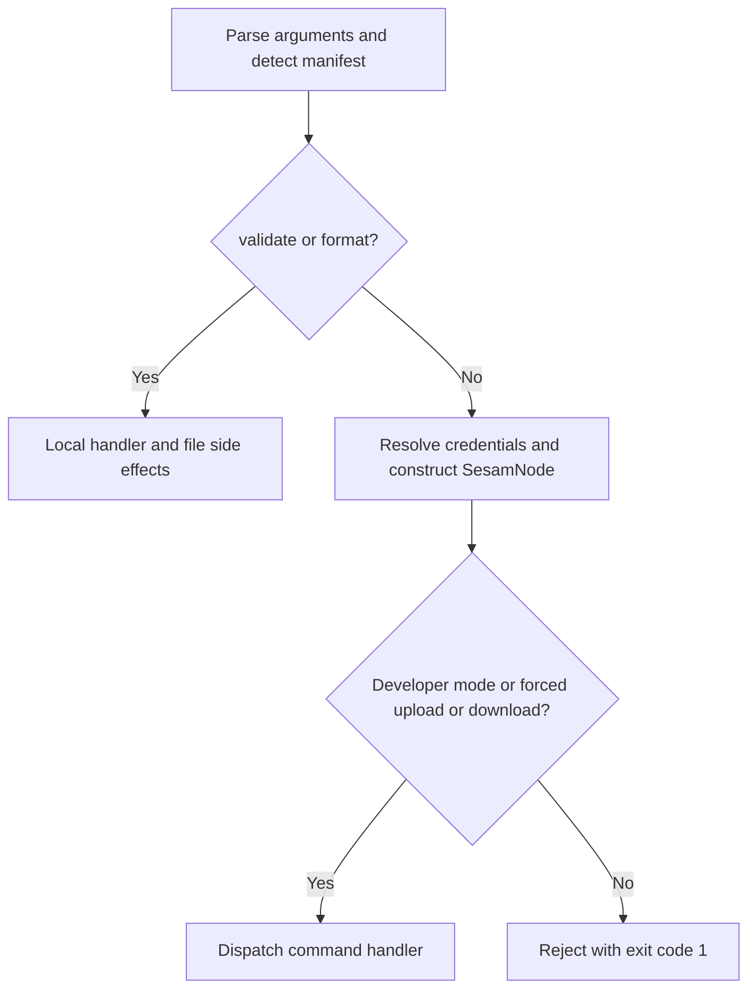

# Sesam client quickstart and task map

This repository is the **Sesam command-line client and connector-development tooling**, not the Sesam runtime or a generic Python SDK. It prepares local configuration, exchanges it with a Sesam node, orchestrates node-side execution and compares published output with local expectations. Connector tooling turns authored manifests and templates into node configuration and reconstructs templates after development. Node access uses the external `sesamclient` dependency. [Sources: `README.md` (L1–12)](../README.md#L1-L12), [`SesamNode.__init__` (L231–272)](../sesam.py#L231-L272), [`SesamCmdClient.test` (L2907–2923)](../sesam.py#L2907-L2923), [`expand_connector` / `collapse_connector` (L121–218)](../connector_cli/connectorpy.py#L121-L218).

## Choose an entry point

| Entry point | What it means here |
| --- | --- |
| `python sesam.py …` | The source CLI. Its `__main__` block parses arguments, establishes context and dispatches to `SesamCmdClient`. Use an absolute script path when launching from another configuration directory. |
| `sesam …` / `sesam.exe …` | The PyInstaller executable built from the same `sesam.py`, with `connector_cli` bundled as data; this is the release-binary route. |
| `connector_cli.connectorpy` functions | Importable operations such as `expand_connector`, `collapse_connector` and `update_schemas`. These are tooling functions with filesystem or node side effects, not installed command aliases. |
| `sesampy` / `connectorpy` | Names used in the connector README's examples. The inspected source does **not** establish installed console entry points or a wheel distribution for them. Do not assume those shell commands exist. |

[`sesam.py`, CLI setup and dispatch (L3345–3382, L3975–3985, L4060–4208)](../sesam.py#L3345-L3382); [`install.sh` (L6–17)](../install.sh#L6-L17); [`connectorpy.py`, expansion and schema operations](../connector_cli/connectorpy.py#L121-L174); [documented names in `connector_cli/README.md` (L3–24)](../connector_cli/README.md#L3-L24).

`pyproject.toml` contains formatting configuration, not packaging metadata. `sitecustomize.py` adds relative connector directories to Python's site path; it does not register shell commands. The accepted main-CLI spelling is **`connector-init`**, despite `connector_init` in the help description. See the [CLI contract](architecture/cli-contract.md) for authoritative command spellings, handlers and side effects rather than treating README examples as a command reference. [Sources: `pyproject.toml` (L1–11)](../pyproject.toml#L1-L11), [`sitecustomize.py` (L1–4)](../sitecustomize.py#L1-L4), [`sesam.py`, command allowlist (L4060–4090)](../sesam.py#L4060-L4090).

## Installation and first inspection

The following are **documented or suggested commands, not commands executed while researching this page**. No dependencies were installed, CLI/login helpers invoked, services contacted or releases built.

- **Release executable:** the installation guide recommends obtaining the OS binary from [GitHub Releases](https://github.com/sesam-community/sesam-py/releases/), unpacking it and making it accessible through `PATH`. Its installation check is `sesam -version`.
- **Source checkout:** the guide documents an isolated Python environment, `pip install -r requirements.txt`, then `python sesam.py -version`. For argument inspection, use `python sesam.py -h` after setting up that environment.
- **Local binary build:** the documented route adds PyInstaller and uses `pyinstaller --onefile --add-data "connector_cli:connector_cli" sesam.py` on Linux/macOS. `install.sh` uses a semicolon data separator on Windows. This is a build operation, not a prerequisite for source use.

[Installation guide (L3–28)](../readme.install.md#L3-L28); [`install.sh` (L6–17)](../install.sh#L6-L17); [`SesamParser` setup (L3345–3382)](../sesam.py#L3345-L3382).

**Coverage is not a minimum-runtime guarantee.** The installation guide's “Python 3.5+” wording is historical. The current PR test and release-build workflows configure Python **3.10** on **Ubuntu 22.04, macOS latest and Windows latest**; that is the checked-in CI matrix, not proof of support for all newer or older Python versions. Follow [troubleshooting and releases](operations/troubleshooting-and-releases.md) for packaging and platform details. [Sources: installation guide (L8–19)](../readme.install.md#L8-L19), [test workflow (L12–29)](../.github/workflows/test.yml#L12-L29), [release workflow (L8–20)](../.github/workflows/build-release-assets.yml#L8-L20).

## Choose the working directory before the command

The **launch directory owns the ordinary working configuration**. `BASE_DIR` captures `os.getcwd()`; it is not the location of `sesam.py`. Most file operations use relative paths, so launching a script elsewhere does not relocate the configuration to the source checkout.

| Local state | Ownership and role |
| --- | --- |
| `pipes/`, `systems/`, `node-metadata.conf.json` | Local node configuration. The ZIP builder collects `.conf.json` files from the two directories and includes metadata when present. |
| `<profile>-env.json` | Profile environment data, read for upload and written on download. `-profile` defaults to `test`, hence `test-env.json`. |
| `testdata/` | Optional upload inputs. JSON filenames identify target pipes; these are separate from the configuration ZIP. |
| `expected/` | Test specifications (`*.test.json`) and expected output. Verification uses these expectations; `update` writes current output into expected files. |
| `manifest.json`, referenced templates, `.expanded/` | Connector authors own the manifest/templates. Expansion generates pipes, systems, metadata and a profile in `.expanded` by default. **Expansion removes and recreates an existing output directory.** |

[Sources: `BASE_DIR` (L36–41)](../sesam.py#L36-L41), [`get_zip_config` / `zip_dir` (L938–1005)](../sesam.py#L938-L1005), [upload profile (L1411–1422)](../sesam.py#L1411-L1422), [testdata upload (L1524–1603)](../sesam.py#L1524-L1603), [download profile (L1714–1721)](../sesam.py#L1714-L1721), [`TestSpec` (L93–217)](../sesam.py#L93-L217), [spec discovery (L1907–1915)](../sesam.py#L1907-L1915), [`expand_connector` (L121–167)](../connector_cli/connectorpy.py#L121-L167), [`-profile` (L3603–3610)](../sesam.py#L3603-L3610).

Connector detection checks for `manifest.json` in `-d` (default `.`); `-e` defaults to `.expanded`. Integrated connector upload changes into the connector directory, expands and validates, then changes into the generated directory to upload. Connector download enters the generated directory and subsequently collapses back into authored templates. Directory changes are command-specific—do not assume every connector operation redirects identically. See [configuration and credentials](concepts/configuration-and-credentials.md) for lookup rules and [connector development](workflows/connector-development.md) for generated-state ownership and round-trip caveats. [Sources: argument defaults (L3809–3825)](../sesam.py#L3809-L3825), [detection (L3975–3979)](../sesam.py#L3975-L3979), [upload dispatch (L4178–4193)](../sesam.py#L4178-L4193), [`download` (L1704–1718, L1787–1793)](../sesam.py#L1787-L1793).

### Minimal placeholder configuration

For an ordinary configuration workspace, a tiny `.syncconfig` skeleton follows the documented format:

```ini
NODE="<node-host>"
JWT="<node-token>"
```

A tiny `test-env.json` profile:

```json
{"node-env": "test"}
```

These are synthetic scaffolding, **not a complete runnable node configuration**. Replace placeholders only in your private working files. The main CLI delegates node/token resolution to `sesamclient.utils.get_node_and_jwt_token`; connector credentials are separate and feed external-service authentication. Read [configuration and credentials](concepts/configuration-and-credentials.md) before choosing argument, environment or file-based credentials, and [connector authentication](integrations/connector-authentication.md) before login or connector upload. Do not paste tokens into shared logs: the CLI's connection-failure message can include the supplied token. [Sources: documented `.syncconfig` format (L5–19)](../readme.usage.md#L5-L19), [profile generation (L133–144)](../connector_cli/connectorpy.py#L133-L144), [credential delegation (L1103–1115)](../sesam.py#L1103-L1115), [`authenticate` (L1144–1216)](../sesam.py#L1144-L1216), [connection error (L4147–4155)](../sesam.py#L4147-L4155).

## Safety boundary at startup



The main CLI's startup gate, not a promise that a local-sounding command is offline. [Source: `sesam.py` (L4092–4177, L4282–4292)](../sesam.py#L4092-L4177).

Only `validate` and `format` bypass node setup in this dispatcher. In particular, `expand`, `init`, `convert` and `dump` still pass through credential/node setup. **Offline does not mean read-only:** `format` rewrites files, and CLI `validate` first expands a connector and therefore needs a manifest; it is not a general validator for an ordinary `pipes/` workspace. Non-offline commands require developer mode unless the command is `upload` or `download` with `-force`. Do not use that override as a quickstart default. [Sources: startup gate (L4100–4166)](../sesam.py#L4100-L4166), [validation dispatch (L4173–4177)](../sesam.py#L4173-L4177), [format writes (L3210–3311)](../sesam.py#L3210-L3311).

## Task map and code ownership

Use these guides for the detailed contracts; this page deliberately does not duplicate the full command table or generated folder indexes.

| Your task | Canonical guide | Primary responsibility |
| --- | --- | --- |
| Determine accepted commands, dispatch, offline behavior or risk | [CLI contract](architecture/cli-contract.md) | `sesam.py`: parser, `SesamCmdClient`, `SesamNode` boundary |
| Choose profiles, configuration files and credentials | [Configuration and credentials](concepts/configuration-and-credentials.md) | Local file readers plus delegated `sesamclient` node/token resolution |
| Authenticate a connector or understand secret/environment updates | [Connector authentication](integrations/connector-authentication.md) | `authenticate` and connector login helpers |
| Upload, download, compare status or synchronize testdata | [Configuration sync](workflows/configuration-sync.md) | ZIP/profile transfer and testdata upload |
| Author templates, expand/collapse or generate schemas | [Connector development](workflows/connector-development.md) | `connector_cli.connectorpy` and integrated connector commands |
| Prepare conditional test sources, extract embedded data or format files | [Local configuration preparation](workflows/local-configuration-preparation.md) | `init`, `convert`, `format`; `jsonformat.py` serialization |
| Run configuration, verify expectations or intentionally update baselines | [Run and verify](workflows/run-and-verify.md) | Scheduler orchestration and `TestSpec`; ordinary `test` uploads, waits for deployment, runs and verifies |
| Recover from failures, administer a node or package a release | [Troubleshooting and releases](operations/troubleshooting-and-releases.md) | Error handling, destructive handlers and build/package workflows |
| Change behavior and select the narrowest meaningful checks | [Change validation](testing/change-validation.md) | Fixture scenarios, Python checks, binary smoke checks and formatting gates |

Ownership anchors: [`sesam.py`, CLI command responsibilities (L3350–3371)](../sesam.py#L3350-L3371), [`get_node_and_jwt_token` / `authenticate` (L1103–1216)](../sesam.py#L1103-L1216), [`test` (L2907–2923)](../sesam.py#L2907-L2923), [`connectorpy.py`, schema workflow (L302–340)](../connector_cli/connectorpy.py#L302-L340), [`install.sh`](../install.sh), [`package.sh`](../package.sh).

**Do not treat `test.sh` as an offline smoke test.** It checks the built binary's help, then runs scenarios against a shared remote CI node. The fair-weather and conversion scripts include destructive reset/wipe operations; the conversion scenario also compares rewritten fixtures. A focused local check such as `tests/fair_weather_test/tests/test_pipe_id.py` checks filenames and configured pipe IDs, not synchronization or scheduler correctness. Follow [change validation](testing/change-validation.md) to distinguish those checks, and preserve the existing [contributor process](../readme.develop.md) and [repository guidance](../AGENTS.md). [Sources: `test.sh` (L7–30)](../test.sh#L7-L30), [fair-weather scenario (L31–42)](../tests/fair_weather_test/run_test.sh#L31-L42), [conversion scenario (L31–57)](../tests/embedded_conversion_test/run_test.sh#L31-L57), [focused pipe-ID check (L6–18)](../tests/fair_weather_test/tests/test_pipe_id.py#L6-L18).
