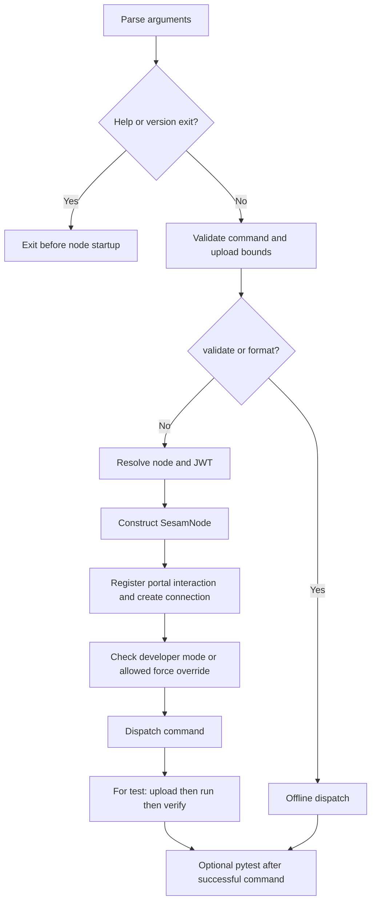

# Change navigation and validation strategy

Start with the behavior being changed, not with a blanket “run the tests.” The repository's authored checks have four different boundaries:

| Check class | What it establishes | What it does not establish |
| --- | --- | --- |
| **Directly inspectable offline fixtures and naming check** | The `before`/`expected_after` conversion contract, JSON/CSV examples, and the assertions in `test_pipe_id()` can be reviewed without a node. The naming function itself only reads local fixture files. | Comprehensive CLI unit coverage, remote execution correctness, or safety of arbitrary pytest suites. |
| **Credentialed remote-node scenarios** | `test.sh` invokes the two authored shell scenarios against one credentialed CI node. They exercise upload/run/verify and selected synchronization/conversion operations. | Isolation from services, exhaustive branch coverage, or permission to run destructive operations on another subscription. |
| **Packaged binary smoke check** | `test.sh` first invokes the PyInstaller executable with `-h`. | Successful command execution, connector authentication, or correctness of every bundled template. |
| **Python lint/format gates** | Black, isort, and flake8 check Python source style through distinct local/hook/CI configurations. | JSON fixture semantics, scheduler behavior, or remote data correctness. |

These boundaries come from [the test driver](../../test.sh#L3-L32), [the build script](../../install.sh#L1-L17), [the naming check](../../tests/fair_weather_test/tests/test_pipe_id.py#L6-L18), and the [hook configuration](../../.pre-commit-config.yaml#L1-L22). This page records source-inspected coverage, not a fresh passing test run. No CLI commands, scenario scripts, dependency installers, binary builds, expected-file updates, or service calls were executed during research.

## Follow startup before calling anything “local”

`SesamParser` owns error reporting and exit code 2; argument definitions and dispatch live in `sesam.py`'s `__main__` block. The command positional argument is a list: dispatch lowercases its first element and treats the remaining elements as command arguments. Unknown or absent commands exit 1. Worker/rate bounds are validated after parsing, independently of the selected command. See [parser behavior](../../sesam.py#L86-L90), [command arguments](../../sesam.py#L3756-L3761), and [startup/dispatch](../../sesam.py#L3975-L4101).

*Startup determines the network boundary before the selected command body runs; the test chain is one dispatch branch.*

Only `validate` and `format` are marked offline by startup. Commands such as `convert`, `dump`, `expand`, and `run-pytest` still resolve credentials, construct `SesamNode`, and check the node's API information before dispatch. Node construction decodes the JWT and attempts to register a portal interaction when it can identify a subscription, before creating the API connection. Thus a filesystem-oriented command body is not evidence that its CLI invocation is offline. [Offline gate and connection](../../sesam.py#L4100-L4166), [node initialization](../../sesam.py#L234-L272), [interaction registration](../../sesam.py#L312-L337).

`validate` is network-offline, but it is not read-only: dispatch expands connector configuration first. Expansion deletes and recreates the expanded directory. Likewise, appending `-run-pytest` to an offline command does not make user tests offline. `run_pytest_tests()` calls `pytest.main()` with the folder plus whitespace-split `-pytest-args`; it cannot constrain service calls or other side effects inside those tests. [Validation dispatch](../../sesam.py#L4167-L4177), [expansion lifecycle](../../connector_cli/connectorpy.py#L121-L144), [pytest runner](../../sesam.py#L2925-L2954), [post-command pytest](../../sesam.py#L4278-L4281).

For the broader command boundary, see [CLI contract](../architecture/cli-contract.md); for credential resolution, see [Configuration and credentials](../concepts/configuration-and-credentials.md).

## Ownership and nearest-check matrix

“Exercised” below means the authored scenario reaches the behavior with its particular fixtures and flags. It is not a claim that all failure modes have regression coverage. Proposed checks are collected separately below.

| Changed behavior | Owning code and mechanism | Nearest authored check and coverage limit |
| --- | --- | --- |
| Parser and dispatch | `SesamParser.error`, argument definitions, and `__main__` command gate/dispatch in [sesam.py](../../sesam.py#L3345-L3374), [parsing and bounds](../../sesam.py#L3947-L3990), [dispatch](../../sesam.py#L4044-L4304). | Binary `-h` reaches parser help; scenario invocations exercise their listed flags/commands. No authored parser error/exit-code suite. |
| Configuration lookup and local packaging | `parse_config_file()` tries JSON, then INI with a prepended `[sesam]`; `read_config_file()` searches the current directory and parents. `get_node_and_jwt_token()` delegates node/JWT resolution to `sesamclient.utils`. `zip_dir()` filters `.conf.json` paths against the whitelist and substitutes non-connector Jinja variables. [Lookup](../../sesam.py#L868-L931), [ZIP creation](../../sesam.py#L938-L1005), [credential delegate](../../sesam.py#L1103-L1115). | Fair-weather supplies explicit node/JWT and a whitelist. Its `-sesamconfig-file` invocation is not proof of custom style lookup. Parent search, malformed configs, and Jinja replacement are not asserted by the naming test. |
| Upload sequencing and partial failure | `SesamCmdClient.upload()` reads the profile, overlays parent `.additional_parameters.json`, replaces remote env, packages/adjusts metadata, uploads config, waits for deployment, then sends testdata. [Upload](../../sesam.py#L1411-L1592). | Both scenarios use `test`; conversion supplies separate testdata. Neither deliberately injects config validation or partially failed uploads. These writes are not transactional. |
| Upload workers, rate, and retries | `get_testdata_jobs()`, `upload_testdata()`, rate/retry helpers and `TestDataUploadException`: recursive JSON discovery, filename-derived receiver ID, bounded executor or sequential path, shared rate lock, retry classification. [Workers and jobs](../../sesam.py#L1528-L1603), [request/retry helpers](../../sesam.py#L1605-L1695). | Conversion exercises ordinary default testdata uploads. It does not select sequential upload, positive rate limiting, Decimal parsing, or induced transient failures. |
| Scheduler requests and lifecycle | `run()` stops an existing scheduler, then `run_internal_scheduler()` uses a worker thread and validates mode values. `SesamNode.run_internal_scheduler()` maps options into POST query parameters on `/pipes/run-all-pipes`; status/log/stop requests have separate endpoints. [Node requests](../../sesam.py#L561-L643), [runner](../../sesam.py#L2895-L3101). | Both scenarios request scheduler logs and use the default synchronous request mode. The conversion scenario's deprecated `-use-internal-scheduler` flag does not select a separate implementation. Async polling and failure responses lack focused authored assertions. |
| TestSpec selection, filtering, and comparison | `TestSpec` defines defaults and expected files; `load_test_specs()` selects specs and validates references. `filter_entity()` removes internal and blacklisted fields; `verify()` sorts/normalizes JSON entities, while CSV and other non-JSON/non-XML endpoints compare bytes. [Spec contract](../../sesam.py#L93-L228), [selection/filtering](../../sesam.py#L1880-L2011), [comparison](../../sesam.py#L2069-L2368). | Fair-weather covers default JSON and explicit CSV specs; conversion covers one default JSON output. Not XML, custom sort keys, blacklist patterns, delete-policy variants, ignored specs, or missing-test errors. |
| Expected/config synchronization | `update()` fetches current output and writes expected files; `download()` rewrites profile/config and optionally saves a normalized ZIP; `status()` reports differences. [Update](../../sesam.py#L2792-L2893), [download](../../sesam.py#L1704-L1793), [status](../../sesam.py#L1795-L1878). | Fair-weather invokes all three. It only explicitly asserts ZIP existence after download; status differences are logged, not converted into a failure by `status()`. |
| JSON formatting | `FormatStyle`, `format_json()`/`format_object()` own convention-based key ordering and whitespace; serialization preserves Unicode with `ensure_ascii=False`. `SesamCmdClient.format()` uses a separate expected-file path with sorted keys and Unicode/HTML-escape options. [Formatter](../../jsonformat.py#L9-L144), [CLI formatting](../../sesam.py#L3233-L3305). | Conversion's directory diff checks the formatter output used during conversion. Fair-weather download formats a ZIP but asserts only its existence. No standalone authored format/style-option suite; Python Black/isort are different gates. |
| Embedded-source conversion | `SesamCmdClient.convert()` selects only the conditional source's current-profile embedded alternative, replaces it with `http_endpoint`, and extracts entities using the JSON `_id`. [Conversion](../../sesam.py#L3175-L3231). | `embedded_conversion_test`: selected alternatives, untouched cases, case-sensitive IDs, and Unicode are checked by the whole-tree diff. |
| Connector expansion and collapse | `render()` handles boolean substitutions; `expand_connector_config()` renders manifest templates and shims. `expand_connector()` recreates generated files; `collapse_connector()` excludes shims/reused datatype templates and reverses placeholders by best-effort string replacement. Connector upload expands/validates/authenticates; connector download collapses. [Rendering/expansion](../../connector_cli/connectorpy.py#L15-L167), [collapse](../../connector_cli/connectorpy.py#L170-L299), [callers](../../sesam.py#L1787-L1793), [connector upload](../../sesam.py#L4178-L4193). | Neither authored shell fixture is a connector manifest scenario. The `test` dispatch directly calls `test()`, not the connector-specific upload prelude. No demonstrated round-trip or permission-rewrite check. |
| Schema generation | `connectorpy.update_schemas()` attempts to enable inference, waits for deployment, runs collect pumps, fetches live sink entity types, creates manual null-property files when absent, merges manual overrides, and writes `schema.csv`. [Schema pipeline](../../connector_cli/connectorpy.py#L302-L424), [CSV output](../../connector_cli/connectorpy.py#L436-L542), [dispatch](../../sesam.py#L4196-L4198). | No authored scenario invokes `update-schemas`. This is both a remote-node operation and a local output writer, not merely a JSON transformation. |
| Authentication | `authenticate()` dispatches from manifest auth/variant, reads `.authconfig` or arguments, and calls OAuth, API-key/JWT, or Tripletex helpers. OAuth starts a local Flask callback server but exchanges tokens remotely and writes node secrets/env. [Auth dispatch](../../sesam.py#L1131-L1216), [OAuth callback/server](../../connector_cli/oauth2login.py#L66-L237), [other helpers](../../connector_cli/api_key_login.py#L7-L49), [Tripletex](../../connector_cli/tripletexlogin.py#L10-L82). | No authored connector-auth scenario. Help/import smoke is not authentication coverage. System selection, external failures, token handling, and callback shutdown need separate checks. |

## What the authored scenarios actually do

### CI execution boundary

[Integration CI](../../.github/workflows/test.yml#L1-L48) runs Python **3.10** on **Ubuntu 22.04**, **macOS (`macos-latest`)**, and **Windows (`windows-latest`)**. It is triggered by pull requests changing Python files, `requirements.txt`, or that workflow. Workflow concurrency is `sesam_py_environment`; matrix `max-parallel: 1` serializes OS jobs because they share the same credentialed node. Do not parallelize these jobs merely because the OS environments differ.

`install.sh` installs PyInstaller/runtime requirements and builds a one-file executable with `connector_cli` data, using platform-specific data separators. `test.sh` selects `dist/sesam` or `dist/sesam.exe`, checks `-h`, exports the configured CI node URL and token, and invokes `run_test.sh` in each non-symlink directory under `tests`. Shell scenarios and fixture-only changes are not explicitly included in the integration workflow's path filter. [Build](../../install.sh#L1-L17), [driver](../../test.sh#L3-L32).

**Safety:** the scenarios deliberately reset or wipe remote state and use TLS-verification bypass on many calls. This is an explanation of credentialed CI behavior, not a recipe for an arbitrary subscription. Startup permits these commands only in developer mode; the non-developer `-force` exception is limited to upload/download. `reset` delegates to a database reset/restart and waits for a changed start time; `wipe` stops scheduling, replaces config with empty config, clears env, and waits for pipes to disappear. [Developer gate](../../sesam.py#L4158-L4166), [reset request/wait](../../sesam.py#L406-L433), [wipe/reset commands](../../sesam.py#L3103-L3160).

### Fair-weather: JSON, CSV, whitelist, and synchronization

The complete [fair-weather scenario](../../tests/fair_weather_test/run_test.sh#L1-L49) has `set -e`, a 15-second initial sleep, and a shell `retry` helper allowing **three total attempts**, with 15 seconds between failures. It resets the node, sleeps five more seconds, then runs:

1. `test` with scheduler logs, `whitelist.txt`, and post-command pytest from `tests`.
2. `update`, then `status`.
3. `download` with `-dump` and `-sesamconfig-file .mysesamconfig.json`.
4. Another reset, followed by an explicit `sesam-config.zip` existence check.

The [whitelist](../../tests/fair_weather_test/whitelist.txt#L1-L4) includes metadata, `input-pipe1`, `output-pipe1`, and `output-pipe-csv`, excluding [foo.conf.json](../../tests/fair_weather_test/pipes/foo.conf.json#L1-L11). The excluded pipe even contains the note “I am not in the whitelist.” ZIP filtering means it is not uploaded during the whitelisted `test`; the later `update`, `status`, and `download` invocations do **not** carry that whitelist flag.

[Input entities](../../tests/fair_weather_test/pipes/input-pipe1.conf.json#L1-L15) contain `test1` and `test2`. The [JSON output spec](../../tests/fair_weather_test/expected/output-pipe1.test.json#L1-L3) leaves the default endpoint/file behavior intact and expects those two entities. The [CSV spec](../../tests/fair_weather_test/expected/output-pipe-csv.test.json#L1-L5) explicitly selects `endpoint: csv` and `output-pipe-csv.csv`; the [sink](../../tests/fair_weather_test/pipes/output-pipe-csv.conf.json#L1-L13) selects `_id` and `name` columns. The [CSV expected file](../../tests/fair_weather_test/expected/output-pipe-csv.csv#L1-L3) includes the header and two rows with CRLF line endings. Its comparison is byte-level, not CSV-aware normalization.

`test()` uploads, runs for `args.runs`, and verifies before the dispatch-level pytest hook. The one [test_pipe_id.py](../../tests/fair_weather_test/tests/test_pipe_id.py#L6-L18) function then checks that top-level pipe fixture filenames and JSON `_id` values contain **no underscores**. It checks neither filename/ID equality nor lowercase naming and does not call CLI functions. It establishes a fixture naming invariant, not comprehensive CLI unit coverage.

This scenario is mutating: `update()` writes expected output and can create/remove specs or expected files; `download()` rewrites the profile and replaces local config even with `-dump`. There is no final fixture-tree diff here. Passing `status` is also not an equality assertion: it logs mismatches without raising for them. The custom style fixture exists, but `sesamconfig_file` is only parsed in current `sesam.py`; formatting calls use `format_json()` defaults. Do not treat this invocation as exercised custom-format-style support. [Spec maintenance](../../sesam.py#L1907-L2011), [writes](../../sesam.py#L2792-L2893), [download](../../sesam.py#L1714-L1785), [style flag](../../sesam.py#L3722-L3729).

### Embedded conversion: whole-tree expected output

The complete [conversion scenario](../../tests/embedded_conversion_test/run_test.sh#L1-L58) uses the same three-attempt/15-second shell retry policy and initial 15-second sleep. It removes/recreates `test_after`, copies **all authored `before/*` content**, enters that copy, wipes the node, converts, runs upload/run/verify with scheduler logs, resets, then compares `expected_after/` against `test_after/` with `diff -r`. Both diff-result branches remove the scratch directory; a mismatch exits 1. `set -e` can abort earlier, so neither scratch cleanup nor remote reset is guaranteed after every failure—there is no cleanup trap.

The fixture contract is more specific than “convert embedded sources”:

- `input-pipe-1`, `input-pipe-2`, `Input-Pipe-3`, and `input-pipe-norwegian` have conditional **test** alternatives containing embedded entities. Only that selected alternative becomes `http_endpoint`; their **prod** dataset alternatives remain unchanged. Compare [before input 1](../../tests/embedded_conversion_test/before/pipes/input-pipe-1.conf.json#L1-L30) with [after input 1](../../tests/embedded_conversion_test/expected_after/pipes/input-pipe-1.conf.json#L1-L17).
- [A direct HTTP endpoint](../../tests/embedded_conversion_test/before/pipes/input-pipe-to-be-left-alone.conf.json#L1-L7) and [an already-HTTP conditional test alternative](../../tests/embedded_conversion_test/before/pipes/input-pipe-to-be-also-left-alone.conf.json#L1-L17) remain untouched. The nested SMTP system, metadata, and expected output/spec are also retained in the authored trees; they are part of the directory comparison, not permission to discard unrelated fixture content.
- The lowercase configuration filename `input-pipe-3.conf.json` holds `_id: Input-Pipe-3`, and the extracted file is [testdata/Input-Pipe-3.json](../../tests/embedded_conversion_test/expected_after/testdata/Input-Pipe-3.json#L1-L16). Similarly, `input-pipe-with-norwegian-characters.conf.json` holds `_id: input-pipe-norwegian`. Conversion keeps the configuration path but names testdata from JSON `_id`; upload derives the receiver ID from that testdata filename. Preserve these intentional differences.
- The Norwegian pipe retains [description `øæå`](../../tests/embedded_conversion_test/expected_after/pipes/input-pipe-with-norwegian-characters.conf.json#L1-L18), and the [extracted names](../../tests/embedded_conversion_test/expected_after/testdata/input-pipe-norwegian.json#L1-L7) remain literal Unicode. UTF-8 reads/writes and `format_json()`'s `ensure_ascii=False` support this contract.
- The only output spec targets [output-pipe](../../tests/embedded_conversion_test/before/expected/output-pipe.test.json#L1-L3), whose [dataset source](../../tests/embedded_conversion_test/before/pipes/output-pipe.conf.json#L1-L11) is `input-pipe-1`. The whole-tree diff checks all selected extractions, but remote output verification does not independently assert downstream results for every extracted pipe.

Keep both authored fixture trees complete. The scratch copy is the scenario's mutation target; silently updating `expected_after` to match a changed converter would erase the regression signal.

## Mechanisms that need focused regression checks

The following are **proposals**, not existing coverage. Use temporary directories and fake node/API/session objects; patch clocks, sleep, randomness, and HTTP/process boundaries as needed. Call isolated helpers instead of assuming CLI startup is offline.

| Priority area | Source-grounded risk | Proposed regression check |
| --- | --- | --- |
| Parser and inert flags | Current `-sesamconfig-file`, `-use-internal-scheduler`, `-scheduler-node`, and `-compact-execution-datasets` destinations have no behavior-reading consumers in `sesam.py`. Scheduler execution always uses the internal runner. | Assert error/exit contracts and worker/rate bounds without node access. Assert compatibility no-ops explicitly, or deliberately add behavior and new tests; accepting a flag alone is not coverage. |
| Partial uploads and scheduling order | Env/config changes precede testdata. Parallel upload collects failures after completing futures and raises `TestDataUploadException`; sequential upload stops at the first exception. Successful earlier writes are not rolled back. Defaults are eight workers, unlimited rate, and three retries after the initial request. | Fake mixed success/failure jobs; assert aggregation versus sequential fail-fast, deployment-before-data, and that a failed `test()` never reaches run/verify. Assert request spacing across workers, 429/5xx/transport retries, permanent 4xx failure, retry exhaustion, Decimal parsing, and filename/whitelist selection. |
| Retry timing | Per-file request retries use exponential delay plus jitter and the shared rate limiter for every attempt. The shell helper separately retries the **whole command**. The parallel success message says “Waiting 5 seconds” but that branch contains no matching sleep. | Patch time/randomness and assert actual delays and call counts, rather than testing the log text. Distinguish per-request attempts from scenario-level retries and repeated remote writes. |
| Scheduler request/status branches | Sync success/failure and async token/status paths differ. Async polls every ten seconds, registers interactions, and fails on missing tokens or `not-running`. `testdata` directory presence suppresses input-dataset deletion. | Capture POST parameters, stop-before-run ordering, mode validation, tokens/status failures, log cursors, and input-deletion selection with fake sessions. The authored scripts do not exercise async mode. |
| TestSpec normalization and XML helper mismatch risk | JSON filtering retains `_id` and true `_deleted`, strips other underscore fields, and applies blacklist patterns. XML has a separate header helper and broad fallback to byte comparison. `find_xml_header_settings()` computes a quote index on `arg[1:]` but slices `arg[1:endix]`, dropping the final character of a quoted standalone value; it returns a string passed through to serialization. Current consumers unpack the same two values—there is no tuple-arity mismatch in this source. | Table-test nested blacklists, delete policies, custom sort keys, large-number normalization, no/missing/ignored specs, and JSON versus bytes. Test XML declarations, single/double quotes, standalone values, malformed XML, and helper/serializer agreement so fallback cannot conceal a header-handling mismatch. [XML helper and consumers](../../sesam.py#L2019-L2046), [fallback](../../sesam.py#L2256-L2304), [header extraction](../../sesam.py#L2370-L2394), [XML update](../../sesam.py#L2865-L2880). |
| Conversion and JSON formatting | Conversion searches top-level pipe configs and only the selected conditional embedded alternative. Expected JSON formatting differs from convention-formatted configs/testdata; key ordering, strings/escapes, and Unicode are separate concerns. | Preserve the authored examples; add temporary fixtures for other profiles, direct embedded sources, missing alternatives/entities, nested files, reruns, escape sequences, and format idempotence. Treat new profile/malformed-input behavior as a deliberate extension, not implied coverage. |
| Expansion/collapse and schemas | Expansion deletes existing generated state; collapse uses best-effort string replacement and skips reused templates. Schema generation touches live metadata/pumps and writes manual/merged/CSV output. | Fake manifest/template round-trips with booleans, parents, reused templates, webhook permissions, and custom directories. Fake missing/empty collect schemas, manual null overrides, inference metadata with/without `global_defaults`, and shallow object/array CSV cases. |
| Connector auth scope and failure | OAuth callback and API-key helper iterate **all systems** and write the same secrets, whereas Tripletex selects `system_placeholder`. OAuth updates env after token/secrets handling and has an event/thread/process shutdown path. None is covered by the two scenarios. | Use Flask request contexts and fake HTTP/node/system objects to assert intended target scope, scopes/optional scopes in authorization URLs, token/identity errors, refresh-token policy, account overrides, partial secrets/env failures, and teardown. Stub `lsof`, signals, and thread/server boundaries; do not contact providers or start a real login during regression research. |

Sources for these proposals are the matrix owners, [upload defaults](../../sesam.py#L828-L836), [rate/retry implementation](../../sesam.py#L1605-L1675), [scheduler branches](../../sesam.py#L2956-L3098), [OAuth target writes](../../connector_cli/oauth2login.py#L121-L151), [API-key target writes](../../connector_cli/api_key_login.py#L11-L31), and [Tripletex target selection](../../connector_cli/tripletexlogin.py#L39-L45). See [Run and verify](../workflows/run-and-verify.md), [Connector development](../workflows/connector-development.md), and [Connector authentication](../integrations/connector-authentication.md) for operational context.

## Keep style gates separate and non-destructive during review

There are three distinct version/configuration layers:

| Layer | Actual configuration |
| --- | --- |
| Developer requirements | [dev-requirements.txt](../../dev-requirements.txt#L1-L4): `black==25.1.0`, `flake8==7.3.0`, `isort==6.0.1`, `pre-commit==4.3.0`. |
| Pinned pre-commit hooks | [.pre-commit-config.yaml](../../.pre-commit-config.yaml#L1-L22): Black revision `23.3.0`, isort `5.12.0`, flake8 `6.0.0`, with commit-stage Python hooks. These are not the developer-requirements versions. |
| flake8 CI | [flake8.yml](../../.github/workflows/flake8.yml#L1-L26): Python 3.10 on `ubuntu-latest`, Python-file pull requests targeting `master`, using `py-actions/flake8@v2` with maximum line length 100 and ignores `E203, E231, W503, W605`. The action revision is not a pinned flake8 package version. |

[pyproject.toml](../../pyproject.toml#L1-L11) sets Black/isort line length 100 and isort's Black profile; it also contains a flake8 table. [setup.cfg](../../setup.cfg#L1-L14) supplies flake8's line length/ignores and exclusions including `venv`, `pipes`, `systems`, editor files, and caches. Do not collapse these distinct settings into a claim that all environments use the same tool releases.

Hook installation is itself mutating. [.pre-commit/install.sh](../../.pre-commit/install.sh#L2-L13) removes existing `.git/hooks/pre-commit.d` and `.git/hooks/pre-commit`, recreates the directory, and installs the wrapper. The [wrapper](../../.pre-commit/pre-commit.default#L9-L24) checks staged Python paths, may install `dev-requirements.txt` when `pre-commit` is absent, installs hooks (including `commit-msg`), moves generated/legacy hook paths, and runs the Python hook. Review this behavior without running the installer or replacing contributors' existing hooks merely to investigate a change.

For behavior changes, choose the matrix owner and nearest authored case first, identify uncovered branches, and add isolated regression proposals where appropriate. Treat expected-file rewrites, connector expansion, and remote resets as separate state-changing operations—not as harmless validation gates. Related context: [Configuration sync](../workflows/configuration-sync.md), [Local configuration preparation](../workflows/local-configuration-preparation.md), and [Troubleshooting and releases](../operations/troubleshooting-and-releases.md).
