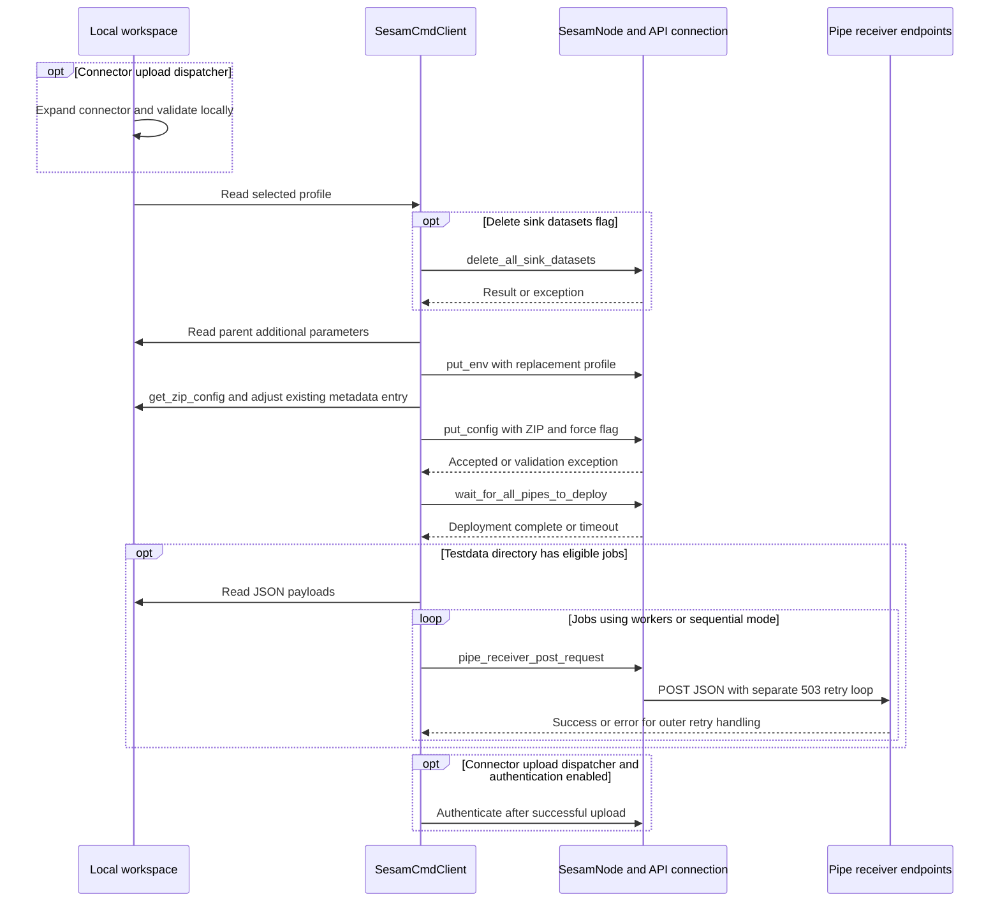

# Upload, download, status and testdata synchronization

Synchronization has **three separate data channels**, not one backup/restore package:

| Channel | Local representation | Node boundary |
| --- | --- | --- |
| Configuration | `pipes/**/*.conf.json`, `systems/**/*.conf.json`, optional `node-metadata.conf.json` | ZIP passed through `SesamNode.put_config()` to `api_connection.upload_config()` |
| Environment profile | `<profile>-env.json`, default `test-env.json` | `SesamNode.put_env()` / `get_env()` delegate to environment-variable APIs |
| Testdata | JSON files recursively discovered below `testdata/` | POST payloads to individual pipe receiver endpoints, after configuration deployment |

`upload` replaces node configuration from local files; `download` replaces local files from the node; `status` compares the two. Profiles and testdata are **not members of the configuration ZIP**, and download does not retrieve receiver testdata. The default profile is `test`; a path-valued profile such as `profiles/prod` means `profiles/prod-env.json`, relative to the command's working directory. [Sources: synchronization methods](../../sesam.py#L1411-L1878), [ZIP membership](../../sesam.py#L981-L1005), [node API wrappers](../../sesam.py#L435-L445), [profile usage](../../readme.usage.md#L500-L511).

This page describes the implementation, not an invitation to run it against a node. Back up local work and check the target before any replacement. There is no transaction or rollback orchestration here, and receiver retries do not establish idempotency.

## Entry points and synchronization order

The CLI detects connector mode from `manifest.json` under `args.connector_dir`. A regular-config `upload` directly calls `SesamCmdClient.upload()`. Connector upload first changes directory, expands the connector, validates it locally, then uploads from the expanded directory; authentication follows a successful upload unless `-skip-auth` is set. See [Connector development](connector-development.md) for dispatcher-specific expansion, validation and authentication, and [Connector authentication](../integrations/connector-authentication.md) for external-service credentials. `test()` also calls `upload()`, waits for deployment again, then runs and verifies; it is not itself the connector-upload dispatcher branch. [Sources: mode detection](../../sesam.py#L3975-L3978), [dispatch](../../sesam.py#L4173-L4213), [test composition](../../sesam.py#L2907-L2923).

The dispatcher normally requires a developer subscription. `-force` permits `upload` and `download` on a non-developer subscription; upload also forwards it to the backend configuration API. It does not create a safety boundary around a subset of files. Target resolution and the broader command contract belong in [CLI contract](../architecture/cli-contract.md) and [Configuration and credentials](../concepts/configuration-and-credentials.md). [Sources: target resolver](../../sesam.py#L1103-L1115), [developer-mode gate](../../sesam.py#L4157-L4166), [rejection and exit handling](../../sesam.py#L4282-L4304).

*Synchronization sequence: local preparation precedes optional destructive cleanup, environment replacement, configuration upload, deployment waiting and separate receiver uploads.* [Sources: upload ordering](../../sesam.py#L1411-L1592), [receiver requests](../../sesam.py#L785-L812), [connector dispatcher](../../sesam.py#L4178-L4193).

## Building the configuration ZIP

`get_zip_config(remove_zip=True)` deletes an existing `sesam-config.zip`, creates a new deflated archive, calls `zip_dir()` for `pipes` and `systems`, optionally includes root `node-metadata.conf.json`, reads the archive into bytes, and normally deletes the disk file. `zip_dir()` uses `os.walk()`, so upload discovery is recursive, but only `.conf.json` files qualify. ZIP names retain their directory paths; it does not flatten nested files. Whitelist checks compare normalized forward-slash paths against the file list. Metadata has a separate inclusion check: it must exist and either the file list is falsy or it explicitly contains `node-metadata.conf.json`. [Sources: ZIP construction and filtering](../../sesam.py#L938-L1005).

For **regular configuration**, `zip_dir()` reads file text and performs regex substitution of `{{@ variable @}}` placeholders with values from `.jinja_vars`, without changing the original file. Connector mode writes configuration files directly into the ZIP because expansion is handled elsewhere. Root node metadata is also written directly, not through that substitution path. This is textual substitution, not a general-purpose template renderer or JSON validator. See [Local configuration preparation](local-configuration-preparation.md). [Sources: substitution](../../sesam.py#L938-L963), [metadata membership](../../sesam.py#L993-L995), [loading `.jinja_vars`](../../sesam.py#L4117-L4134).

### What `sesam-config.zip` means

| Operation | Disk artifact behavior |
| --- | --- |
| Normal upload | Temporary local archive is removed after being read into memory. |
| Upload with `-dump` | Retains the initially constructed local archive. Metadata adjustments happen afterward in memory, so this file is **not necessarily the exact submitted ZIP**. |
| `dump` | Calls `get_zip_config(remove_zip=False)` to retain a local configuration archive. |
| Download with `-dump` | Replaces the disk archive with remote configuration after metadata normalization and JSON formatting; **still deletes and extracts local configuration afterward**. |
| Status with `-dump` | First constructs/deletes the temporary local archive, then writes the remote archive after metadata normalization, without formatting every member. |

Profiles, credentials files, testdata and expected outputs are not included by this builder. Neither a local dump nor a downloaded ZIP is a complete synchronization-state backup. [Sources: builder](../../sesam.py#L981-L1005), [upload metadata changes](../../sesam.py#L1464-L1510), [dump/download](../../sesam.py#L1697-L1768), [status dump](../../sesam.py#L1812-L1825).

## Node-metadata adjustments and restoration

Upload reads local `node-metadata.conf.json` if present, otherwise starts from `{}`, and computes these changes **in the ZIP bytes**, leaving the local metadata file unchanged:

| Setting | Upload rule |
| --- | --- |
| `task_manager.disable_user_pipes` | `True` by default, `False` with `-enable-user-pipes` |
| `global_defaults.eager_load_microservices` | `False` by default, `True` with `-enable-eager-ms` |
| `global_defaults.enable_cpp_extensions` | Set to `False` only with `-disable-cpp-extensions`; otherwise the existing value is left alone |

The computed object is passed to `replace_file_in_zipfile()`. **That helper replaces an existing matching entry only; it never adds a missing entry.** If metadata was absent locally or excluded from the archive by a whitelist, these computed scheduling/microservice/C++ changes are not inserted into the submitted archive. [Sources: upload adjustments](../../sesam.py#L1468-L1510), [replace helper](../../sesam.py#L1017-L1032).

Both download and status call `remove_task_manager_settings()` on the remote ZIP before using it. Despite its name, it also handles the two `global_defaults` settings. It reads the *current local metadata file* as the baseline, then normalizes only remote values matching these cases:

- `disable_user_pipes is True`;
- `enable_cpp_extensions is False`;
- `eager_load_microservices is False`.

For each, it restores the local value if that key exists locally; otherwise it removes the key and removes an emptied enclosing section. The opposite values are not normalized, so enabling user pipes or eager microservices can remain visible in download/status. If remote metadata is absent, the ZIP is returned unchanged. This is local-baseline normalization, not recovery of a stored pre-upload snapshot. [Source: restoration rules](../../sesam.py#L1034-L1101).

**Current edge case:** removing the only `global_defaults` key when it is `enable_cpp_extensions: false` deletes that section, but the following eager-microservice check still indexes it. That archive can raise `KeyError` rather than complete normalization. The normalizer should not be treated as unconditional round-trip restoration. [Source: section removal and subsequent access](../../sesam.py#L1061-L1092).

## Upload replacement and failure boundaries

`upload()` first reads `<profile>-env.json` using `utf-8-sig`, accepting a UTF-8 BOM. A missing or malformed profile raises before the upload method deletes datasets or replaces environment variables. With `-upload-delete-sink-datasets`, it then calls `api_connection.delete_all_sink_datasets()` and fails immediately if that call raises. This is deletion of **all sink datasets**, not a whitelist-scoped cleanup or an entire database reset. The flag's help warns that old data/config can still affect the new test run compared with wipe/reset. [Sources: profile and deletion](../../sesam.py#L1411-L1437), [flag help](../../sesam.py#L3590-L3601).

Next it reads `../.additional_parameters.json` if present, overlays those values onto the profile, warns for overwritten keys, and calls `put_env()`. The path is relative to the current upload working directory—normally the connector root when uploading from `.expanded`, but the parent of the working directory for regular upload. It does not merge the fetched remote environment: it submits the assembled replacement object to `put_env_vars()`. Only after this step does it build/adjust the ZIP and call `put_config()`, which forwards the archive and `force` to `upload_config()`. [Sources: overlay and replacement](../../sesam.py#L1439-L1466), [configuration call](../../sesam.py#L1515-L1522), [API delegation](../../sesam.py#L435-L445).

### Local validation is not backend validation

Offline `validate` is a connector-oriented expansion/consistency path: the dispatcher expands first, and `validate()` checks template sink constraints and expanded JSON/connector conventions. The connector upload dispatcher invokes that before `upload()`; regular upload does **not** invoke this offline validator. Backend validation happens separately when `put_config()` calls the API. Passing local checks is not evidence that the backend will accept the archive. [Sources: offline classification](../../sesam.py#L4100-L4103), [validation implementation](../../sesam.py#L1218-L1409), [validation/upload dispatch](../../sesam.py#L4173-L4193).

If the backend exception has `parsed_response`, upload wraps its `validation_errors` list in `UploadException`; otherwise it rethrows the original exception. The report is framed by validation headers and derives each identifier from `posted-config._id`. With no verbosity flag it can contain only those headers. Its `if/elif` reporting order is:

- `-v`: critical `config-errors` whose `level` is `error`, when present;
- `-vv`: the complete `config-errors` list, when present;
- `-vvv`: the complete validation-error record, when present.

When flags are combined, earlier matching branches win. The dispatcher logs `UploadException` and exits with status 1. **Earlier sink deletion and environment replacement may already have succeeded**; there is no compensating code after ZIP creation or config-validation failure. [Sources: wrapping](../../sesam.py#L1515-L1522), [validation report](../../sesam.py#L49-L72), [exit handling](../../sesam.py#L4293-L4304).

After config acceptance, `wait_for_all_pipes_to_deploy()` checks user pipes whose runtime state is `Deploying`, excluding system/search/replica/storage-origin and `:singlenode` pipes. It tries a zero-timeout deployment check on one pipe, refreshes the list after success, and sleeps five seconds per loop. Its default timeout is 30 minutes; it raises `RuntimeError` on a still-failing check after the timeout. It does not run the configuration to stability or undo acceptance. Testdata starts only after this wait returns, so a timeout leaves config/env possibly installed without receiver uploads. [Sources: deployment wait](../../sesam.py#L274-L310), [user-pipe filter](../../sesam.py#L339-L358), [upload continuation](../../sesam.py#L1524-L1529). See [Run and verify](run-and-verify.md) for execution after synchronization.

## Testdata: mapping, concurrency and retries

`get_testdata_jobs()` recursively walks `testdata/`, accepts filenames ending in `.json` case-insensitively, and derives the target pipe ID by removing the extension from the **basename**. For example, `testdata/nested/Input-Pipe-3.json` targets `Input-Pipe-3`, preserving case; the subdirectory is not part of the ID. This mapping does not read `_id` from a configuration file. Duplicate basenames in different directories can target the same receiver, with no deterministic cross-job ordering in parallel mode. A nonempty `whitelisted_pipes` list filters these jobs; an empty pipe list does not. [Source: job discovery](../../sesam.py#L1594-L1603).

`upload_testdata()` reads each file as UTF-8 JSON. Floating-point literals parse as `float` by default, or `Decimal` with `--do-float-as-decimal`; it then passes the loaded payload as `json=entities_json` to `pipe_receiver_post_request()`. A JSON `null` payload returns without a POST, but the caller still counts the returned job as uploaded. JSON/file parsing occurs outside the receiver retry loop. The receiver resolves the pipe and raises if it does not exist; it does not locally validate that the payload's target is an input pipe. [Sources: payload loading](../../sesam.py#L1605-L1641), [receiver resolution](../../sesam.py#L785-L812), [decimal option](../../sesam.py#L3918-L3925).

### Parallel completion versus sequential failure

- Default mode uses a `ThreadPoolExecutor` with **eight workers**, capped to the job count (and at least one). It submits all jobs, collects every completed future, records successes and failures, logs a summary, then raises `TestDataUploadException` if any failed. The exception lists file path, pipe ID and error for each failure. Other files may already have uploaded successfully.
- `-single-thread-upload` processes jobs sequentially and **fails fast** on the first final exception. It still logs progress for that job and a summary in `finally`, but does not continue to later files or aggregate their errors. `--upload-workers` is ignored in this mode.
- Progress is logged every 25 processed jobs and on the last job; summaries include total/uploaded/failed and elapsed time. No directory or no eligible jobs logs that no testdata was found.
- The parallel-success branch logs “Waiting 5 seconds before proceeding...” but contains **no corresponding sleep**. Do not infer a post-upload grace period from that message.

CLI parsing rejects worker counts below 1 and negative rates. [Sources: constants](../../sesam.py#L831-L836), [parallel/sequential control flow](../../sesam.py#L1528-L1592), [aggregate exception](../../sesam.py#L75-L83), [progress/summary](../../sesam.py#L1677-L1695), [option checks](../../sesam.py#L3987-L3990), [worker warning](../../sesam.py#L4053-L4058).

### Two retry layers, not one

| Layer | Retry behavior |
| --- | --- |
| Per-file outer loop | At most four attempts: initial call plus three retries. Response status `429` or any status at least `500` is retryable; other `4xx` responses are not. Without a response, `requests.exceptions.RequestException` is retryable; other errors are not. |
| Outer delay | Before retries, sleeps `1.0 * 2 ** (attempt - 1) + uniform(0, 1.0)` seconds: approximately 1–2, 2–3 and 4–5 seconds. |
| Optional outer request-rate gate | `--upload-rate` defaults to `0` (unlimited). A positive rate uses a shared lock and monotonic next-slot timestamp to space outer attempts by at least `1 / rate` seconds across workers. Sleeps occur outside the lock. |
| Receiver's inner loop | A `503` response is retried every one second while routes may be deploying, until more than 60 seconds has elapsed, then `raise_for_status()` is called. Other responses immediately use `raise_for_status()`, and success returns response JSON. |

An exhausted inner `503` loop can feed a retryable error into the outer loop, restarting that receiver call. The rate lock gates outer attempts, **not each POST inside the receiver's 503 loop**, and neither layer promises duplicate-free writes. [Sources: retries and rate lock](../../sesam.py#L1618-L1675), [constants](../../sesam.py#L831-L836), [inner receiver loop](../../sesam.py#L785-L812).

## Download: profile write, deletions and extraction

In connector mode, download creates the expanded directory if necessary and changes into it. It writes the fetched environment to `<profile>-env.json` using `format_json()` and `utf-8-sig` **before** fetching/extracting configuration. Existing profile content is overwritten. It then obtains remote ZIP bytes using `SesamNode.get_config(binary=True)`, normalizes metadata as above, and optionally saves a formatted dump. [Sources: download setup/profile](../../sesam.py#L1704-L1738), [config retrieval wrapper](../../sesam.py#L504-L509).

Download's local replacement is not symmetric with recursive upload discovery:

1. Delete existing **top-level** `pipes/*.conf.json` and `systems/*.conf.json`. A truthy whitelist file list protects nonmatching files from this deletion; nested files are not covered by these globs. Root node metadata is not deleted either, so a local metadata file can remain if it is absent from the remote ZIP.
2. Reformat **every ZIP member** by parsing it as JSON and calling `format_json()`, then call `ZipFile.extractall()` with **no whitelist filter**. A protected local file can still be overwritten by a same-path remote member. Nested stale files not present remotely can remain. Unexpected non-JSON members can fail formatting after the deletion stage.
3. For regular config with `.jinja_vars`, reverse-substitute values into `{{@ variable @}}` placeholders in top-level `.json` files under `pipes` and `systems`, only when both directories exist. This uses regex patterns over text; nonunique values or regex metacharacters can cause unintended replacements. It does not reverse-substitute node metadata or nested files.
4. In connector mode, move back from the expanded directory and call `connectorpy.collapse_connector()`. Collapse reconstructs templates and rewrites `manifest.json`, using best-effort textual replacement for template parameters. Download can therefore overwrite connector source files as well as expanded configuration.

The default `format_json()` uses two-space indentation and conventional key order, retains Unicode characters and adds a trailing newline. These synchronization methods call it directly with the default style. Download is a replacement workflow, not a merge or dump-only action, and failure does not restore deleted files or the previous profile. [Sources: deletion/extraction/substitution](../../sesam.py#L1740-L1793), [format ZIP](../../sesam.py#L1117-L1129), [reverse substitutions](../../sesam.py#L965-L979), [connector collapse](../../connector_cli/connectorpy.py#L170-L299), [JSON formatter](../../jsonformat.py#L9-L60), [key order/output](../../jsonformat.py#L97-L143), [trailing newline](../../jsonformat.py#L249-L252).

## Status: drift reporting, not a failing assertion

`status()` builds the local ZIP through the same builder, fetches the remote ZIP, and applies the same local-baseline metadata normalization. Connector status compares an **already existing expanded directory**, without expanding it anew; if the directory is missing, the dispatcher logs an error instead of performing the comparison. [Sources: status archive setup](../../sesam.py#L1810-L1828), [connector status dispatch](../../sesam.py#L4199-L4213).

Status compares:

- **Membership:** sorted local/remote archive names; remote-only and local-only files count as drift. It does not filter the remote file list by whitelist.
- **Profile content:** local profile JSON and remote environment are both formatted before string comparison. A missing profile only logs an error and does not itself set `diff_found`.
- **Configuration content and format:** local ZIP text is compared *as stored* (including regular-config placeholder substitution) against parsed, formatted remote JSON. Equivalent JSON with different local whitespace/key order can therefore be reported as different. This is not purely structural JSON equality.

`-diff` controls whether the unified diff text is logged, not whether differences are detected. `get_diff_string()` uses Python `difflib.unified_diff` over text lines; the help's “requires external diff command” statement is stale for status. Drift produces “NOT in sync” logging, **not an exception or a nonzero exit solely for drift**. Other connection, parsing or normalization failures can still fail the command. [Sources: comparisons and result logging](../../sesam.py#L1795-L1878), [Python diff](../../sesam.py#L2013-L2017), [diff flag](../../sesam.py#L3731-L3737), [stale help](../../sesam.py#L3357-L3360), [dispatcher exceptions](../../sesam.py#L4293-L4304).

### Whitelists are not universal scope restrictions

A file whitelist restricts local ZIP membership; a nonempty pipe list restricts receiver jobs; download uses the file list only for pre-extraction deletion. It does **not** scope environment replacement, all-sink deletion, deployment waiting, remote ZIP extraction or status's remote membership comparison. In particular, a whitelist containing only systems yields no pipe IDs and does not restrict testdata jobs. Use forward-slash paths as documented. `-single` is parsed with single-pipe help text, but is not used as an implemented scope restriction; it is also unrelated to `-single-thread-upload`. [Sources: whitelist loading](../../sesam.py#L850-L866), [ZIP filter](../../sesam.py#L938-L995), [job filter](../../sesam.py#L1594-L1603), [upload ordering](../../sesam.py#L1424-L1524), [download/status](../../sesam.py#L1740-L1878), [single option](../../sesam.py#L3514-L3520), [whitelist guidance](../../readme.usage.md#L514-L530).

## Evidence fixtures and safe diagnostics

The fair-weather shell fixture resets the node, runs `test` with a whitelist and pytest hooks, then `update`, `status` and `download -dump`; its download check asserts that `sesam-config.zip` exists. `pipes/foo.conf.json` is deliberately absent from that whitelist. This illustrates filtered upload and the status/download path, but the script does not assert status's drift text or implement an exhaustive comparison test. [Sources: fair-weather script](../../tests/fair_weather_test/run_test.sh#L29-L49), [whitelist](../../tests/fair_weather_test/whitelist.txt), [excluded fixture](../../tests/fair_weather_test/pipes/foo.conf.json).

The embedded-conversion fixture converts conditional embedded sources, then exercises `test` to upload testdata, run and verify. Conversion writes payloads as `testdata/<pipe _id>.json`, explaining the mixed-case `Input-Pipe-3.json` in expected output. Its final `diff -r expected_after/ test_after/` **does use external shell `diff`**, unlike status. These fixtures exercise the main integration path, not every worker/retry or partial-failure branch. See [Change validation](../testing/change-validation.md) for testing changes. [Sources: conversion logic](../../sesam.py#L3175-L3231), [conversion shell fixture](../../tests/embedded_conversion_test/run_test.sh#L31-L58), [expected mixed-case payload](../../tests/embedded_conversion_test/expected_after/testdata/Input-Pipe-3.json).

Treat diagnostics as sensitive. Profile diffs, complete backend validation records, `.jinja_vars` logging, connection failures and receiver-error response logging can expose configuration values, tokens or payload details. Share only redacted config/response examples and logs; no secret-bearing examples are reproduced here. For broader failure investigation, see [Troubleshooting and releases](../operations/troubleshooting-and-releases.md). [Sources: validation report](../../sesam.py#L56-L69), [receiver error logging](../../sesam.py#L1634-L1641), [profile diff](../../sesam.py#L1830-L1846), [variable logging](../../sesam.py#L4117-L4134), [connection failure logging](../../sesam.py#L4140-L4155).
