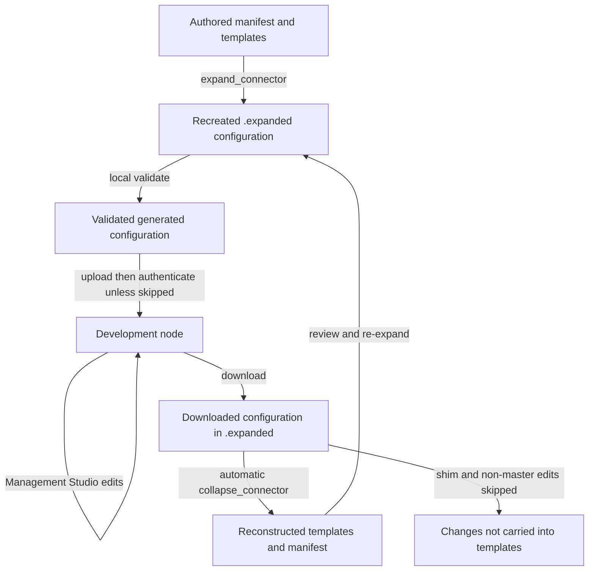

# Connector templates, expansion, collapse and schemas

## Ownership: author templates, treat expansion as disposable

A connector's reusable source is `manifest.json` plus its system and datatype templates. `connector_cli.connectorpy` renders that source into ordinary pipe/system configuration; the `sesam.py` dispatcher supplies the upload/download development workflow. `.expanded` is a **replaceable working tree, not a source of truth**: expansion deletes the entire selected output directory before recreating it. Collapse writes back into authored templates and regenerates parts of the manifest. Neither direction is a lossless inverse. Commit or back up authored files and preserve important downloaded/generated changes before either operation. [Expansion](../../connector_cli/connectorpy.py#L50-L167), [collapse](../../connector_cli/connectorpy.py#L170-L299).

Template reuse has a specific owner: a datatype is a **master** only when its name matches its template's basename without the extension. For example, `customer` using `templates/customer.json` owns that template; `product` using the same file does not. Expansion adds a warning `comment` to reused-template pipes. Collapse silently ignores changes to those non-master datatypes. Develop the master, download/collapse, then re-expand/upload to propagate its changes to other instances. [Implementation](../../connector_cli/connectorpy.py#L86-L117), [master selection](../../connector_cli/connectorpy.py#L203-L218), [documented reuse workflow](../../connector_cli/README.md#L99-L125).


*The normal connector-mode round trip uses destructive expansion, remote development and best-effort collapse; the skipped branch is deliberately not reversible.* Sources: [`expand_connector`](../../connector_cli/connectorpy.py#L121-L167), [upload dispatch](../../sesam.py#L4178-L4195), [`download`](../../sesam.py#L1704-L1793), [`collapse_connector`](../../connector_cli/connectorpy.py#L170-L299).

See [configuration sync](configuration-sync.md) for the underlying configuration transfer contract, and [configuration and credentials](../concepts/configuration-and-credentials.md) for environment and secret ownership.

## Scaffold a connector and datatypes

Use the actual `sesam` commands, rather than assuming the README's historical `connectorpy init/expand/collapse` examples describe an installed standalone executable. In this source, `connectorpy` exposes importable functions such as `expand_connector_config`, `expand_connector`, `collapse_connector` and `update_schemas`; scaffolding belongs to `SesamCmdClient.connector_init`, `get_datatype_template` and `add_datatype`. The dispatcher recognizes `connector-init`, `add-datatype`, `expand`, `validate` and `update-schemas`, but **not a standalone `collapse` command**. Download invokes collapse internally. [README examples](../../connector_cli/README.md#L5-L24), [functions](../../connector_cli/connectorpy.py#L50-L170), [dispatch](../../sesam.py#L4060-L4083), [scaffolding dispatch](../../sesam.py#L4214-L4219).

Typical command shapes, with node/JWT configuration already available:

```sh
mkdir example-connector
cd example-connector
sesam connector-init --auth oauth2
sesam add-datatype customer contact --share
# Complete the scaffold's URLs, pagination, keys and transforms before upload.
sesam validate
sesam upload
# Develop on the node, then download to reconstruct authored files.
sesam download
```

`connector-init` requires `<name>-connector`: with `-d .`, it checks the current directory's name; with another `-d`, it checks that argument's suffix. If `manifest.json` exists it skips initialization altogether. Otherwise it creates `templates`, a manifest, a REST system template and a README, and copies `LICENSE`. **The license must already exist in the parent directory when running inside the connector, or in the current directory when using `-d`.** This is a filesystem-layout assumption, not a packaged-license lookup; the copy can fail before the manifest is written. [Naming and file creation](../../sesam.py#L2543-L2641).

The initial REST system has `_id: "{{@ system @}}"`, empty `operations` and `url_pattern`, and `verify_ssl: true`. `--auth` defaults to `oauth2`; OAuth2 scaffolding adds blank login/token URLs, scopes and `$SECRET(...)` references. `api_key` adds `$SECRET(api_key)` as the password. `jwt` is represented as `auth: "api_key"` plus `auth_variant: "jwt"`, JWT endpoint/header metadata and a JWT access-token reference. These are starting points, not working integrations. [System/auth scaffold](../../sesam.py#L2573-L2612), [auth option](../../sesam.py#L3927-L3933).

`add-datatype` takes one or more **positional names after the command**, not its unused `--datatype` option. For each name it replaces that manifest entry with `{"template": "templates/<datatype>.json"}`, overwrites the datatype template, and updates operations in the hard-coded `templates/system.json` rather than following an alternative `system-template` path. Re-running it for an existing datatype can erase custom parameters and template edits and overwrite operation definitions. [Argument handling and writes](../../sesam.py#L2751-L2790).

The authored datatype scaffold is a JSON list containing an `-all` REST source using `<datatype>-list` and a `-collect` dataset source. Collect includes DTL placeholders for `$last-modified` and `transform-collect-rest` with primary key and lookup-delete settings. The list operation contains pagination and identifier placeholders to fill in. `--share` also adds an `-share` pipe with `batch_size: 1`, `transform-share-rest`, a source at `-transform`, collect-side `share_dataset`/`exclude_completeness`, and DELETE/POST/GET/PUT operation stubs. [Datatype construction](../../sesam.py#L2643-L2749).

The `-transform` pipe is different: it is generated from the **packaged shim**, not authored by `add-datatype`. It reads `-collect`, disables source signalling, copies properties and adds `$based_on` through DTL rules. Expansion generates one per datatype, and collapse excludes it. The build includes `connector_cli` as PyInstaller data so the package loader can find `templates/shim.json`. [Shim](../../connector_cli/templates/shim.json#L1-L25), [generation](../../connector_cli/connectorpy.py#L63-L65), [per-datatype rendering](../../connector_cli/connectorpy.py#L114-L117), [packaging](../../install.sh#L10-L16).

## Compact manifest contract and rendering

The manifest is interpreted by code rather than a local manifest-schema validator. Its key responsibilities are:

| Field | Consumer and meaning |
| --- | --- |
| `system-template` | Local template path, rendered when truthy; scaffold uses `templates/system.json`. |
| `datatypes` | Mapping keyed by datatype name. Expansion expects this mapping to exist. |
| `datatypes.<name>.template` | Required template path. Its basename also determines master ownership at collapse. |
| `datatypes.<name>.parameters` | Optional substitutions for that instance. Values enter the rendering context, not the generated profile. |
| `datatypes.<name>.parent` | Optional literal supplied as `parent` during rendering. Collapse can reconstruct the parent placeholder only from an existing manifest entry. |
| `additional_parameters` | Mapping whose **keys** become `$ENV(key)` substitutions; expansion does not use the values as runtime defaults. Existing value/description objects are retained only for keys rediscovered by collapse. |
| `auth`, `auth_variant`, `oauth2`, `jwt` | Authentication metadata, consumed by scaffolding/`authenticate` and login helpers, not a generic rendering context. OAuth2 dispatch reads `login_url`, `token_url`, `scopes`, optional `optional_scopes`; variants include Tripletex and SuperOffice ticket handling. |
| `use_webhook_secret` | Enables generated endpoint permission rewriting and, in OAuth2/Tripletex login, webhook-secret provisioning. |
| `requires_service_api_access` | OAuth2/Tripletex helpers add `service_jwt` as a system secret and `service_url` to the environment. It does not itself inject template substitutions. |
| `system` | Used as the CSV's system label, defaulting to `unknown`; it does not replace the CLI's system placeholder for pipe IDs. |

Sources: [render context](../../connector_cli/connectorpy.py#L67-L118), [manifest regeneration](../../connector_cli/connectorpy.py#L280-L299), [auth dispatch](../../sesam.py#L1161-L1213), [OAuth2 switches](../../connector_cli/oauth2login.py#L105-L139), [Tripletex switches](../../connector_cli/tripletexlogin.py#L29-L58), [CSV label](../../connector_cli/connectorpy.py#L445-L448).

Both package and local templates use custom Jinja delimiters: variables `{{@ ... @}}`, blocks `{}`. Ordinary REST-side `{{ ... }}` and `` expressions in the scaffold can therefore remain in the rendered configuration. `render` renders text and immediately calls `json.loads`; a single object is normalized to a list. Invalid rendered JSON fails here rather than producing partial valid components. [Jinja setup](../../connector_cli/connectorpy.py#L15-L40), [delimiters](../../connector_cli/connectorpy.py#L53-L69), [REST expressions](../../sesam.py#L2728-L2741).

Boolean substitution is a special workaround: `render` **mutates its input `props`**, replacing Boolean values with placeholder strings, parses the rendered JSON, then replaces quoted dummy placeholders with JSON `true`/`false` and parses again. Expansion also uses one mutable `subst` dictionary across the system and all datatypes: it starts with `system` and additional-parameter environment references, then updates with each datatype's `parameters` without clearing earlier keys. Parameters can leak into later datatypes or override earlier shared substitutions; a previous `parent` key can likewise persist if introduced as a parameter. Do not assume each datatype receives an isolated context or that Boolean values can be reliably reconstructed by collapse. [Boolean algorithm](../../connector_cli/connectorpy.py#L15-L40), [shared substitution state](../../connector_cli/connectorpy.py#L72-L105).

## Expansion lifecycle and command boundaries

`expand_connector` first renders the full configuration in memory. Once rendering succeeds it deletes/recreates `expanded_dir` (default `.expanded`), makes `pipes` and `systems`, and writes `node-metadata.conf.json` with `task_manager.disable_user_pipes: true`. It copies the connector-root `<profile>-env.json` after JSON parsing if present. Otherwise it generates `{"node-env": "test", ...}` with empty values for additional-parameter keys—even if the selected profile is not named `test`. Pipe and `system:*` components are written as `<_id>.conf.json`; other component types are not written. [Lifecycle and serialization](../../connector_cli/connectorpy.py#L121-L167).

Consequences:

- Generated edits, downloaded profiles and other files inside the selected output directory disappear on the next successful expansion. A downloaded profile is **not copied back** to the connector root by collapse, so preserve it deliberately if it should seed subsequent expansions.
- Templates and the root profile determine the next upload, not previously downloaded `.expanded` configuration. Generated metadata is reset by expansion; upload then applies its scheduler/C++/microservice settings to the ZIP.
- Rendering errors occur before directory deletion, but writing errors after recreation can leave incomplete output. There is no transactional staging or rollback in this function.

Sources: [expansion](../../connector_cli/connectorpy.py#L121-L167), [downloaded profile](../../sesam.py#L1714-L1721), [collapse output scope](../../connector_cli/connectorpy.py#L277-L299), [upload metadata changes](../../sesam.py#L1464-L1510).

| Entrypoint | Directory handling and sequence |
| --- | --- |
| `sesam expand` | Calls `expand_connector(system_placeholder, expanded_dir, profile)` **in the current directory**. It does not first change into `-d`. |
| `sesam validate` | Also expands in the current directory, then runs `SesamCmdClient.validate`. Validation checks the literal `.expanded`, not `-e`. |
| Connector-mode `sesam upload` | Detection is the existence of `-d/manifest.json`. Changes into `-d`, expands, validates, changes into `-e`, uploads, returns via relative parent-directory logic, then authenticates unless `-skip-auth`. |
| Connector-mode `sesam download` | Creates/enters `-d/-e`, downloads profile and configuration, replaces old pipe/system files subject to whitelist handling, then moves up one directory and calls collapse when the current path ends with `expanded_dir`. |
| `sesam update-schemas` | Changes into `-d` and calls `update_schemas(node)` without forwarding `--system-placeholder`; collect IDs therefore use its default `xxxxxx`. |
| `sesam test` | Calls `self.upload()` directly, waits for deployment, runs and verifies. It does **not** enter the connector upload dispatcher branch, expand, locally validate or authenticate. Use an already expanded ordinary configuration tree for this path. |

Sources: [mode detection](../../sesam.py#L3975-L3978), [dispatch](../../sesam.py#L4167-L4198), [download](../../sesam.py#L1704-L1793), [test](../../sesam.py#L2907-L2923).

`-d` defaults to `.`, `-e` to `.expanded`, and `--system-placeholder` to `xxxxxx`. Stay in the connector root with the default output directory for standalone expand/validate. The validator contains an intended `-d` adjustment, but it compares `self.args.command == "validate"`; the parser stores `command` as a list (`nargs="*"`) and dispatch normalizes only a separate local variable. That adjustment is not effective for normal parsed invocations. Custom/nested output directories also do not make the upload/download parent-navigation logic fully general. [Options](../../sesam.py#L3801-L3825), [validator adjustment](../../sesam.py#L1256-L1265), [parsed command](../../sesam.py#L3756-L3761), [normalization](../../sesam.py#L4044-L4048).

“Local” does not mean every related dispatcher command is offline: only `validate` and `format` bypass node/JWT setup. `expand`, scaffold commands and `update-schemas` still pass through node connection and developer-mode gating. `-force` permits only upload/download on non-development subscriptions. [Dispatcher gates](../../sesam.py#L4100-L4166). See the [CLI contract](../architecture/cli-contract.md).

The underlying upload first replaces the node environment, overlaying parent-directory `.additional_parameters.json` onto the selected generated profile, then builds and uploads the config ZIP and waits for deployment. Authentication is a later operation, not part of rendering or local validation: auth failure is not an upload rollback. [Upload order](../../sesam.py#L1439-L1526), [post-upload auth](../../sesam.py#L4183-L4193).

## What local validation actually enforces

`check_template_sink` rejects a truthy `sink.dataset` on pipe objects in **list-shaped authored datatype templates**. It skips single-object templates, and uses `json.load` on authored files before checking; Jinja constructs that are not themselves valid JSON can fail this step. This is a connector convention to leave sink dataset naming implicit, not comprehensive backend validation. [Sink check](../../sesam.py#L1218-L1254).

`validate` requires `.expanded` and parses generated JSON. For pipe files it enforces these conventions:

- A `description` containing uppercase `WARNING` is a failure. Collapse's unused-parameter warnings are inserted into descriptions; the reused-template warning is a `comment`, so that alone does not trigger this check.
- Filenames containing `share` mark their datatype as shared; datatype extraction is `file.split("-")[1]`. A corresponding filename containing `collect` must include `transform-collect-rest`, in either a dict transform or a list entry.
- For **list-shaped collect transforms**, each `transform-collect-rest` requires top-level `exclude_completeness`, transform `properties`, a truthy `properties.share_dataset`, and membership of that dataset in `exclude_completeness`. This check is not implemented for dict-shaped collect transforms and is not conditional on a share pipe being found.
- For share pipes using `transform-share-rest` in a dict or list, top-level `batch_size` must equal `1`.

These checks depend on filenames and transform shape, do not resolve arbitrary chained transforms and should not be mistaken for the full server pipe/schema contract. In particular, the unshared collect scaffold still contains a list-form `transform-collect-rest` without the share/completeness fields, so it can require revision before passing this validator. Invalid results exit with status `1`; “All config files are valid” is logged at warning level. [Validation implementation](../../sesam.py#L1264-L1409), [scaffold comparison](../../sesam.py#L2658-L2694).

## Webhook permissions and authentication are separate

During expansion, when `use_webhook_secret` is truthy, a pipe whose source is `http_endpoint` and whose `_id` ends with `event` receives exactly:

```json
[["allow", ["group:Anonymous"], ["write_data"]]]
```

Existing permissions are overwritten, with a warning when truthy. Collapse strips `permissions` from **all matching endpoint-event pipes**, regardless of whether the manifest enabled webhook secrets. Thus hand-authored endpoint permissions can be lost during download/collapse, and regenerated permissions are not retained as authored intent. [Overwrite](../../connector_cli/connectorpy.py#L145-L163), [removal](../../connector_cli/connectorpy.py#L223-L230).

This expansion step does not generate or verify a secret. Actual `webhook_secret` generation occurs in OAuth2 and Tripletex authentication: the helpers derive a 12-character SHA-256 hex prefix from `service_url + "/" + system_id` encoded with `utf-8-sig`, then provision system secrets. Their `requires_service_api_access` switch provisions `service_jwt`/`service_url`; the API-key helper does not implement these switches. Do not infer endpoint request validation from this local permission rewrite. See [connector authentication](../integrations/connector-authentication.md) for provisioning scope, credentials and security boundaries. [OAuth2 provisioning](../../connector_cli/oauth2login.py#L105-L147), [Tripletex provisioning](../../connector_cli/tripletexlogin.py#L29-L64), [API-key path](../../connector_cli/api_key_login.py#L7-L49).

## Collapse: reconstruction, not source recovery

`collapse_connector(connector_dir=".", system_placeholder="xxxxxx", expanded_dir=".expanded")` reads all `systems/*.json` into a `system` group and groups `pipes/*.json` by a filename-derived datatype: remove the prefix through the first hyphen, then the final hyphen-delimited suffix. It skips shim filenames ending `-transform.json` and also skips the exact generated `_id` `<system>-<datatype>-transform`. Naming conventions therefore matter; this is not manifest-based discovery of arbitrary downloaded pipes. It creates `templates`, but does not clear old unreferenced template files. [Input grouping](../../connector_cli/connectorpy.py#L170-L195).

For each master group it sorts components by `_id`, removes endpoint-event permissions, and serializes an object for one component or a list for several. It then performs **global string replacements**, not syntax-aware reverse templating:

1. System placeholder becomes `{{@ system @}}`.
2. Existing datatype parameter values become their `{{@ parameter @}}` placeholders, on a best-effort basis explicitly noted in source as risking unintended replacements.
3. `$ENV(\w+)` matches become connector placeholders and their names are collected.
4. Datatype text becomes `{{@ datatype @}}`; known parent text becomes `{{@ parent @}}` using the previous manifest's parent association.

The reconstructed file is always `templates/<group>.json`. Original Jinja conditionals, layout and comments cannot be recovered from rendered JSON; replacements can also alter unrelated substrings. Parent relations are not inferred from pipe wiring. Existing custom template paths are not used as write targets. [Parent/master lookup](../../connector_cli/connectorpy.py#L197-L218), [serialization and replacements](../../connector_cli/connectorpy.py#L254-L278).

Parameter handling is string-oriented: an unused value is tested with `value not in str(components)` and uppercased for the warning, and replacement uses `fixed.replace(value, ...)`. Non-string values such as Booleans that can render successfully can instead raise type errors during collapse. Missing values cause an error log and a `WARNING` appended to the first component's description, which can block subsequent validation. [Unused-parameter check](../../connector_cli/connectorpy.py#L232-L253), [replacement](../../connector_cli/connectorpy.py#L259-L267).

Manifest regeneration preserves unrelated existing top-level fields but replaces `additional_parameters`, `system-template` and `datatypes`. It retains only environment parameter keys rediscovered in processed master templates, sets `system-template` to `templates/system.json`, and builds datatype entries from discovered groups plus previous non-master entries. Existing datatype fields override the default template path, preserving parameters, parents and reused-template references—but potentially retaining a custom path different from the newly written file. A master datatype absent from downloaded input can drop out of the manifest; a previously known non-master can remain even without input. [Manifest rebuild](../../connector_cli/connectorpy.py#L280-L299).

**Review the diff before re-uploading.** Loss risks include rewritten master files and manifest keys, ignored non-master/shim edits, stripped permissions, accidental substring substitutions, and authored control-flow information absent from generated JSON. Expansion then destroys any generated changes that were not carried back into reviewed source.

## `update-schemas`: live execution plus local schema artifacts

This is not an offline schema compiler. The dispatcher enters the connector directory and invokes `update_schemas(node)` with default `system_placeholder="xxxxxx"`, ignoring a custom CLI placeholder for this operation. The function creates `schemas`, fetches effective node metadata, attempts to set `global_defaults.infer_pipe_entity_types` to `true` if it is not already exactly `True`, calls `set_metadata`, and waits for all pipes to deploy. It does not restore the previous inference setting afterward. **If effective metadata lacks `global_defaults`, the code mutates a detached default `{}` without attaching it to `node_metadata`; the setter call therefore need not include the intended flag.** Verify the remote setting rather than assuming success. [Dispatch](../../sesam.py#L4196-L4198), [metadata change](../../connector_cli/connectorpy.py#L302-L313).

For every manifest datatype, it looks up `<system>-<datatype>-collect`, runs its pump until there is no pending work when found, then GETs `<pipes_url>/<pipe_id>/entity-types/sink` with `retries=20`, `retry_delay=3`. A missing pipe logs a warning but still proceeds to that GET; an empty response schema logs a warning and skips output for that datatype. These are real remote collect executions with dataset effects, not merely inspection. The meaning and accuracy of inferred entity types and pump completion belong to the backend/client API, not a local implementation of schema inference here. [Collect execution and endpoint](../../connector_cli/connectorpy.py#L315-L350).

| Artifact | Ownership and update behavior |
| --- | --- |
| Live inferred schema | Read from the collect pipe's sink entity-types endpoint. Used in memory as the base; this function does not save a separate raw inferred-schema file. |
| `schemas/<datatype>.json` | Manual/incomplete schema. Created **only if absent**, initially retaining top-level null-only properties, omitting `$`-prefixed internal properties and removing non-null properties. Retained properties receive `type: null` (Python `None`) and an empty description. Edit this file to supply manual property schemas. Existing files are not automatically augmented with newly found null properties. |
| `schemas/<datatype>.merged.json` | Generated output, overwritten for nonempty live schemas. Starts as a deep copy of the live schema, then overlays qualifying manual property entries. |
| `schema.csv` | Generated summary rewritten from all `schemas/*.merged.json` in the current directory, with header `System,Type,Name,SubName,Datatype,Description`. System label comes from manifest `system` or `unknown`. |

Sources: [manual schema creation](../../connector_cli/connectorpy.py#L352-L400), [merging](../../connector_cli/connectorpy.py#L402-L424), [CSV inputs/header](../../connector_cli/connectorpy.py#L436-L448), [CSV write](../../connector_cli/connectorpy.py#L530-L542).

The merge's actual null test matters: it takes `subtype` before `type`; for a `None` value with `anyOf`, it checks whether any alternative's `type` differs from the literal string `"null"`. Otherwise it considers only the literal `"null"` null. Consequently a manual JSON `null` type without `anyOf` is **not** excluded by that test and can overlay the live property. Do not assume unedited manual placeholders are universally filtered out. [Exact merge logic](../../connector_cli/connectorpy.py#L409-L421).

CSV rendering is a local summary, not a complete schema serializer: it drops top-level `$` properties, prefers `subtype`, simplifies some two-alternative `anyOf` combinations (including integer/decimal), emits object children only one level deep, and puts array-of-object children in `SubName`. The CSV phase uses relative `schemas/*.merged.json`, `manifest.json` and `schema.csv` even when the importable helper is passed another `connector_dir`. Stale merged files are not deleted when a datatype is skipped or removed, so they can remain in the CSV. [CSV transformations](../../connector_cli/connectorpy.py#L450-L528), [relative inputs and filtering](../../connector_cli/connectorpy.py#L436-L448), [write](../../connector_cli/connectorpy.py#L530-L542).

Run this deliberately against an uploaded, authenticated development node, review the remote metadata and collect effects, maintain manual schemas separately from generated merged/CSV output, and check for stale artifacts. Backend schema semantics remain delegated.

## Merge connectors into a hub solution

`expand_connectors_to_hub_solution.sh` takes one or more connector directories followed by a target directory. For each connector it derives the system placeholder from the first hyphen-delimited segment of the argument, changes into that directory, runs `python3 ../sesam.py expand --system-placeholder ...`, then uses `rsync` for `.expanded/pipes` while excluding `*-transform.*` and copies `.expanded/systems` into the target. This intentionally omits generated transform pipes; it does not substitute a hub-specific transform implementation. [Helper script](../../expand_connectors_to_hub_solution.sh#L3-L25).

The script assumes a sibling-directory layout with `sesam.py` one level above each connector and the target reachable via `../<target>`. It copies pipe/system config only, not generated profiles or node metadata. It is an overlay: there is no `rsync --delete`, collision check, or combined validation/upload. Matching target files can be overwritten and unrelated/stale target files can survive. It has no `set -e` or explicit expansion-status check, so do not treat a later copy as proof that expansion succeeded. Review exclusions, collisions and environment/metadata assembly before uploading the hub solution. [Exact merge commands](../../expand_connectors_to_hub_solution.sh#L15-L25).

## Focused change validation

The shipped test runner executes the authored `tests/*/run_test.sh` scenarios against a live node. Fair-weather coverage exercises ordinary `test`, `update`, `status` and `download`; embedded-conversion coverage converts then tests ordinary config and compares output directories. These scripts do not exercise connector scaffolding, reuse/collapse, Boolean reverse substitution or `update-schemas`. Do not take their success as a round-trip guarantee. [Runner](../../test.sh#L15-L30), [fair-weather scenario](../../tests/fair_weather_test/run_test.sh#L29-L49), [conversion scenario](../../tests/embedded_conversion_test/run_test.sh#L31-L58).

When changing these mechanisms, useful focused checks are master-versus-reused datatype edits, parent/parameter reconstruction, non-string parameters, generated-directory deletion, profile retention, permission overwrite/removal, dict-versus-list validation and manual-null schema merging. Separate offline rendering/validation checks from explicitly authorized node operations; `test`, upload and schema collection have remote side effects. See [change validation](../testing/change-validation.md), [run and verify](run-and-verify.md), [quickstart](../quickstart.md) and [troubleshooting and releases](../operations/troubleshooting-and-releases.md).
