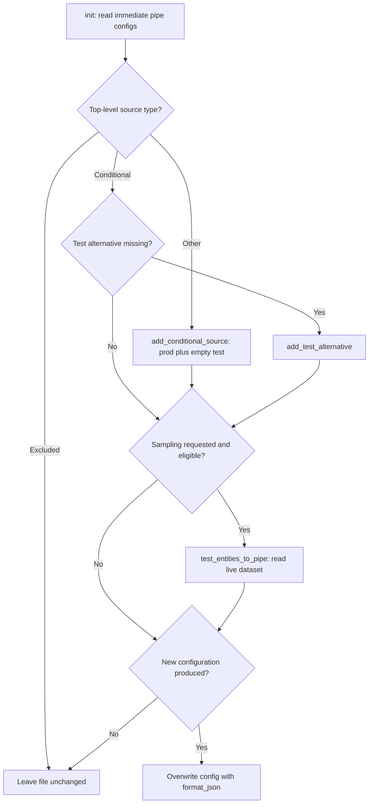
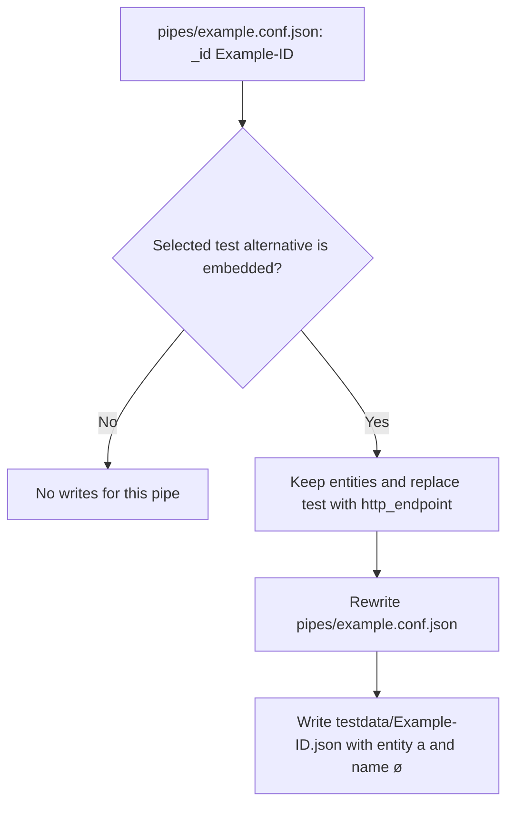

# Prepare test sources, convert embedded data and format files

## Local file ownership and command risk

These commands own **files in the working directory**, not proof that a configuration works on a node. `SesamCmdClient.init` prepares test alternatives, `convert` moves selected embedded entities into `testdata/`, and `format` rewrites JSON representation. The dispatch branches call these handlers directly; they do not expand a connector or change into its expanded directory first. Work from the intended configuration directory. See the [canonical command/risk table](../architecture/cli-contract.md#canonical-command-contract-table) before choosing a command. [Handlers and dispatch](../../sesam.py#L2396-L2517), [conversion/formatting](../../sesam.py#L3175-L3311), [dispatch](../../sesam.py#L4214-L4273).

**Local work is not necessarily offline.** Only `validate` and `format` are classified offline. `init`, `convert` and `dump` still resolve node/JWT credentials, construct an authenticated `SesamNode`, and require a developer-mode node before doing their principal local work. `-force` only provides a non-developer bypass for `upload` and `download`, not these preparation commands. Node construction attempts portal analytics before creating the API connection when a subscription identifier is available; that attempt can occur even if the later connection fails. [Bootstrap and gate](../../sesam.py#L4100-L4166), [denial](../../sesam.py#L4282-L4292), [`SesamNode.__init__`, `register_user_interaction`](../../sesam.py#L234-L337). Credential selection belongs to [configuration and credentials](../concepts/configuration-and-credentials.md).

| Command | Local scope/output | Main boundary or risk |
|---|---|---|
| `sesam init` | Immediate `pipes/*.conf.json`; rewritten conditional sources | Online bootstrap even without sampling. `-add-test-entities` reads live datasets; `-force-add` permits replacing existing test entities. |
| `sesam convert` | Immediate `pipes/*.conf.json`; `testdata/<JSON _id>.json` | Online bootstrap. Replaces only the selected profile's conditional embedded alternative; overwrites matching output files. |
| `sesam dump` | Replaces `sesam-config.zip` with a local configuration archive | Online bootstrap. Not a complete backup of test data, expectations or environment files. |
| `sesam format [all\|pipes\|systems\|testdata\|expected\|path.json]` | Selected JSON files, rewritten in place | Offline dispatch, but not read-only. The path determines which serializer is used. |

Sources: [`init`](../../sesam.py#L2453-L2517), [`convert`](../../sesam.py#L3175-L3231), [`dump` → `get_zip_config`](../../sesam.py#L1697-L1702), [archive contents](../../sesam.py#L938-L1005), [`format`](../../sesam.py#L3233-L3311).

`init`, `convert` and `format` do **not** filter their file selection through `-whitelist-file`. `dump` does apply archive whitelist rules, recursively including `.conf.json` files from `pipes/` and `systems/`, plus optional `node-metadata.conf.json`. It replaces an existing archive; for regular configurations, its pipe/system contents can undergo Jinja-variable substitution. Thus `convert -dump` is useful as a pre-conversion configuration archive, not a full, byte-for-byte repository backup. [Selection loops](../../sesam.py#L2456-L2517), [conversion backup](../../sesam.py#L3213-L3229), [format selection](../../sesam.py#L3257-L3311), [archive implementation](../../sesam.py#L938-L1005).

## `init`: add fixed production and test alternatives

`init` parses each immediate `pipes/*.conf.json` and examines `pipe["source"]["type"]`. It excludes top-level sources of type `dataset`, `merge`, `merge_datasets`, `union_datasets`, `diff_datasets` and `embedded`. Other non-conditional sources are wrapped by `add_conditional_source`: the original source becomes `alternatives.prod`, an empty embedded source becomes `alternatives.test`, and `condition` is set to `$ENV(node-env)`. These names are **fixed**, not derived from `-profile`. For an already conditional source, `add_test_alternative` adds an empty embedded `test` only if that alternative is missing; it does not replace an existing test source by default. [Helpers](../../sesam.py#L2432-L2451), [`init` branching](../../sesam.py#L2453-L2513).

*`init` branches on the existing source, optionally samples into `test`, and only writes when `new_cfg` is produced; existing nonempty test entities require `-force-add` to be sampled again.* [Control flow](../../sesam.py#L2453-L2517).

### Sampling is an explicit live-data import

`-add-test-entities` is false unless requested. With it, existing conditional test entities are sampled only when their array is empty or `-force-add` is set; newly wrapped sources can also be sampled. `-force-add` alone does not trigger sampling. **Do not treat importing production data as a safe default:** the helper persists live entities in local configuration, so select an appropriate node and review/redact the resulting files before committing. [Flags](../../sesam.py#L3739-L3754), [overwrite checks](../../sesam.py#L2481-L2517).

`test_entities_to_pipe`:

1. Looks up the remote pipe by the local JSON `_id`.
2. Uses its effective `sink.dataset`, falling back to the remote pipe ID.
3. Requests at most **10** entities with `history=False`, `deleted=False` and `do_transit_decoding=False`.
4. Assigns that list to `source.alternatives.test.entities` and returns the pipe and count.

A missing remote pipe yields a warning and returns the original pipe with zero entities added. A failure fetching the dataset yields a warning, then assigns `[]`. In a forced refresh, that can **clear previously stored entities** despite the log saying that no test entities will be updated. The caller still receives a configuration to write. [Sampling helper](../../sesam.py#L2396-L2430), [caller/write](../../sesam.py#L2486-L2517).

The implementation assumes a compatible shape: `source.type`, conditional `alternatives`, and, when sampling an existing test alternative, an `entities` array. A conditional `test` already converted to `http_endpoint` has no such array, so `init -add-test-entities` is not a generic way to refill converted sources. Changed pipe files are overwritten using `format_json` and explicit UTF-8 output. There is also a separate edge case: if the directory is not recognized as a connector and `connector_dir != "."`, `init` writes a new `manifest.json` with empty `datatypes` and `additional_parameters`. [Shape accesses and writes](../../sesam.py#L2472-L2517), [manifest write](../../sesam.py#L2534-L2541).

## `convert`: extract only the selected conditional embedded branch

The CLI defaults `-profile` to `test`. `has_conditional_embedded_source` requires a top-level `source.type == "conditional"` and an alternative whose **key equals `args.profile`** and whose type is `embedded`. It does not evaluate the source's `condition`, read `<profile>-env.json`, or search other alternatives for embedded data. A plain embedded source, a missing selected alternative, a top-level `http_endpoint`, or a selected non-embedded alternative is left alone. [Profile default](../../sesam.py#L3603-L3610), [predicate and conversion](../../sesam.py#L3180-L3200).

For a match, `convert_pipe_config` extracts the selected alternative's `entities` and replaces that **entire alternative** with `{"type": "http_endpoint"}`. Other alternatives and the condition remain; extra settings on the selected embedded branch do not carry over. The outer loop then writes the pipe back to its original filename and writes the extracted entities to `testdata/<pipe["_id"]>.json`, both through `format_json` with UTF-8 output. Filename-derived ID code is unused. [Mutation and persistence](../../sesam.py#L3175-L3229).

### Tiny synthetic before/after flow

For a file `pipes/example.conf.json` with JSON `_id: "Example-ID"`, `source.type: "conditional"` and `alternatives.test: {"type": "embedded", "entities": [{"_id": "a", "name": "ø"}]}`, the default-profile conversion follows this flow:

*The synthetic names illustrate the inspected conversion order: the configuration path stays fixed, while the extracted-data filename comes from the case-preserved JSON `_id`.* [`convert`](../../sesam.py#L3180-L3229).

Operational consequences:

- `testdata/` is created on demand. Existing matching pipe and testdata files are opened with `"w"`, with no prompt, merge or `-force` requirement. A second conversion normally skips the now-`http_endpoint` branch; it does not clean up stale testdata. Changing profile targets a different branch. [Writes and selection](../../sesam.py#L3190-L3229).
- The pipe is saved **before** its extracted data. There is no transactional pair of writes or rollback: failure in the later data write can leave the source converted without a usable data file. An empty entities list still produces a data file; a JSON `null` value would be extracted as `None` and suppress that write. [Write guards/order](../../sesam.py#L3190-L3229).
- IDs are interpolated directly into the testdata path without normalization or collision checks. Preserve ID case and use filesystem-safe IDs; two matching pipes with the same `_id` target the same file. Missing `entities`, malformed `alternatives`, invalid JSON or an I/O failure can abort processing after earlier files have been rewritten. [Predicate, direct indexing and writers](../../sesam.py#L3180-L3229), [dispatch failure](../../sesam.py#L4299-L4304).

### Authored fixture expectations

The nearest before/after fixtures pin both source selection and the exact resulting JSON layout:

| Fixture | Expected behavior |
|---|---|
| `input-pipe-1.conf.json` and `input-pipe-2.conf.json` | Default `test` embedded data moves to same-ID testdata files; `prod` remains a dataset source and literal `condition: "test"` remains unchanged. [Before 1](../../tests/embedded_conversion_test/before/pipes/input-pipe-1.conf.json#L1-L30), [after 1](../../tests/embedded_conversion_test/expected_after/pipes/input-pipe-1.conf.json#L1-L17), [data 1](../../tests/embedded_conversion_test/expected_after/testdata/input-pipe-1.json#L1-L13), [before 2](../../tests/embedded_conversion_test/before/pipes/input-pipe-2.conf.json#L1-L30), [after 2](../../tests/embedded_conversion_test/expected_after/pipes/input-pipe-2.conf.json#L1-L17), [data 2](../../tests/embedded_conversion_test/expected_after/testdata/input-pipe-2.json#L1-L13). |
| `input-pipe-3.conf.json` | JSON `_id` is `Input-Pipe-3`, so the configuration filename remains lowercase while the new file is **`testdata/Input-Pipe-3.json`**. Entity IDs such as `This`, `Pipe` and `PipeId` retain case. [Before](../../tests/embedded_conversion_test/before/pipes/input-pipe-3.conf.json#L1-L33), [after](../../tests/embedded_conversion_test/expected_after/pipes/input-pipe-3.conf.json#L1-L17), [data](../../tests/embedded_conversion_test/expected_after/testdata/Input-Pipe-3.json#L1-L16). |
| `input-pipe-with-norwegian-characters.conf.json` | Its `_id` is `input-pipe-norwegian`; the data file uses that ID, not the configuration basename. Description and entity names preserve literal `øæå`. [Before](../../tests/embedded_conversion_test/before/pipes/input-pipe-with-norwegian-characters.conf.json#L1-L25), [after](../../tests/embedded_conversion_test/expected_after/pipes/input-pipe-with-norwegian-characters.conf.json#L1-L18), [data](../../tests/embedded_conversion_test/expected_after/testdata/input-pipe-norwegian.json#L1-L7). |
| The two “left alone” inputs and `output-pipe.conf.json` | A plain HTTP endpoint, a conditional `test` HTTP endpoint, and a dataset-source output pipe remain unchanged. [Plain before](../../tests/embedded_conversion_test/before/pipes/input-pipe-to-be-left-alone.conf.json#L1-L7), [plain after](../../tests/embedded_conversion_test/expected_after/pipes/input-pipe-to-be-left-alone.conf.json#L1-L7), [conditional before](../../tests/embedded_conversion_test/before/pipes/input-pipe-to-be-also-left-alone.conf.json#L1-L17), [conditional after](../../tests/embedded_conversion_test/expected_after/pipes/input-pipe-to-be-also-left-alone.conf.json#L1-L17), [output before](../../tests/embedded_conversion_test/before/pipes/output-pipe.conf.json#L1-L11), [output after](../../tests/embedded_conversion_test/expected_after/pipes/output-pipe.conf.json#L1-L11). |

Existing-file overwrite behavior comes from the writers, **not** from these clean before/after fixtures: the scenario copies `before/` into a fresh `test_after/` before conversion. [Scenario setup](../../tests/embedded_conversion_test/run_test.sh#L31-L40).

## `format`: scope first, serializer second

With no extra positional argument, dispatch calls `format("all")`; otherwise only the first argument is used. The handler accepts these modes:

| Mode | Files selected |
|---|---|
| `all` | `pipes/*.json`, `testdata/*.json`, `systems/*.json`, then `expected/*.json` |
| `pipes`, `systems`, `testdata`, `expected` | That folder's immediate `*.json` files only |
| A path ending in `.json` | Exactly that file, including a `.test.json` spec if explicitly named |

The group globs are **nonrecursive** and include any immediate `.json`, not just `.conf.json`. Folder mode skips expected paths containing `.test.json`; the explicit-file branch has no such skip. An unknown option not ending in `.json` logs an informational message and returns rather than raising a formatting error. Invalid JSON or missing/unwritable files do raise through the normal CLI failure path. [Default dispatch](../../sesam.py#L4270-L4273), [mode selection and skipping](../../sesam.py#L3257-L3311), [read/write](../../sesam.py#L3233-L3255), [exception handling](../../sesam.py#L4299-L4304).

### Explicit paths carry serialization policy

In folder mode the glob's folder determines the serializer. In file mode the code splits the supplied string on **`/`** and takes the first component matching an option key (`all`, `pipes`, `testdata`, `systems`, `expected`). Only a match of `expected` selects the expected-data serializer. With no match, it warns about the unknown directory and uses normal formatting. This is string-based, case-sensitive selection—not detection of an expected-data schema or normalized OS path. For example:

- `sesam format expected/output-pipe.json` uses expected-data serialization.
- `sesam format output-pipe.json` uses `format_json`, even if that file contains expected output.
- `sesam format expected/output-pipe.test.json` formats the spec, despite folder mode skipping it.
- A path beginning `pipes/expected/…` selects `pipes` first and uses normal formatting; backslash-only paths do not gain expected handling from an `expected` directory component.

[`SesamCmdClient.format` path policy](../../sesam.py#L3280-L3307).

### Two representations, not one universal pretty-printer

| Policy | `pipes`, `systems`, `testdata`, unknown paths | Paths classified as `expected` |
|---|---|---|
| Serializer | Locally owned `jsonformat.format_json` | Standard `json.dumps` |
| Object key order | Conventional ordering, recursively | Alphabetical `sort_keys=True`, recursively |
| Indentation/layout | Default `FormatStyle`, including collapsed indentation for objects in arrays | Two-space `indent="  "` |
| Non-ASCII characters | Literal Unicode via `ensure_ascii=False` | Literal by default; `-unicode-encoding` enables `\uXXXX` escaping |
| `<`, `>`, `&` | No additional HTML escaping | Replaced with `\u003c`, `\u003e`, `\u0026` unless `-disable-json-html-escape` |
| End of output | Final newline | Final newline |

[Serializer branch](../../sesam.py#L3233-L3255), [flags](../../sesam.py#L3571-L3588), [formatter defaults](../../jsonformat.py#L9-L60), [Unicode serialization](../../jsonformat.py#L130-L144), [final newline](../../jsonformat.py#L229-L252). `format` itself opens files in text mode without an explicit encoding, unlike the UTF-8 writers in `init` and `convert`; literal Unicode serialization does not by itself guarantee a UTF-8 filesystem encoding on every host. [Format I/O](../../sesam.py#L3235-L3255), [init output](../../sesam.py#L2515-L2517), [convert output](../../sesam.py#L3202-L3209).

## The locally owned `jsonformat.FormatStyle` contract

`jsonformat.py` is imported directly by the CLI. Its header records that it was copied from Lake on 03/03/2025 during IS-18106. CLI help describes portal-equivalent formatting, but **current portal compatibility is not verified here**: the inspected implementation and fixtures are the contract documented on this page. [Import](../../sesam.py#L33-L34), [provenance](../../jsonformat.py#L1-L2), [help wording](../../sesam.py#L3371-L3372).

`FormatStyle(**kwargs)` supplies defaults for omitted known properties; `format_json` and `format_object` default to a `FormatStyle()` instance. The important defaults are:

- Two spaces, not tabs; spaces after colons and array commas.
- `new_line_before_dict_as_value=False` and `newline_before_dict_in_array=False`.
- `close_nested_array_on_new_line=True` and `collapse_indent_for_dict_inside_array=True`.
- `elements_of_array_as_value_on_separate_lines=False` and `sort_keys_by_convention=True`.
- `font_size=12` is stored as a style property but does not affect the emitted JSON.

[`FormatStyle` and entrypoints](../../jsonformat.py#L9-L60), [layout implementation](../../jsonformat.py#L137-L252).

Conventional sorting recursively visits mappings and lists, preserving list element order. It prioritizes `_id`, `type`, `name`, `description`, then familiar configuration keys such as `source`, `sink`, `transform`, `pump`, `metadata`, `system` and the remaining `_SORT_ORDER` keys. Other ordinary keys follow alphabetically; underscore-prefixed internal keys except `_id`, plus `$audit` and `$principals-from-user`, sort at the end. Setting `sort_keys_by_convention=False` switches to alphabetical key order. [Ordering definitions and recursion](../../jsonformat.py#L63-L132).

After compact `json.dumps(..., ensure_ascii=False)`, a character-state formatter tracks dictionaries, arrays, strings and escapes. Quoted content is not treated as structural punctuation, so braces, commas and escaped quotes in string values are preserved. Objects in arrays avoid an extra indentation level by default; child arrays start on a new line, and when a closing `]` follows another `]`, the default nested-array rule inserts a newline. Empty objects collapse to `{}` and all output ends with a newline. [State machine and layout](../../jsonformat.py#L130-L252).

**Customization is a Python extension point, not a connected CLI setting in this source.** The README advertises `.sesamconfig.json` `formatstyle` customization and `-sesamconfig-file` is parsed, but the inspected CLI formatter calls pass no style and there is no consumption of `args.sesamconfig_file`. The authored fair-weather `.mysesamconfig.json` requests `elements_of_array_as_value_on_separate_lines: true`, unlike the actual default; its presence does not demonstrate that it controls the current formatter. [README](../../readme.usage.md#L52-L81), [argument](../../sesam.py#L3722-L3729), [default calls](../../sesam.py#L2515-L2517), [convert/format calls](../../sesam.py#L3202-L3253), [fixture](../../tests/fair_weather_test/.mysesamconfig.json#L1-L14).

## Validation boundaries and safe change checks

Formatting changes key order, indentation, escaping and file representation. It does not run transforms, upload configuration, populate HTTP endpoints or establish expected-output correctness. `format expected` also does not perform the entity sorting/normalization done by `update` and `verify`: it loads JSON and serializes it without reordering array elements. The expected-data serializer shares `update`'s two-space, alphabetical, Unicode/HTML-escaping choices, but **formatting is not baseline generation or semantic verification**. [Format implementation](../../sesam.py#L3233-L3255), [`update` sorting/serialization](../../sesam.py#L2845-L2863), [`verify` expected loading/sorting](../../sesam.py#L2117-L2124), [current-output normalization](../../sesam.py#L2148-L2163). See [run and verify](run-and-verify.md) and [configuration sync](configuration-sync.md) for those separate lifecycle steps.

The nearest conversion scenario has two different assertions:

1. **Remote integration:** copies the before tree to `test_after/`, wipes a node, converts, invokes `test` (upload → deployment wait → run → verify), then resets the node. Upload derives pipe IDs from testdata filenames and posts the parsed data to their receivers. The explicit expected spec covers `output-pipe`, whose dataset source reads `input-pipe-1`; the other converted fixtures are not separate expected-output assertions. [Scenario](../../tests/embedded_conversion_test/run_test.sh#L31-L46), [`test`](../../sesam.py#L2907-L2923), [upload handoff](../../sesam.py#L1524-L1533), [testdata naming/posting](../../sesam.py#L1594-L1623), [spec](../../tests/embedded_conversion_test/expected_after/expected/output-pipe.test.json#L1-L3), [output config](../../tests/embedded_conversion_test/expected_after/pipes/output-pipe.conf.json#L1-L11).
2. **Local representation:** `diff -r expected_after/ test_after/` compares the tree after the scenario. That catches missing/extra files, filename case and byte-level JSON layout—not just equivalent parsed JSON. For example, extracted [testdata/input-pipe-1.json](../../tests/embedded_conversion_test/expected_after/testdata/input-pipe-1.json#L1-L13) uses the local formatter's compact array/object layout, while [expected/output-pipe.json](../../tests/embedded_conversion_test/expected_after/expected/output-pipe.json#L1-L18) uses standard expanded indentation. [Directory diff](../../tests/embedded_conversion_test/run_test.sh#L48-L58). JSON verification, by contrast, loads expected entities as JSON and compares normalized/sorted output rather than original file whitespace. [Expected loading](../../sesam.py#L199-L206), [verification](../../sesam.py#L2117-L2163).

Neither this scenario nor the fair-weather script is a focused `init`/`format` test. Fair-weather exercises `test`, `update`, `status` and `download`, passing `.mysesamconfig.json` only to download; that is not evidence that CLI style customization works. [Fair-weather sequence](../../tests/fair_weather_test/run_test.sh#L31-L47). The top-level test runner invokes scenario scripts with a remote CI token, and the CI matrix is serialized because all OS jobs share a node. These are not harmless local diff scripts. [Runner](../../test.sh#L17-L30), [CI](../../.github/workflows/test.yml#L10-L22), [token handoff](../../.github/workflows/test.yml#L44-L48).

For a focused change review, use disposable synthetic inputs and check separately: excluded/init source shapes; empty versus forced samples and fetch failures; selected versus nonselected profiles; `_id`/filename mismatch and case; existing-file replacement; Unicode, string escapes and nested arrays; and folder versus explicit expected/spec formatting. Then evaluate remote upload/run/verify in an isolated developer environment. Preserve authored fixtures unless intentionally changing their contract. **No conversion, formatting, initialization, dump or scenario scripts were executed for this documentation, and no fixtures were modified.** Broader check selection belongs to [change validation](../testing/change-validation.md); bootstrap, I/O and version issues belong to [troubleshooting and releases](../operations/troubleshooting-and-releases.md).
