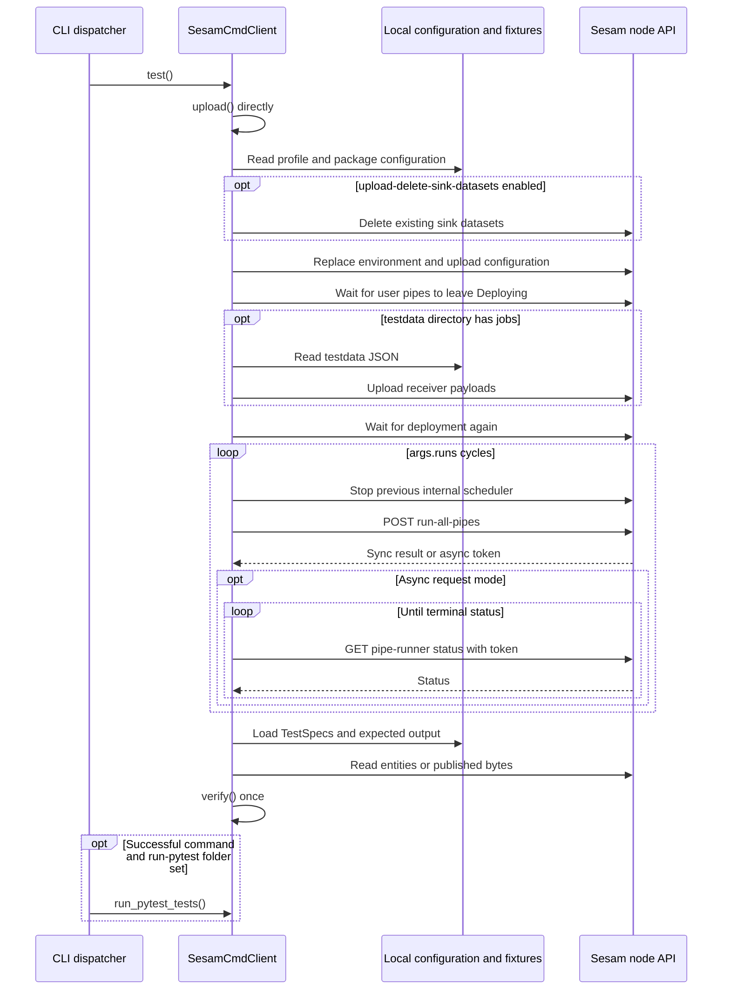
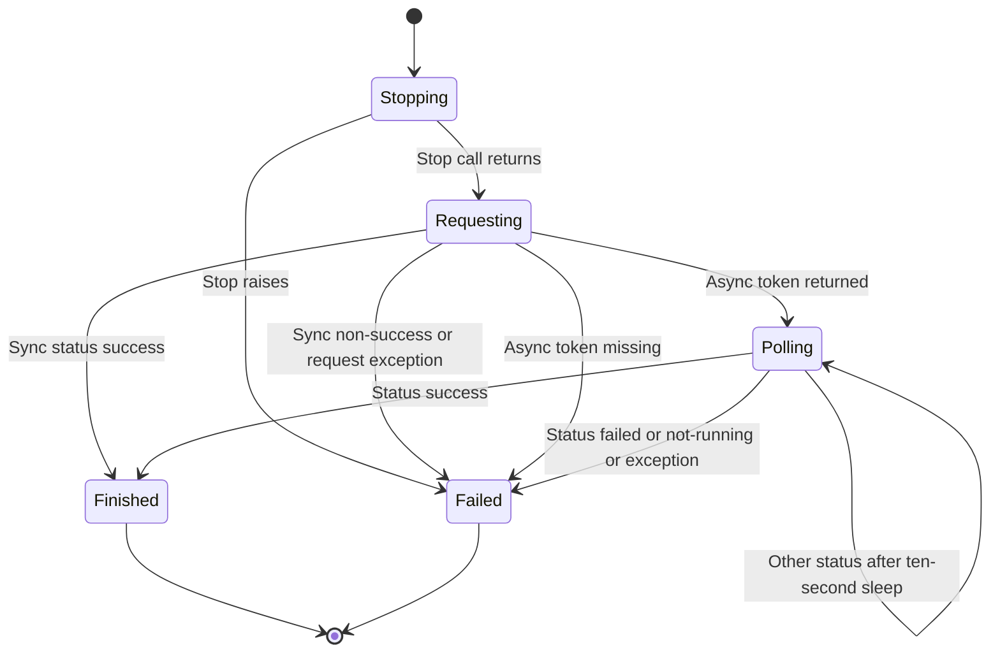

# Scheduler execution and expected-output testing

`test` is a state-changing **upload → run → verify** workflow, not just a local test runner. `run` delegates execution to the node's internal scheduler; `verify` compares live output with local `expected` files; `update` accepts live output as a new baseline. A successful command is not necessarily evidence that any output was checked: **no discovered TestSpecs makes `verify` warn and return**, and ignored or whitelisted-away tests reduce what is checked.

This page describes inspected source, not a fresh test run. No remote commands, scenario scripts, or expected-fixture updates were executed during research. For actual authored coverage and proposed isolated regression checks, see [Change navigation and validation](../testing/change-validation.md).

## Entry points and operating boundary

| Command | Responsibility | Important boundary |
| --- | --- | --- |
| `upload` | Replace node environment/configuration, wait for deployment, then upload available testdata. | Does not itself run output verification. Connector dispatch has a separate expansion/validation/authentication branch. |
| `run` | Stop any previous internal scheduler, then request a new run and wait for its result. | Does not upload configuration or compare expected files. |
| `verify` | Discover TestSpecs and compare eligible live output against expected files. | Does not run the scheduler first; publisher reads can enable disabled pumps. |
| `update` | Maintain specs and write current live output into expected files. | Does not upload or run first, and is not a correctness assertion. |
| `test` | Directly call `upload()`, wait for deployment, call `run()` for `-runs` cycles, then call `verify()` once. | Does not route through the connector-specific `upload` dispatcher. |
| `stop` | Ask the node to stop its internal scheduler. | Explicit recovery action, not a rollback of configuration, datasets, or files. |
| `run-pytest <folder>` | Run Python tests through `pytest.main()`. | CLI startup still connects to a node; it is not classified as offline. |

Sources: [command handlers](../../sesam.py#L2792-L3101), [upload](../../sesam.py#L1411-L1592), [publisher read](../../sesam.py#L656-L670), [startup and dispatch](../../sesam.py#L4100-L4307).

Work from the intended configuration directory. TestSpec paths, `testdata`, and profile files are relative to the current working directory. Upload's profile defaults to `test-env.json`; credential lookup and target selection are explained in [Configuration and credentials](../concepts/configuration-and-credentials.md). Startup treats only `validate` and `format` as offline. These workflow commands require node/JWT setup and the developer-mode gate; the non-developer `-force` exception is limited to `upload` and `download`, not `test`, `run`, `verify`, `update`, or `run-pytest`. [Working-directory usage](../../readme.usage.md#L5-L17), [profile default](../../sesam.py#L3603-L3609), [startup gate](../../sesam.py#L4100-L4166).

The documented workflow is to upload/run, deliberately inspect output, then update a baseline and verify it. Once a baseline is accepted, subsequent `test` commands should compare against it rather than automatically replacing it. See [Configuration sync](configuration-sync.md) for upload/download effects and [Local configuration preparation](local-configuration-preparation.md) for conditional input sources and testdata extraction.

## The actual upload-run-verify sequence


*Successful `test` sequencing, including upload's deployment wait, test's extra wait, repeated scheduler cycles, one final verification, and the dispatch-level pytest hook.*

The sequence follows [`test()`](../../sesam.py#L2907-L2923), [`upload()`](../../sesam.py#L1411-L1592), [`run()`](../../sesam.py#L3094-L3101), and [post-command pytest](../../sesam.py#L4278-L4281). It intentionally omits the connector upload prelude: the `upload` command dispatcher expands and validates a connector, changes directories, uploads, and optionally authenticates, whereas the `test` dispatcher simply calls `test()`. Do not assume `test` prepares or authenticates a connector in the same way. See [Connector development](connector-development.md). [Dispatch distinction](../../sesam.py#L4178-L4193), [test dispatch](../../sesam.py#L4220-L4225).

Upload reads the profile before any optional sink deletion, replaces environment variables before configuration, waits for deployment before testdata, and can fail after earlier writes have succeeded. Testdata JSON files are discovered recursively; receiver IDs come from their filenames, and a nonempty pipe whitelist filters jobs. The default parallel path collects failures and raises `TestDataUploadException`; sequential upload fails on the first failed file. Neither path rolls back prior writes. The parallel success message says “Waiting 5 seconds,” but that branch has no corresponding sleep. [Upload order and errors](../../sesam.py#L1411-L1592), [testdata jobs and requests](../../sesam.py#L1594-L1641).

Deployment waiting selects user pipes whose runtime state is exactly `Deploying`, retries deployment checks with five-second sleeps, and has a default 30-minute timeout. Leaving `Deploying` is not an assertion that every pipe has valid configuration or that downstream data is correct. The wait catches `BaseException` around the individual deployment check, so even an interruption there can be treated as another still-deploying attempt until timeout. [Deployment wait](../../sesam.py#L274-L310).

`-runs` defaults to **1**. Each cycle calls `run()` again, including its stop-before-start step; upload is not repeated, and verification happens only after all cycles. The README's illustrative three run/verify pairs are not the current handler's ordering. Only the last run's returned `additional_info` is retained for the final test-success log. Any upload, wait, run, or verify exception prevents later stages and is re-raised after “Test failed!”. [Current test handler](../../sesam.py#L2907-L2923), [runs option](../../sesam.py#L3692-L3700), [older illustrative output](../../readme.usage.md#L340-L351).

## Scheduler lifecycle and request contract

### Stop before starting

`run()` first calls `stop()` with its default `throw_error=True`. A failed stop prevents the new run. The stop request is `POST /pipes/stop-run-all-pipes` with `terminate_timeout=30`; HTTP errors are raised, and the response JSON is returned by the node wrapper, but the command handler does not inspect a success field. Execution then uses `SesamNode.run_internal_scheduler()` against the **same node URL**, not a separate scheduler service. [Stop wrapper](../../sesam.py#L610-L618), [stop/run handlers](../../sesam.py#L2895-L2905), [run handler](../../sesam.py#L3094-L3101).


*Client-observed scheduler lifecycle; `Finished` and `Failed` are local runner states, not a specification of the backend's scheduling algorithm.*

Source: [threaded scheduler runner](../../sesam.py#L2956-L3039). The README advertises running “until it stabilizes,” and option help describes zero-change runs and limits. The client passes those controls to the backend; it does **not** implement the pipe dependency algorithm, change detection, reset semantics, or time-limit enforcement locally. Treat stabilization as the documented intent and terminal API status as the client's actual success criterion. [Documented intent](../../readme.usage.md#L146-L150), [request parameter mapping](../../sesam.py#L561-L608).

### Local defaults sent to `POST /pipes/run-all-pipes`

| CLI setting | Local default / selection | Query behavior |
| --- | --- | --- |
| `-scheduler-zero-runs` | `2` | Sent as `extra_zero_runs=2`, not `zero_runs`. |
| `-scheduler-max-runs` | `100` | Sent as `max_runs`. |
| `-scheduler-max-run-time` | `900` seconds | Sent as `max_run_time`; not a local watchdog. |
| `-scheduler-request-mode` | `sync` | Sent as `request_mode`; only `sync` or `async` accepted by the handler. |
| `-scheduler-mode` | `None` locally | Omitted unless supplied; help advertises backend default `active`. Only supplied `active` or `poll` is accepted. |
| Presence of `testdata/` | `delete_input_datasets = not os.path.isdir("testdata")` | With a directory, send `delete_input_datasets=False`; without one, omit it and rely on the backend's true default. Even an empty directory selects false. |
| `-scheduler-check-input-pipes` | Off | Send `check_input_pipes=True` only when enabled; help says this controls whether failing input pipes fail the run. |
| `-output-run-statistics` | Off | Send `output_run_statistics=True` only when enabled. |
| `-scheduler-dont-reset-pipes-or-delete-sink-datasets` | Off | Normally omit `reset_pipes_and_delete_sink_datasets`; when enabled, send `False`. |

Sources: [parser defaults](../../sesam.py#L3487-L3494), [scheduler options](../../sesam.py#L3620-L3678), [local selection and validation](../../sesam.py#L2956-L2975), [query mapping](../../sesam.py#L575-L608).

The directory-dependent input deletion setting protects externally uploaded testdata from the scheduler's normal input-dataset deletion request. It does not examine whether testdata was uploaded, is relevant to every pipe, or contains any JSON. This is separate from:

- **Scheduler reset/sink deletion:** suppressed by `-scheduler-dont-reset-pipes-or-delete-sink-datasets` for the run request.
- **Upload sink deletion:** `-upload-delete-sink-datasets` makes `upload()` delete all existing sink datasets before replacing env/config, including when upload is called by `test`. The option help warns that this shortcut versus wipe/reset can leave previous configuration/data influencing the next test.
- **Ordinary user scheduling:** upload sets `task_manager.disable_user_pipes=True` by default, or false with `-enable-user-pipes`. Passing that flag to `run` alone does not change node metadata.

Sources: [directory and reset selection](../../sesam.py#L2962-L2969), [upload deletion](../../sesam.py#L1424-L1437), [risk warning](../../sesam.py#L3590-L3600), [upload metadata](../../sesam.py#L1468-L1485), [run-only warning](../../sesam.py#L4228-L4233).

Several scheduler-looking options are **parsed but unused by these handlers**: `-dont-remove-scheduler`, `-use-internal-scheduler`, `-custom-scheduler`, `-scheduler-image-tag`, `-scheduler-id`, `-scheduler-node`, `-scheduler-poll-frequency`, and `-compact-execution-datasets`. Deprecated flags do not select a microservice implementation or change cleanup; the poll-frequency flag does not change the hard-coded sleeps below. [Option definitions](../../sesam.py#L3429-L3505), [remaining definitions](../../sesam.py#L3554-L3559), [scheduler ID](../../sesam.py#L3612-L3618), [poll-frequency definition](../../sesam.py#L3712-L3720), [actual runner](../../sesam.py#L2956-L3101).

### Sync, async, status, and logs

A `SchedulerRunner` thread issues the POST, checks HTTP status, and reads JSON. In **sync** mode, response `status == "success"` becomes local `finished`; any other response status becomes `failed`. In **async** mode, the initial response must contain a `token`. The worker polls `GET /pipes/get-pipe-runner-status?token=...`, registering user interaction each time. `success` finishes, `failed` fails, and `not-running` fails with result text `Scheduler is not running`. Other status values continue after a **10-second** sleep. Missing fields, missing token, HTTP failures, and other exceptions caught in the worker become `failed` with the exception as its result. [API wrappers](../../sesam.py#L561-L643), [worker handling](../../sesam.py#L2986-L3036).

The main thread waits one second after starting the worker and checks its local status in a one-second loop. With `-print-scheduler-log`, it calls `GET /pipes/get-run-all-pipes-log` using the available token and a `since` cursor, prints dictionary log records, and advances the cursor to the last timestamp. Early requests can have no token because the async POST has not returned yet; sync mode never assigns one. It fetches logs once more after observing success or failure. Log-fetch exceptions are not wrapped in the worker's exception handling and can themselves abort the main wait. [Log request](../../sesam.py#L620-L633), [main wait and cursor](../../sesam.py#L3038-L3080).

A local `failed` state raises `RuntimeError(scheduler_runner.result)`, so `test` never reaches verify after a scheduler failure. On success, the handler logs completion time and returns `additional_info`, if present in the initial scheduler result. Async terminal polling updates local status, not that initial result object. [Completion/failure propagation](../../sesam.py#L3073-L3101).

### Cleanup is explicit, not guaranteed

There is **no general finally-based scheduler stop or rollback** in `run()`, `test()`, or scheduler waiting. Main-thread interruption, a log-fetch error, or a connection loss can leave remote execution or partial uploaded state behind. The outer CLI `finally` only logs elapsed time. The worker's broad exception catch records failures but does not issue a stop request. Deployment waiting has its own broad catch, as noted above. Use explicit `stop` after reconnecting when appropriate; it stops scheduling, not prior mutations. [Handlers and worker](../../sesam.py#L2895-L3101), [outer exception/finally](../../sesam.py#L4293-L4307).

The authored shell scenarios perform final resets on their normal paths, but `set -e` and exhausted retries can exit earlier. Neither script installs a cleanup trap. A reset or wipe is destructive and should only be an intentional operation on the intended developer node. See [Troubleshooting and releases](../operations/troubleshooting-and-releases.md) for recovery context. [Fair-weather cleanup](../../tests/fair_weather_test/run_test.sh#L3-L42), [conversion cleanup](../../tests/embedded_conversion_test/run_test.sh#L3-L58), [wipe/reset handlers](../../sesam.py#L3103-L3160).

## TestSpec discovery and eligibility

`load_test_specs()` discovers **top-level** `expected/*.test.json` files, not a recursive tree. Each must contain a JSON object, read as `utf-8-sig`. Specs are grouped by `pipe` into lists, allowing multiple endpoints, stages, parameter combinations, or expected files for one pipe. Arbitrary supplied keys are merged over constructor defaults; there is no general TestSpec schema validation. [TestSpec loading](../../sesam.py#L93-L115), [discovery and grouping](../../sesam.py#L1907-L2011).

### Runtime defaults, not just the README table

| Property | Implemented behavior |
| --- | --- |
| `name` | Filename with `.test.json` removed, including its discovered directory prefix. |
| `pipe` | Last path component of that initial name, unless explicitly overridden. |
| `file` | Initial name plus `.json`, unless explicitly overridden; ordinary relative file values are resolved under `expected/`. |
| `endpoint` | `json`. Both `json` and `excel` use entity JSON, not publisher bytes. |
| `ignore` | False; enabled only by literal JSON `true`. |
| `ignore_deletes` | True; enabled only when its value is literal `true`. |
| `stage` | `None`, so the entities URL has no stage query. README describes the default stage as sink; the client leaves that default to the API. |
| `parameters` | `None`; forwarded only on publisher requests, not entity requests. |
| `blacklist` | `None`; only a nonempty list activates path matching. |
| `fields_to_sort_by` | `["_id"]`; whole-entity sorted-key JSON is appended as a tie-breaker. |
| `_id`, `type`, `description` | Not execution selectors. `_id` has a getter but is not used to select or count tests; the constructor does not synthesize the README's advertised `_id`/`type` defaults. |

Sources: [constructor and properties](../../sesam.py#L93-L228), [entity/publisher URLs](../../sesam.py#L645-L670), [README spec table](../../readme.usage.md#L357-L371).

For example, a synthetic `expected/sample.test.json` containing `{}` targets pipe `sample`, compares entity JSON, and expects `expected/sample.json`. To make two specs target that pipe, give both an explicit `"pipe": "sample"` and distinct filenames/files. A tiny publisher-oriented spec could be:

```json
{"pipe":"sample","endpoint":"csv","file":"sample-short.csv","parameters":{"limit":1}}
```

It requests `/publishers/sample/csv` with the parameter object; the pipe must publish that endpoint. `stage` instead affects `/pipes/sample/entities?stage=...` for JSON/excel. Publisher reads enable a disabled pump and do not restore its disabled state. [Fetch behavior](../../sesam.py#L645-L670), [branch selection](../../sesam.py#L2117-L2154), [publisher parameters](../../sesam.py#L2256-L2313).

### Which pipes can be verified?

Verification combines the node's **output** and **endpoint** user-pipe lists. Classification uses the effective config in this order:

1. Embedded source → input.
2. String sink type ending in `_endpoint` → endpoint.
3. Dataset source plus dataset sink → internal.
4. No sink dataset → output.
5. Otherwise → internal.

User-pipe selection excludes origins `system`, `search`, `replica`, and `aggregator-storage-node`, and IDs containing `:singlenode`. Specs do not make arbitrary internal/input pipes eligible. `verify` logs and excludes pipes whose `is-valid-config` is absent or false; this alone does not set its failure flag. A spec referencing such an excluded pipe then fails as a reference to a missing eligible pipe. `update` builds its output/endpoint map **without** that validity check. [Classification and user filter](../../sesam.py#L339-L358), [pipe lists](../../sesam.py#L511-L559), [verify eligibility](../../sesam.py#L2069-L2088), [update eligibility](../../sesam.py#L2792-L2799).

A nonempty `whitelisted_pipes` list skips specs and output-pipe processing outside the list; skipped specs do not undergo missing-file/reference maintenance. The list is derived from `pipes/...conf.json` lines in `-whitelist-file`. Empty lists do not activate these pipe-selection checks. This limits verification/update, not the node scheduler's run-all request. **`-single` is advertised as single-pipe update/verify but is not applied in either handler.** [Whitelist loading](../../sesam.py#L850-L866), [spec filtering](../../sesam.py#L1920-L1926), [verify/update skips](../../sesam.py#L2092-L2099), [update skips](../../sesam.py#L2805-L2812), [single option](../../sesam.py#L3514-L3520), [run request](../../sesam.py#L2988-L2998).

### Absence, ignore, and failure are different cases

| Condition | `verify` | `update` |
| --- | --- | --- |
| No specs remain after loading/filtering | Warns `Found no tests (*.test.json) to run` and returns, before checking unreferenced pipes. | Generates missing specs for eligible whitelisted pipes; if still empty, raises an assertion. |
| Non-ignored spec's expected file missing | Loader warns, then raises `RuntimeError("Test specs verify failed, correct errors and retry")`. | Writes placeholder `[]\n`; later output fetching overwrites it. |
| Spec references absent eligible pipe | Loader fails, even if `ignore: true`. | Deletes a non-ignored spec file; retains an ignored spec with a warning. Deleting the spec does not also delete its old expected file. |
| Valid pipe has no spec, but some other specs exist | Records missing test and ultimately raises `RuntimeError("Verify failed")`. | Creates `expected/<pipe>.test.json` containing an empty object, then writes expected output for it. |
| `ignore: true` on a valid spec | Skips comparison; missing expected file is permitted. Existing output file normally produces a warning. | Removes an existing expected file and skips fetching/writing that spec. |

Sources: [loader maintenance and failure](../../sesam.py#L1928-L2011), [no-spec return](../../sesam.py#L2083-L2088), [ignored verification](../../sesam.py#L2103-L2111), [missing tests and terminal error](../../sesam.py#L2344-L2368), [update](../../sesam.py#L2799-L2823). Loader warning/removal for ignored output files is gated on no prior loader error. Do not rely on every secondary warning being emitted once loading has already failed.

## Comparison semantics

### JSON and excel: normalized entity comparison

Both endpoints read `/pipes/<pipe>/entities`, optionally with `stage`. They do **not** download an Excel workbook or call the JSON publisher. Expected files are parsed JSON, not byte-compared. Current entities follow this pipeline:

1. **Filter current data recursively.** Deep-copy dictionaries and lists; apply blacklist first; remove underscore-prefixed properties except `_id` and `_deleted` whose value is exactly `True`. False `_deleted` is removed. A blacklist can remove even these normally retained keys. Kept `_id`/true `_deleted` values are not recursively filtered.
2. **Apply delete policy.** With default `ignore_deletes`, exclude current tombstones unless their IDs occur among expected tombstones.
3. **Sort.** Expected and current entity arrays sort by `fields_to_sort_by`, default `_id`, with a whole-entity JSON tie-breaker; dictionary field values are serialized with sorted keys. Other values remain native sort-key values, so incompatible types are not made universally sortable. Nested list order is not normalized.
4. **Normalize current numbers and sort again.** Recursively convert Decimal/float values only when their string ends in `.0`. Unless `-no-large-int-bugs` is set, integers whose string length exceeds the length of `9007199254740991` are converted through float and Decimal to reproduce an old large-integer rounding bug. This is a string-length test, not an exact safe-integer threshold test.
5. **Compare length and serialized content.** Dumps use sorted object keys, two-space indentation, and `ensure_ascii=False`. Mismatches log expected/current output and unified diffs, then aggregate into `RuntimeError("Verify failed")`.

Expected entities are sorted but **not** passed through the current-data blacklist/underscore/numeric filters. Baselines therefore need to contain the intended normalized form; adding a blacklist does not erase the corresponding field from a hand-authored expected file during verify. [Filtering](../../sesam.py#L1880-L1905), [sorter](../../sesam.py#L163-L180), [number normalization](../../sesam.py#L2048-L2067), [JSON verification](../../sesam.py#L2113-L2254).

Blacklist matching joins property paths with dots, removes `\.` escapes from the generated path string, and uses `fnmatch`; pattern `[].` is replaced with `.*.`. Dictionary recursion adds keys, but **list recursion adds no index/path segment**. Thus a list under `items` produces child paths like `items.ts`, while a keyed object under `items.A` produces `items.A.ts`. Do not assume array-index selection or that `items.*.ts` matches direct list members. The join loses the distinction between a literal dotted key and an equivalent nested path. Use tiny temporary fixtures when changing these mechanics. The usage guide recommends avoiding ignore/blacklist where possible because they hide deviations. [Matcher](../../sesam.py#L219-L228), [recursion](../../sesam.py#L1883-L1901), [documented blacklisting and warning](../../readme.usage.md#L447-L493).

A synthetic example of current-data filtering:

```json
{"_id":"a","_updated":"volatile","_deleted":false,"details":{"ts":1,"value":"ok"}}
```

With `"blacklist": ["details.ts"]`, the filtered result is:

```json
{"_id":"a","details":{"value":"ok"}}
```

### `ignore_deletes` does not mean the same thing in verify and update

For entity endpoints only:

| Setting | Verify current tombstones | Update baseline |
| --- | --- | --- |
| Default `true` | Retain a tombstone only if its `_id` is already an expected tombstone ID; ignore unexpected deletions. Expected tombstones still must match. | Remove **all** current tombstones before writing, including previously expected ones. |
| `false` | Include all filtered current tombstones. | Include all filtered current tombstones. |

A tiny case: expected `[ {"_id":"a","_deleted":true} ]` can verify that deletion with the default policy, but updating with the same default removes it from the baseline. Likewise, if expected contains live `a` and current contains deleted `a`, ignoring the tombstone does not make the expected live entity appear: verification still fails. To retain deletion assertions through updates, use `ignore_deletes: false`. [Verify delete handling](../../sesam.py#L2126-L2154), [update delete handling](../../sesam.py#L2828-L2843).

### CSV and other publisher types: exact bytes

For endpoints other than `json`, `excel`, or `xml`, expected data is read as bytes and compared with publisher response bytes. `parameters` is forwarded; `stage`, entity sorting, blacklist, underscore filtering, numeric normalization, and delete policy are not applied. CSV is not parsed or row-sorted: headers, row order, encoding, line endings, and quoting differences matter. On mismatch the handler tries UTF-8, then Latin-1 decoding **for diagnostics**, not to change the byte comparison. [Raw comparison](../../sesam.py#L2305-L2343).

The authored [CSV spec](../../tests/fair_weather_test/expected/output-pipe-csv.test.json#L1-L5) selects `csv` and `output-pipe-csv.csv`; its [pipe sink](../../tests/fair_weather_test/pipes/output-pipe-csv.conf.json#L8-L12) publishes `_id` and `name`. The [expected CSV](../../tests/fair_weather_test/expected/output-pipe-csv.csv#L1-L3) has CRLF line endings. In contrast, the [default JSON spec](../../tests/fair_weather_test/expected/output-pipe1.test.json#L1-L3) uses entities even though the [pipe](../../tests/fair_weather_test/pipes/output-pipe1.conf.json#L8-L10) has an `http_endpoint` sink.

### XML: intended prettification, broad fallback, and header-helper risk

XML fetches expected and publisher bytes, then tries to compare prettified strings from `bytes_to_xml_string()`. That converter parses with `lxml.etree`, serializes with declaration/standalone settings and `pretty_print=True`, and has a UTF-8/Latin-1 encoding fallback. This is an intended serialization normalization, not XML canonicalization or verified general semantic equality. [Converter](../../sesam.py#L2019-L2046), [XML branch](../../sesam.py#L2256-L2304).

**The inspected call in `bytes_to_xml_string()` is `self.find_xml_header_settings(xml_data)`**, delegating to the differently named header helper. In this checked source the definition is also `find_xml_header_settings`, so there is no missing-method-name discrepancy to assert. There is a real header-handling risk: the helper finds a closing quote relative to `arg[1:]` but slices `arg[1:endix]`, dropping the final character of a quoted standalone value, then returns a string to the serializer. Do not present XML normalization as demonstrated working behavior. [Call site](../../sesam.py#L2019-L2021), [helper definition and slicing](../../sesam.py#L2370-L2394).

Verify catches **any `BaseException`** around XML conversion/comparison and attempts a byte-level fallback, with a debug warning that this can create false differences. This broad fallback can conceal helper/serializer errors, not just malformed XML. The variables are reassigned one at a time: if expected conversion succeeds but current conversion fails, fallback can compare a string with bytes rather than two untouched byte buffers. XML update separately parses and pretty-prints UTF-8 using the same header helper, but has **no equivalent byte fallback**. Neither authored shell scenario tests XML. [Verify fallback](../../sesam.py#L2264-L2304), [XML update](../../sesam.py#L2865-L2880), [authored spec fixtures](../../tests/fair_weather_test/expected/output-pipe-csv.test.json#L1-L5), [JSON fixtures](../../tests/fair_weather_test/expected/output-pipe1.test.json#L1-L3), [conversion spec](../../tests/embedded_conversion_test/before/expected/output-pipe.test.json#L1-L3).

## Updating expected output safely

`update()` writes what the node currently returns, without first running it. Its loader can create or delete files **before** any output fetch. Ensure the intended configuration has finished running and review each baseline change; otherwise a stale or partial result can become the new expectation. Existing output/endpoint pipes without specs get a new empty spec and default JSON expected file. Expected-file writes open in binary write mode, creating or truncating them; these routines do not create the `expected` directory or arbitrary parent directories. Provide those directories yourself in a controlled working tree. [Loader writes](../../sesam.py#L1937-L2009), [update handler](../../sesam.py#L2792-L2893), [binary writer](../../sesam.py#L208-L217).

Output serialization differs by endpoint:

- **JSON/excel:** filter and normalize current entities, apply update's delete policy, sort, dump with two-space indentation and sorted keys, and append a newline. Default output is literal Unicode encoded as UTF-8. `-unicode-encoding` changes `ensure_ascii` to true, writing `\uXXXX` escapes. By default `<`, `>`, and `&` are replaced with `\u003c`, `\u003e`, and `\u0026`; `-disable-json-html-escape` disables that replacement. Verify parses these escape forms, so spelling differences alone are not entity mismatches.
- **XML:** parse and pretty-print UTF-8 with the header helper, subject to the risks above.
- **CSV/other:** store publisher bytes unchanged.

Sources: [serialization and writes](../../sesam.py#L2828-L2890), [encoding flags](../../sesam.py#L3571-L3588), [expected JSON reading](../../sesam.py#L200-L206).

There is no transaction across specs or files. A failure can leave placeholders, removed specs, removed ignored output files, and already-written baselines. Removing a missing-pipe spec can leave its expected file orphaned. Review file deletions as well as content changes; do not treat an update-success log as proof of correct output. The update count is processed non-ignored specs, whereas verify's “Ran ... tests” and failure denominator count **pipe keys**, not individual specs. With multiple specs per pipe or ignored specs, those summary numbers are not the true number of comparisons. [Maintenance](../../sesam.py#L1907-L2011), [verify summary](../../sesam.py#L2349-L2368), [update count](../../sesam.py#L2804-L2893).

## Python tests after the command

These are illustrative invocations for an intentionally selected developer environment, not commands executed for this page:

```bash
sesam -run-pytest tests -pytest-args="-vv -x" test
sesam -pytest-args="-vv -x" run-pytest tests
```

The first runs pytest **after** test's upload, all scheduler cycles, and final verification have returned successfully. It is outside `test()`: “Test was successful!” can already be logged before Python tests fail. A failed main command never reaches the hook. For commands other than `run-pytest`, any truthy `-run-pytest <folder>` triggers the post-command hook; only `test` suppresses its standalone warning about needing a recent upload/run. The standalone command requires a positional folder, sets it from the first remaining command argument, runs once, and is excluded from the post-command hook. [Dispatch and ordering](../../sesam.py#L4260-L4281), [test-success log](../../sesam.py#L2917-L2920).

The runner first checks **top-level** `<folder>/test_*.py`. If none exist it warns and returns without invoking pytest, even if deeper tests could have been discovered by pytest. If any exist, it invokes pytest with `[folder] + pytest_args.split()`. The default argument string is `-rP -v`; splitting is ordinary whitespace splitting, **not shell/shlex parsing**. Outer quoting keeps the CLI option together, but embedded quotes do not preserve a multiword pytest expression. For example, an argument string `-k "alpha or beta"` becomes separate fragments rather than one `-k` expression. Once invoked, pytest owns collection within the folder. [Runner](../../sesam.py#L2925-L2954), [argument default](../../sesam.py#L3782-L3790).

Pytest result value zero logs success; any other result raises `RuntimeError("One or more Python tests failed, see above output.")`. The CLI's outer exception handler exits **1**, rather than forwarding pytest's particular nonzero exit value. `run-pytest` is not an offline startup path, and neither direct nor post-command pytest is sandboxed against user tests making service calls or writing files. [Result handling](../../sesam.py#L2949-L2954), [startup](../../sesam.py#L4100-L4166), [CLI failure exit](../../sesam.py#L4299-L4307).

## What the authored checks establish

“Exercised” here means that the inspected scenario invokes the path with its authored fixtures, not that it was run during this research or that all branches have assertions.

| Authored case | Exercised path | Limit |
| --- | --- | --- |
| [Fair-weather shell scenario](../../tests/fair_weather_test/run_test.sh#L29-L49) | Reset, whitelisted `test` with scheduler logs and post-command pytest, then `update`, `status`, download with ZIP dump, and final reset. Default sync scheduler; JSON entities and CSV bytes. | No async, XML, alternate sort/delete/ignore policies, or injected failures. Update is invoked, not followed by a complete fixture-tree equality assertion. |
| [Embedded conversion scenario](../../tests/embedded_conversion_test/run_test.sh#L31-L58) | Scratch-copy conversion, wipe, upload including extracted `testdata`, default sync run and JSON verify, reset, whole-tree diff. | Its single output spec targets `output-pipe`, not every extracted input's downstream output. Deprecated `-use-internal-scheduler` is supplied but does not select a distinct runner. |
| [Naming pytest](../../tests/fair_weather_test/tests/test_pipe_id.py#L6-L18) | Checks local pipe filenames and JSON `_id` values contain no underscores. | Not CLI unit coverage, filename/ID equality, lowercase naming, or scheduler assertions. |

Both shell scripts use `set -e` and retry the **whole command** up to three total attempts with 15-second delays. These retries can repeat uploads or baseline writes; they are not rollback, and are separate from per-file testdata request retries. CI serializes OS jobs because they share the same remote node. Do not run these scripts casually or parallelize them against that node. [Shell retries](../../tests/fair_weather_test/run_test.sh#L3-L25), [conversion retries](../../tests/embedded_conversion_test/run_test.sh#L3-L25), [CI serialization](../../.github/workflows/test.yml#L10-L22), [test driver](../../test.sh#L17-L29).

For changes to scheduler failures/polling, TestSpec missing/ignored behavior, blacklists, sort keys, number normalization, XML, or pytest argument handling, prefer tiny synthetic temporary fixtures and fake node/session objects that capture requests. Those are focused test proposals, not existing coverage. Consult [Change navigation and validation](../testing/change-validation.md#mechanisms-that-need-focused-regression-checks) before choosing a validation method, and [CLI contract](../architecture/cli-contract.md) for broader dispatch/exit behavior.
